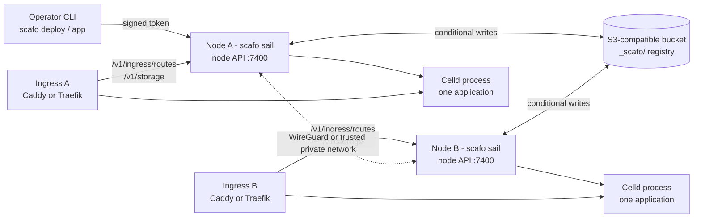

# Introduction

> Scafo is a self-hosted serverless deployment platform for JavaScript projects: one binary that is both the node daemon and the operator CLI, with an S3-compatible bucket as its registry.

## What Scafo is

One executable provides two things:

| Invocation | What it is |
|---|---|
| `scafo sail` | The node daemon. Joins the machine to a fleet, serves the node API, supervises runtime processes, and renders the fleet's routing. |
| every other subcommand | The operator CLI: `app`, `deploy`, `deployment`, `trust`, `operator`, `remote`, `fleet`, `wg`, `metrics`, `traces`, `health`. |

Scafo stores its registry as JSON objects in an S3-compatible bucket and mutates them with conditional writes. There is no database and no consensus protocol. Nodes that point at the same bucket and key prefix are one installation.

## Vocabulary

| Term | Meaning |
|---|---|
| **Fleet** | One installation: one registry (bucket + prefix) and every Scafo node that joined it. A single node is a fleet of one. |
| **Node** | A machine running `scafo sail`. It has a persistent id and Ed25519 keypair. |
| **Application** | The unit Scafo deploys, places, serves, blocks, retires and deletes, identified by its name. It holds the current deployment, its hosts, its placement constraints and its trust policy, and it is served at `<name>.<platform domain>`. |
| **Deployment** | The current artifact an application serves. Scafo records a monotonic deployment revision, never a selectable version. |
| **Placement** | The registry record naming which nodes serve an application, written by the coordinator. |
| **Ingress** | Caddy or Traefik, running beside a node. It *pulls* the fleet's routing from the node API; Scafo never writes ingress configuration. |
| **Operator** | A person or automation holding an Ed25519 key the fleet trusts, at `admin` or `operator` tier. |
| **Registry** | The `_scafo/` object tree in the bucket: meta, nodes, operators, applications, trust policies, deployments, deploys, placements, domains, TLS material, observations. |
| **Celld fleet** | Celld's own concept, one per Scafo application. Unqualified *fleet* and *node* always mean Scafo's machine-level concepts. |

## How the parts connect

- **Operator CLI → node API.** Deploys and most control operations are signed requests to a node. Some commands (`fleet nodes`, `trust`, `metrics`, `traces`, `wg`, `deployment prune`, `app retire`/`unretire`/`selector`/`replicas`/`delete` when no node is named, `operator keygen --register`, `remote add --register`) read or write the bucket directly with bucket credentials.
- **Nodes ↔ registry.** Every node reads and writes the same bucket. Membership, placement and coordination are registry state, not a cluster protocol.
- **Ingress → node.** An ingress holds one bearer token and reaches its colocated node on `/v1/ingress/routes` for routing and `/v1/storage` for certificate material. It never holds bucket credentials.
- **Node → Celld.** A node starts one Celld process per application assigned to it, on a public/internal port pair.
- **Node ↔ node.** Runtime peer traffic and operator traffic cross either a WireGuard tunnel or a network the operator has declared private.

## What each part owns

| Scafo owns | Celld owns |
|---|---|
| Registry and its conditional writes | Deployment adoption |
| Authorization: operator keys, application scopes, OIDC deploy policy | Application health |
| Placement: selectors, rendezvous hashing, replica counts | Cells and durable cell ownership |
| Process supervision and port allocation | Runtime resource policy |
| Deploy intake, staging and bundling | Serving application requests |
| The routing document every ingress reads | — |

Vocabulary follows Celld: a **deployment** is what Celld serves, identified by its **version**; a **deploy** is one run of `scafo deploy`; a **build** is compiling only. Celld exposes one current deployment per application fleet, and Scafo records a monotonic deployment revision rather than a selected version: there is no per-deployment host and no historical deployment selector.

::note
`/.well-known/scafo/health` is the Scafo node/API health endpoint. `/.well-known/celld/health` is the deployed application's health endpoint, served on application hosts.
::

## Requirements

| Requirement | Detail |
|---|---|
| **Celld 0.5.0** | The runtime. The container image bundles it; the Linux installer downloads and verifies it. `scafo sail` checks the version at start and refuses an older one. |
| **S3-compatible store** | Must honour conditional writes — `If-None-Match: *` on create, `If-Match: <etag>` on update — and `Range` reads, which Celld needs for cell data. Tested against SeaweedFS and RustFS. |
| **Node.js ≥ 24.17.0** | For the CLI installed from npm and for local development. The container image and compiled binaries carry their own runtime. |
| **esbuild** | Only to bundle Worker entries on the node. Bundled in the image; installed by the Linux installer; `scafo deploy --no-bundle` skips it. |
| **`wireguard-tools`** | An operating-system prerequisite when `SCAFO_TRANSPORT=wireguard`. Scafo never brings the interface up itself. |
| **An ingress** | Caddy with the `scafo-ingress` modules, or Traefik v3 with its http provider. |
| **Linux** | For a node. `scripts/install.sh` refuses non-Linux hosts and musl-based distributions. |

::read-more{to="/docs/quick-start"}
Run a disposable local fleet before configuring a real one.
::

## License and hosting

Scafo and scafo-ingress are released under the [Apache-2.0](https://github.com/sandros94/scafo/blob/main/LICENSE) and [MIT](https://github.com/sandros94/scafo-ingress/blob/main/LICENSE) licenses respectively. This site is hosted on [Netlify](https://www.netlify.com), which sponsors the project's open-source plan.
