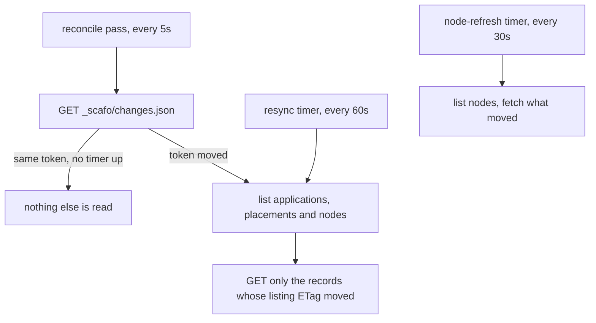
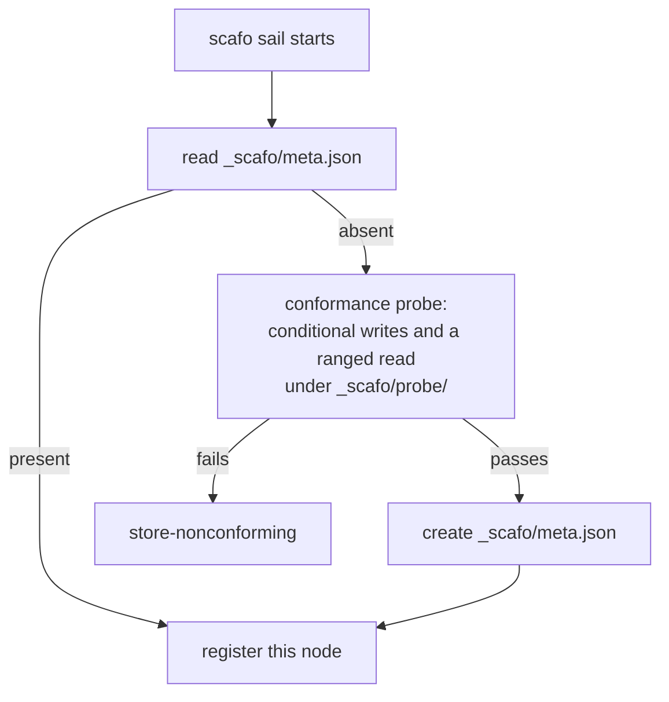

# The registry

> Every piece of Scafo state is a JSON object in an S3-compatible bucket, mutated with conditional writes.

## Bucket and prefix

A fleet is defined by one bucket and one key prefix. Every node pointed at the same pair is one installation; nothing else makes two nodes a fleet.

| Setting | Flag | Environment | Config key |
|---|---|---|---|
| Endpoint | `--endpoint` | `SCAFO_S3_ENDPOINT`, `S3_ENDPOINT` | `bucket.endpoint` |
| Bucket | `--bucket` | `SCAFO_S3_BUCKET` | `bucket.bucket` |
| Prefix | `--prefix` | `SCAFO_S3_PREFIX` | `bucket.prefix` |
| Region | `--region` | `SCAFO_S3_REGION`, `AWS_REGION` | `bucket.region` |
| Access key | `--access-key` | `SCAFO_S3_ACCESS_KEY`, `AWS_ACCESS_KEY_ID` | `bucket.accessKey` |
| Secret key | `--secret-key` | `SCAFO_S3_SECRET_KEY`, `AWS_SECRET_ACCESS_KEY` | `bucket.secretKey` |

The prefix is optional and exists so one bucket can hold several fleets. Use one bucket/prefix pair for one fleet only.

::warning
Bucket credentials are fleet-root authority. Anything holding them can rewrite the registry. Keep them out of the ingress and out of tenant workflows.
::

## Layout

Everything Scafo writes lives under `_scafo/`, inside the configured prefix.

```
<prefix>/
  _scafo/
    meta.json                                   fleet meta
    freeze.json                                 deploy freeze; absent means deploys are taken
    changes.json                                the change hint: one token, rewritten on every change
    coordinator/lease.json                      coordinator lease
    probe/<hex>.json                            conditional-write conformance probe
    nodes/<id>.json                             node records
    operators/<id>.json                         trusted operator keys
    identities/<id>.json                        shared node/operator id reservations
    placement/<name>.json                       placement records
    domains/<host>.json                         custom-domain claims
    applications/<name>.json                    application records
    trust/<name>.json                           OIDC trust policies
    deployments/<name>/<version>.json           deployments, by the version Celld assigned
    deploys/<name>/<id>.json                    deploy records, id `<name>.<16 hex>`
    tls/objects/<key>                           certificates, keys, ACME account data
    tls/locks/<name>                            issuance locks
    observe/<node>/<yyyy>/<mm>/<dd>/<hh>/...    Parquet observation files
  fleets/<name>/                                Celld's own state, outside _scafo
```

The layout is flat and kind-prefixed: every kind of record has a prefix of its own, so listing one kind never reads another's keys and `_scafo/applications/` holds exactly one key per application — the listing a node runs whenever the change hint below has moved. Every per-application prefix carries its trailing separator, so listing under `shop` never reaches `shop-preview` or `shop2`.

`fleets/<name>` is handed to Celld as its bucket prefix. Scafo does not write inside it.

::read-more{to="/reference/registry"}
The full key list, record shapes and id grammars.
::

## Conditional writes

| Operation | Precondition |
|---|---|
| Create | `If-None-Match: *` — fails with `cas-conflict` if the key exists. |
| Update | Read, mutate, `If-Match: <etag>` — retried with jittered backoff on `cas-conflict`. |
| Delete | Unconditional. S3 has no conditional delete, so callers gate deletes behind the coordinator lease instead. |

Update functions must be side-effect free: a `cas-conflict` re-reads the object and calls the mutation again.

## How a node follows the registry

A node reads what **changed**, not what exists.

Every write that changes what should run also overwrites one small object, `_scafo/changes.json`, with a fresh 16-hex token: an application record, a placement, a domain claim, and a node that changes what it serves or starts draining. The write is blind — no precondition, last writer wins — so fifty concurrent deploys never contend on it.



The token is a **hint**, never authority. Losing one costs latency and nothing else, because a full resync runs on its own timer whatever the hint says — that timer is the bound on a hint that never arrived. A refresh that fails leaves the previous view standing and raises: a registry that could not be read is never read as "every application was removed".

Node records are not hinted. A heartbeat rewrites one every 30 seconds, and a token minted for each of those would cost every node a listing several times a minute — the very cost the hint exists to remove. Liveness is the *age* of a heartbeat, which no write announces, so the node records are re-read on their own timer instead. The one thing a node changes that the fleet's routing depends on — what it serves, and that it is draining — mints a token explicitly.

| Timer | Default | Setting |
|---|---|---|
| Reconcile pass | 5 s | — |
| Full resync | 60 s | [`registry.resyncIntervalMs`](/config#registry) |
| Node re-read | 30 s | [`registry.nodeRefreshIntervalMs`](/config#registry) |

The consequence worth planning around: **an idle installation costs the bucket a fixed handful of requests per node per minute, whatever number of applications it hosts.** A node with three applications and a node with three hundred read the same one object on a quiet pass.

The node API's operator routes are the exception: they read the bucket directly rather than answer from the node's view. An operator asks rarely and must be shown the truth rather than a snapshot of it.

::read-more{to="/docs/operations#what-an-installation-costs-its-bucket"}
The arithmetic, and what a Celld process costs beside it.
::

## What the store must support

- Conditional `PUT` with both `If-Match` and `If-None-Match`.
- A **listing that carries an ETag for every key**, in the same form `GET` and `PUT` answer with. That is what lets a node read back only the records that moved; a listing that carries none is refused with `store-nonconforming`.
- Reliable, low-latency traffic, because the coordinator lease and Celld's own leases run over it.

The store is both the durable registry and the availability boundary. Scafo cannot make an unreliable object store highly available.

Tested stores:

| Store | Version used in the test matrix |
|---|---|
| SeaweedFS | `chrislusf/seaweedfs:4.42` |
| RustFS | `rustfs/rustfs:1.0.0-beta.12` |

Test conditional writes, latency and failure behaviour on any other store before production use.

## First boot



The first node to arrive initializes the registry. That step runs the conformance probe first, so a store that does not honour conditional writes, or answers a ranged read with the whole object or the wrong bytes, is refused before anything is written for real. A store that fails the probe raises `store-nonconforming`.

If two nodes race, the loser reads the meta record the winner created. A meta record whose version this build does not understand is also `store-nonconforming`.

`meta.json` records the platform domains it was initialized with, along with the creation time.
