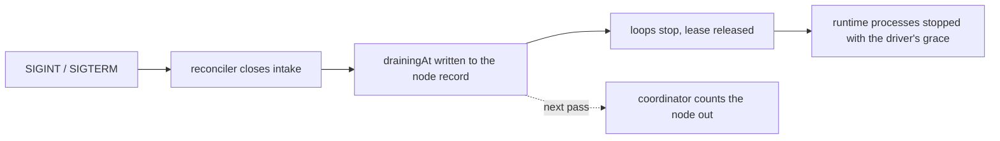

# Nodes and the fleet

> A node is a machine running `scafo sail`. The fleet is every node registered in one bucket and prefix.

## Node identity

A node is its keypair. On first boot the daemon generates an Ed25519 pair and writes it, with the node id, to `node.json` in the state directory, owner-readable.

| Property | Rule |
|---|---|
| Id grammar | `^[a-z\d_-]{1,128}$` |
| Id source | `--node-id` / `SCAFO_NODE_ID` / `node.id`; otherwise the persisted identity supplies one |
| State directory | `--state-dir` / `SCAFO_STATE_DIR` / `node.stateDir`; the container image sets `/var/lib/scafo`, mode `0700` |
| Identity file | `<state-dir>/node.json` |
| Ingress token file | `<state-dir>/ingress-token` |

A pinned id that differs from the stored one replaces the identity: a new keypair is generated and written under it. A state file that exists but cannot be read as an identity is never silently replaced — the daemon refuses with `invalid-input`, because a new keypair under an id the registry still holds the old public key for would have every token rejected.

::warning
Do not share one state directory between two nodes. Each node needs its own identity volume.
::

## Registration

On boot the daemon writes `_scafo/nodes/<id>.json` and claims `_scafo/identities/<id>.json`. Node and operator ids share one keyspace, and the registration guards enforce it:

| Situation | Refusal |
|---|---|
| The id is already reserved by another identity's public key | `reference-held` |
| The id belongs to an operator key the fleet trusts | `reference-held` |
| The stored record holds a different node id | `immutable` |

The node record carries the node's public key, its addresses (internal address, API port), its labels, what it is serving, and its heartbeat and draining stamps.

## Heartbeat and liveness

| Constant | Value |
|---|---|
| Heartbeat interval | 30 s |
| Liveness window | 90 s (three heartbeats) |

A node counts as live when its `heartbeatAt` is inside the liveness window. A node that has never beaten is not live. A node carrying `drainingAt` is never live, whatever its heartbeat says.

Placement and the routing document use liveness directly: a stale or draining node is dropped from the routing rather than left to an ingress health check.

## The coordinator lease

Every node runs the coordinator loop and competes for one lease at `_scafo/coordinator/lease.json`. One holds it; the rest stay candidates.

| Constant | Value |
|---|---|
| Lease TTL | 15 s |
| Renewal cadence | TTL / 3, so 5 s |
| Reap interval | 60 s while holding |
| Release | writes `ttlMs: 0`, so the next node takes it at once |

The lease carries a **fence** that increases on every acquisition. Coordinator-only work — assignment, deletion, reaping — is stamped with the fence it was decided under, so a decision made by a previous holder cannot be applied after the lease moved.

One renewal may fail or run late and the lease still holds; a second miss inside the same TTL loses it.

The holder does three things per iteration: take or renew the lease, assign every environment to the nodes that should serve it, and reap when a reap is due. Non-holders forward coordinator-gated requests to the holder.

## Draining



`drainingAt` is written first, before anything else stops: it is what tells placement the node is leaving rather than dying. A heartbeat landing between that write and the stop cannot undo it — a beat touches its own field only. The write is best effort and never throws, so an unreachable bucket delays shutdown briefly and changes nothing else.

An uncatchable death cannot write `drainingAt`. That node must age past the 90 s liveness window before its environments are reassigned.

## Transports

A node whose API, advertised address or runtime bind host reaches beyond loopback must state what network that is. Booting without doing so raises `invalid-input` naming the offending fields.

| `transport.driver` | Meaning |
|---|---|
| *(unset)* | Only legal for a node that stays entirely on loopback. |
| `none` | The network is already private and trusted, such as a cloud private network. |
| `wireguard` | Peer traffic crosses a WireGuard tunnel this node has been set up on. |

Defaults follow the transport:

| Setting | Unset transport | `none` | `wireguard` |
|---|---|---|---|
| `node.listen` | `127.0.0.1:7400` | `127.0.0.1:7400` | tunnel address on port `7400` |
| `node.advertise` | unset; the listener stands in | unset; the listener stands in | tunnel address on the listen port |
| `runtime.bindHost` | `127.0.0.1` | `0.0.0.0` | tunnel address |

`0.0.0.0` is used rather than `::` because a host with IPv6 disabled cannot bind `::`. A wildcard bind is dialled locally on `127.0.0.1`; every specific bind is dialled as it was bound.

With `transport: wireguard`, the node also refuses to boot until `scafo wg init` has put a keypair in the state directory: registering an address the tunnel does not carry is exactly what the transport decision was made to prevent.

::read-more{to="/docs/wireguard"}
Setting up and maintaining the tunnel.
::

## Labels

Node labels are `key=value` pairs an operator sets, and they are what environment selectors match against.

```sh
scafo sail --node-labels tier=fast,region=eu-west-1
```

Set through `--node-labels`, `SCAFO_NODE_LABELS` (inline `k=v,k2=v2`), or `node.labels` as a JSON object in the config file. An inline value replaces the file's set wholesale.

## Listing the fleet

```sh
scafo fleet nodes
scafo fleet nodes --json
```

Reads the bucket directly, so no node has to be up. One row per machine, judged against a single clock:

| Column | Contents |
|---|---|
| `NODE` | Node id |
| `STATE` | `live`, `draining` or `lost` |
| `SEEN` | How long ago it last beat |
| `API` | Internal address and API port |
| `LABELS` | Its labels |

The header line gives the total and the live count.

::read-more{to="/reference/cli"}
Every command and flag.
::
