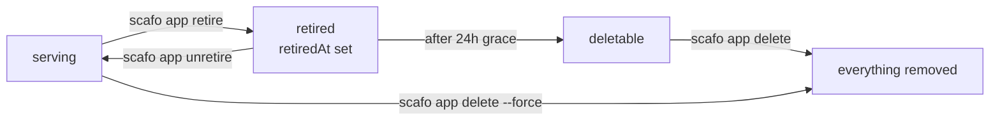

# Applications

> An application is the unit Scafo deploys, places, serves, blocks, retires and deletes. One application is one Celld fleet and one current deployment.

## The name

An application is identified by its name: 1–63 lowercase alphanumeric characters, optionally separated by single hyphens, with no leading, trailing or doubled hyphen. It is the same rule Celld applies to a config's `name`, and the limit is the DNS label limit, because the application is served at its name under every platform domain.

Its record lives at `_scafo/applications/<name>.json`.

| Field | Meaning |
|---|---|
| `v`, `name` | Identity. Never change; an update that tries raises `immutable`. |
| `createdAt` | When the first deploy created it. |
| `blocked` | `true` stops deploys, runtime, routing and certificates, deleting nothing. |
| `labels` | Fleet-owned metadata, replaced wholesale and stripped from a non-admin's view. |
| `deployment` | The deployment notice: `revision` and `deployedAt`. `null` until the first successful deploy, and it never names a version. |
| `domains` | Custom domains claimed for it. |
| `replicas` | `N` or `all`; omitted resolves to every live node that may serve it. |
| `nodeSelector` | Labels a node must carry to serve it. |
| `retiredAt` | Set by retirement; stops serving. |

There is no create command and no create route. The first deploy that names an application creates it; every other setter refuses a missing one with `not-found`. Each mutation is a conditional read-modify-write that preserves the fields it does not own, so a deploy can never drop a block or the fleet's labels.

::note
A trust policy may exist before its application does: an admin pre-grants a name with `scafo trust set`, and the first deploy creates the application under it.
::

## Naming an application on the command line

Every command that acts on one application takes `--name`, and optionally `--env`:

```sh
scafo app show --name shop
scafo app show --name shop --env preview   # the application shop-preview
```

`--env` is a naming convenience and nothing else. It is resolved by the CLI, before anything is contacted: `--name shop --env preview` addresses the application `shop-preview` exactly as `--name shop-preview` would, and the node never sees an environment. `shop` and `shop-preview` are two independent applications that merely share a prefix — separate trust policies, separate placement, separate hosts, separate blocking, retirement and deletion.

Both halves must be names in their own right, and so must the joined result. A join that is too long for a DNS label is refused with `invalid-slug` naming both parts.

::read-more{to="/reference/cli#naming-an-application"}
The same rule as the CLI reference states it.
::

## `scafo app`

```sh
scafo app list
scafo app show     --name shop
scafo app label    --name shop team=payments tier=gold   # admin only
scafo app block    --name shop                           # admin only
scafo app unblock  --name shop                           # admin only
scafo app retire   --name shop-preview
scafo app unretire --name shop-preview
scafo app selector --name shop --set region=eu-west-1
scafo app replicas --name shop --count all
scafo app delete   --name shop-preview
```

| Command | Effect | How it reaches the installation |
|---|---|---|
| `list` | The applications this key reaches, and how many are blocked. `--json` prints the records. | Node only |
| `show` | One application: state, creation time, deployment revision, replicas, selector, domains, labels. `--json` prints the record. | Node only |
| `block` | Stops deploys, runtime, routing and certificate issuance, reversibly. Nothing is deleted. Admin only. | Node only |
| `unblock` | Puts it back into service on the next pass of every node. Admin only. | Node only |
| `label` | Replaces every label the application carries; no pairs clears them. Scafo stores labels and never reads them. Admin only. | Node only |
| `retire` | Stops serving, reversibly. | Node, or the bucket |
| `unretire` | Puts a retired application back into service. | Node, or the bucket |
| `selector` | `--set k=v,k2=v2` constrains which nodes may serve it; `--clear` lifts the constraint. | Node, or the bucket |
| `replicas` | `--count all`, or a whole number of at least 1. | Node, or the bucket |
| `delete` | Deletes a retired application, or any application with `--force`. Prints the keys it removed. | Node, or the bucket |

Every subcommand accepts `--config`, `--remote`, `--node` and `--key`. The five that can also write the bucket directly additionally accept the bucket flags (`--endpoint`, `--region`, `--bucket`, `--prefix`, `--access-key`, `--secret-key`), which is what an installation with no node running has.

Listing, inspecting, blocking, unblocking and labelling go through a node on the authority of an operator key: they refuse with `invalid-input` when no node is named, rather than falling back to the bucket, because a bucket fallback would bypass the operator-tier authorization those calls exist for.

::warning
Deleting straight through the bucket takes the coordinator lease for the length of the deletion, which briefly leaves the installation without a coordinator. `--node` is the better route whenever there is a node to ask. If a live node holds the lease, the direct path refuses with `lease-lost` and says to ask the installation instead.
::

::note
A request touching a blocked application is refused with `application-blocked` (409). Its hosts leave the routing document and `/v1/ingress/ask` stops agreeing to issue certificates for them.
::

## Hosts

An application answers on its name under every configured platform domain:

| Application | Host under `apps.example.com` |
|---|---|
| `shop` | `shop.apps.example.com` |
| `shop-preview` | `shop-preview.apps.example.com` |

The host is the name, and the name is what a DNS label can hold. A name too long for one is skipped rather than failing every other route.

Platform domains are configured on the node with `--platform-domains` / `SCAFO_PLATFORM_DOMAINS` / `platformDomains`. An installation with none serves no application hosts.

## Custom domains

A custom domain is claimed at `_scafo/domains/<host>.json` — `{ v, application, claimedAt }` — and mirrored into the application's `domains` array. Routing publishes each claimed host alongside the platform hosts, and `/v1/ingress/ask` agrees to issue a certificate for it once the application is deployed, unretired and unblocked.

Platform hosts always win: routing writes application hosts first, and a claim can never shadow one. A host already claimed by another application is refused with `reference-held`.

::warning
This version ships no CLI command or node API route that creates a domain claim. The registry record, the routing path and the certificate-eligibility path that read it all exist; the write path does not.
::

## Labels and selectors

An application's `nodeSelector` narrows which nodes may serve it. It is AND over exact values: every entry must match a label the node carries. A node label the selector does not mention is ignored.

```sh
scafo app selector --name shop --set region=eu-west-1,tier=fast
scafo app selector --name shop --clear
```

Exactly one of `--set` and `--clear` must be given. Both together, or neither, is `invalid-input`: they state opposite intentions, and an accidental bare `scafo app selector` that lifted a constraint would move an application across the fleet without anyone asking.

::read-more{to="/docs/placement"}
How selectors, rendezvous hashing and replica counts combine.
::

## Retirement and deletion



```sh
scafo app retire   --name shop-preview
scafo app unretire --name shop-preview
scafo app delete   --name shop-preview
scafo app delete   --name shop-preview --force
```

| Step | Behaviour |
|---|---|
| Retire | Stops serving: the application leaves the routing document and its processes stop on the next pass of every node. Reversible. Retrying does not restamp the grace. |
| Grace | 24 hours from `retiredAt`. |
| Delete | Allowed for a retired application whose grace has passed, or with `--force`. Coordinator-gated: a node that does not hold the lease forwards the request to the one that does. Prints the keys it removed. |

Deleting removes **everything** of the application: its record, its trust policy, its deployment records, its deploy records, its placement, its domain claims and the whole `fleets/<name>/` prefix Celld owns.

## Production and preview

`--env` exists for one pattern: one application per deployment target, named by a shared prefix. Two CI jobs deploy two independent applications out of the same repository.

```yaml
# .github/workflows/deploy.yml
jobs:
  production:
    if: startsWith(github.ref, 'refs/tags/')
    steps:
      - run: scafo deploy ./dist --node https://apps.example.com --token "$OIDC_TOKEN"

  preview:
    if: "!startsWith(github.ref, 'refs/tags/')"
    steps:
      - run: scafo deploy ./dist --node https://apps.example.com --env preview --token "$OIDC_TOKEN"
```

Neither job passes `--name`: the CLI reads `name` from the packed directory's `wrangler.jsonc`, which says `shop`. The tagged job deploys `shop`; every other commit deploys `shop-preview`.

Each application carries its own trust policy, each exact to its own application and its own git ref:

```sh
scafo trust set --name shop \
  --issuer https://token.actions.githubusercontent.com \
  --subject 'repo:acme/shop:ref:refs/tags/*'

scafo trust set --name shop --env preview \
  --issuer https://token.actions.githubusercontent.com \
  --subject 'repo:acme/shop:ref:refs/heads/*'
```

The production policy admits tag pushes and nothing else; the preview policy admits branch pushes and nothing else. Neither can reach the other's application, because a policy belongs to one application exactly.

The two are served at two hosts:

| Application | Host |
|---|---|
| `shop` | `shop.apps.example.com` |
| `shop-preview` | `shop-preview.apps.example.com` |

An operator key scoped `--apps shop-*` reaches `shop-preview` and not `shop`, so a key that may touch previews cannot touch production.

::note
A rollback is a redeploy of the older build. Celld serves one current deployment per fleet, so Scafo has no historical deployment selector: run `scafo deploy` again from the build you want serving.
::

## Variables

An application's variables live in its own `wrangler.jsonc` or `wrangler.json`, under `vars`. That config is the runtime's only variable channel: the node hands the artifact's config to Celld untouched, so whatever `vars` says at deploy time is what the application reads.

`scafo deploy --var KEY:VALUE` sets a variable for one deploy. The flag is repeatable, the pair is split at the **first** colon so a value may contain colons, and an empty value sets the variable to nothing rather than leaving it unset. A name given twice is refused with `invalid-input`. Names are letters, digits and underscores, never beginning on a digit, and never `__proto__`, `constructor` or `prototype`.

A `--var` entry replaces the config's own `vars` entry of the same name and leaves every other entry as written. The edit is made by the CLI, in memory, inside the uploaded archive only — the file in the project directory is read and never written.

```jsonc
// wrangler.jsonc — defaults, committed with the project
{
  "name": "shop",
  "main": "dist/index.js",
  "compatibility_date": "2025-01-01",
  "vars": {
    "LOG_LEVEL": "info",
    "DATABASE_URL": "postgres://localhost/shop"
  }
}
```

```sh
# CI: keep the defaults, override the one value that differs per application
scafo deploy --name shop --var DATABASE_URL:"$DATABASE_URL"
```

`LOG_LEVEL` stays `info`; `DATABASE_URL` becomes whatever the CI secret holds.

::warning
A value passed with `--var` is visible in the process list and the CI log of the machine running the CLI, and Celld stores variables as plain text in the bucket — anyone with bucket read access can read every one of them. Celld has no secret store. Keep defaults in the config's `vars`, pass the values that differ from the CI's secret store as `--var`, mask them in CI logs, and treat bucket read access as access to every variable.
::

## Trust policies for workload deploys

A trust policy lets a CI workload deploy an application with its own OIDC token instead of an operator key. It lives at `_scafo/trust/<name>.json`, and it is exact: one policy per application.

```sh
scafo trust set --name shop \
  --issuer https://token.actions.githubusercontent.com \
  --subject 'repo:acme@123456/shop@456789:ref:refs/heads/main'
scafo trust add    --name shop \
  --issuer https://token.actions.githubusercontent.com \
  --subject 'repo:acme@123456/shop@456789:ref:refs/tags/*'
scafo trust show   --name shop
scafo trust remove --name shop --issuer https://token.actions.githubusercontent.com
```

`set` states the whole list of subjects an issuer is trusted for, so it is also how one is taken away: state the list without it. `add` keeps the list and appends to it. `remove` stops trusting the issuer altogether.

| Flag | Meaning |
|---|---|
| `--name` | The application the policy belongs to. Required. `--env` addresses `<name>-<env>` instead. |
| `--issuer` | Issuer URL, exactly as its tokens carry it in `iss`. Required. |
| `--audience` | Audience the workload requests its token for. Defaults to `scafo`. |
| `--subject` | Subject pattern to trust; `*` matches any run of characters. Comma-separated for several. Required. |

`scafo trust` writes the bucket directly, because a policy is usually set up before there is a node to ask. It takes the bucket flags and `--config`.

A GitHub subject comes in two forms — the plain `repo:OWNER/REPO:ref:...` and the immutable `repo:OWNER@OWNER-ID/REPO@REPO-ID:ref:...` above — and which one a repository carries is covered under [Deploying from CI with OIDC](/docs/deploying#deploying-from-ci-with-oidc).

A token that verifies but matches no policy entry is refused with `trust-mismatch`. A bad, expired, forged or unknown-key token is `auth-invalid`.

::read-more{to="/docs/deploying"}
Using a workload token with `scafo deploy --token`.
::

## Deployment revision

Each successful deploy advances the monotonic `deployment.revision` on the application record, alongside a `deployment.deployedAt` stamp. It is a notice, not a selector: Celld exposes one current deployment per application fleet, and Scafo provides no per-deployment host and no historical deployment selection.

The deploy itself is recorded twice. The deployment Celld published gets an immutable record at `_scafo/deployments/<name>/<version>.json`, filed under the version Celld assigned and nothing else. The run that produced it gets a `DeployRecord` at `_scafo/deploys/<name>/<name>.<16 hex>.json`, which is where its state lives until it finishes.

Earlier deployments stay in the application's Celld fleet and nothing routes to them; `scafo deployment prune` is what deletes them.

::read-more{to="/reference/cli#scafo-deployment-prune"}
::
