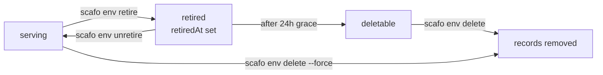

# Projects and environments

> A project holds environments; an environment holds the current deployment, its hosts, its variables and its placement constraints.

## Projects

A project is identified by a slug: 1–63 lowercase alphanumeric characters, optionally separated by single hyphens, with no leading, trailing or doubled hyphen. Its record lives at `_scafo/projects/<project>/project.json` and carries the slug, its creation time, an optional `blocked` marker and optional labels.

```sh
scafo project list
scafo project show shop
scafo project label shop team=payments tier=gold   # admin only
scafo project block shop                            # admin only
scafo project unblock shop                          # admin only
```

| Command | Effect |
|---|---|
| `list` | The projects this key reaches, and which are blocked. |
| `show <slug>` | One project: state, creation time, labels. |
| `label <slug> [k=v ...]` | Replaces every label the project carries. Scafo stores labels and never reads them. |
| `block <slug>` | Stops deploys, runtime, routing and certificate issuance, reversibly. Records stay. |
| `unblock <slug>` | Puts it back into service. |

All of them accept `--config`, `--remote`, `--node` and `--key`; `list` additionally accepts `--json`.

::note
A blocked project is refused with `project-blocked`. Its hosts leave the routing document and `/v1/ingress/ask` stops agreeing to issue certificates for them.
::

## Environments

An environment record lives at `_scafo/projects/<project>/environments/<env>.json`.

| Field | Meaning |
|---|---|
| `name` | The environment name. |
| `prefix` | Bucket prefix its Celld fleet state lives under: `fleets/<project>/<name>`. Fixed at creation. |
| `deployment` | The current deployment notice; `null` until the first successful deploy. Never names a version. |
| `domains` | Custom domains claimed for it. |
| `varset` | Id of the sealed variable set it points at, if any. |
| `replicas` | `N` or `all`; omitted takes the default for its kind. |
| `nodeSelector` | Labels a node must carry to serve it. |
| `retiredAt` | Set by retirement; stops serving. |
| `ephemeral` | Changes the replica default and relaxes deletion. |

`name`, `prefix` and `ephemeral` identify the record and are never rewritten, so a retried create is idempotent. A create that names the same environment with a different identity raises `immutable`.

The default environment is `production`; `scafo deploy` uses it when `--env` is not given.

## Hosts

For every configured platform domain, an environment answers on its own label. `production` additionally owns the project's bare apex host.

| Environment | Hosts under `apps.example.com` |
|---|---|
| `production` | `shop--production.apps.example.com` and `shop.apps.example.com` |
| `preview` | `shop--preview.apps.example.com` |

The separator is `--`, which is unambiguous because a slug never contains two consecutive hyphens. The whole label must fit a DNS label: 63 characters. A project/environment pair whose label would be longer is skipped rather than failing every other route.

Platform domains are configured on the node with `--platform-domains` / `SCAFO_PLATFORM_DOMAINS` / `platformDomains`. An installation with none serves no application hosts.

## Custom domains

A custom domain is claimed at `_scafo/domains/<host>.json` and mirrored into the environment's `domains` array. Routing publishes each claimed host alongside the platform hosts, and `/v1/ingress/ask` agrees to issue a certificate for it once the environment is deployed, unretired and its project unblocked.

Platform hosts always win: routing writes environment hosts first, and a claim can never shadow one.

::warning
This version ships no CLI command or node API route that creates a domain claim. The registry record, the routing path and the certificate-eligibility path that read it all exist; the write path does not.
::

## Labels and selectors

An environment's `nodeSelector` narrows which nodes may serve it. It is AND over exact values: every entry must match a label the node carries. A node label the selector does not mention is ignored.

```sh
scafo env selector --project shop --env production --set region=eu-west-1,tier=fast
scafo env selector --project shop --env production --clear
```

::read-more{to="/docs/placement"}
How selectors, rendezvous hashing and replica counts combine.
::

## Retirement and deletion



```sh
scafo env retire   --project shop --env preview
scafo env unretire --project shop --env preview
scafo env delete   --project shop --env preview
scafo env delete   --project shop --env preview --force
```

| Step | Behaviour |
|---|---|
| Retire | Stops serving immediately: the environment leaves the routing document and its processes stop. Reversible. Retrying does not restamp the grace. |
| Grace | 24 hours from `retiredAt`. |
| Delete | Allowed for an ephemeral environment, a grace-expired retired one, or with `--force`. Coordinator-gated: a node that does not hold the lease forwards the request. Prints the keys it removed. |

`scafo env` commands accept `--node`/`--remote`/`--key` to go through a node, or bucket flags to write the registry directly.

## Variable sets

Variables are sealed with AES-256 before they reach the bucket.

```sh
scafo varset set  --project shop --env production --key-file ./varset.key --file ./vars.env
scafo varset set  --project shop --env production --key-file ./varset.key --file ./vars.env --public LOG_LEVEL,REGION
scafo varset show --project shop --env production --key-file ./varset.key
```

| Item | Rule |
|---|---|
| Key file | 32 raw bytes, 64 hex characters, or 43–44 base64url characters. Trailing whitespace ignored. |
| Variable file | dotenv dialect: one `KEY=VALUE` per line; blank lines and `#` lines skipped; the value is everything after the first `=` with surrounding spaces trimmed, quotes included — there is no unquoting. |
| Names | `[A-Za-z_][A-Za-z0-9_]*` |
| `--public` | Comma-separated names stored in the clear. Everything else is sealed. |

The record lands at `_scafo/projects/<project>/varsets/<id>.json` and the environment is pointed at it.

On the node, every entry becomes `CELLD_VAR_<name>` in the runtime process's environment. The node needs the same key:

| Setting | Flag | Environment | Config key |
|---|---|---|---|
| Varset key file | `--varset-key-file` | `SCAFO_VARSET_KEY_FILE` | `varsets.keyFile` |

A node with no varset key may only serve environments that point at no varset at all. Changing an environment's varset restarts its processes.

## Trust policies for workload deploys

A trust policy lets a CI workload deploy a project with its own OIDC token instead of an operator key. It lives at `_scafo/projects/<project>/trust.json`.

```sh
scafo trust set --project shop \
  --issuer https://token.actions.githubusercontent.com \
  --subject 'repo:acme/shop:ref:refs/heads/main'
scafo trust show   --project shop
scafo trust remove --project shop --issuer https://token.actions.githubusercontent.com
```

| Flag | Meaning |
|---|---|
| `--issuer` | Issuer URL, exactly as its tokens carry it in `iss`. Required. |
| `--audience` | Audience the workload requests its token for. Defaults to `scafo`. |
| `--subject` | Subject pattern to trust; `*` matches any run of characters. Comma-separated for several. Required. |

A token that verifies but matches no policy entry is refused with `trust-mismatch`. A bad, expired, forged or unknown-key token is `auth-invalid`.

::read-more{to="/docs/deploying"}
Using a workload token with `scafo deploy --token`.
::

## Deployment revision

Each successful deploy advances the monotonic `deployment.revision` on the environment record, alongside a `deployment.deployedAt` stamp. It is a notice, not a selector: Celld exposes one current deployment per fleet, and Scafo provides no old-build host and no historical deployment selection. Previous artifacts may remain in the bucket; nothing routes to them.
