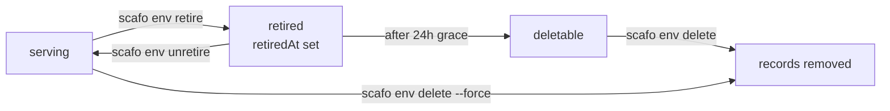

# Projects and environments

> A project holds environments; an environment holds the current deployment, its hosts and its placement constraints.

## Projects

A project is identified by a slug: 1–63 lowercase alphanumeric characters, optionally separated by single hyphens, with no leading, trailing or doubled hyphen. Its record lives at `_scafo/projects/<project>/project.json` and carries the slug, its creation time, an optional `blocked` marker and optional labels.

```sh
scafo project list
scafo project show shop
scafo project label shop team=payments tier=gold   # admin only
scafo project block shop                            # admin only
scafo project unblock shop                          # admin only
```

| Command | Effect |
|---|---|
| `list` | The projects this key reaches, and which are blocked. |
| `show <slug>` | One project: state, creation time, labels. |
| `label <slug> [k=v ...]` | Replaces every label the project carries. Scafo stores labels and never reads them. |
| `block <slug>` | Stops deploys, runtime, routing and certificate issuance, reversibly. Records stay. |
| `unblock <slug>` | Puts it back into service. |

All of them accept `--config`, `--remote`, `--node` and `--key`; `list` additionally accepts `--json`.

::note
A blocked project is refused with `project-blocked`. Its hosts leave the routing document and `/v1/ingress/ask` stops agreeing to issue certificates for them.
::

## Environments

An environment record lives at `_scafo/projects/<project>/environments/<env>.json`.

| Field | Meaning |
|---|---|
| `name` | The environment name. |
| `prefix` | Bucket prefix its Celld fleet state lives under: `fleets/<project>/<name>`. Fixed at creation. |
| `deployment` | The current deployment notice; `null` until the first successful deploy. Never names a version. |
| `domains` | Custom domains claimed for it. |
| `replicas` | `N` or `all`; omitted resolves to every live node that may serve it. |
| `nodeSelector` | Labels a node must carry to serve it. |
| `retiredAt` | Set by retirement; stops serving. |

`name` and `prefix` identify the record and are never rewritten, so a retried create is idempotent. A create that names the same environment with a different identity raises `immutable`.

The default environment is `production`; `scafo deploy` uses it when `--env` is not given.

## Hosts

For every configured platform domain, an environment answers on its own label. `production` additionally owns the project's bare apex host.

| Environment | Hosts under `apps.example.com` |
|---|---|
| `production` | `shop--production.apps.example.com` and `shop.apps.example.com` |
| `preview` | `shop--preview.apps.example.com` |

The separator is `--`, which is unambiguous because a slug never contains two consecutive hyphens. The whole label must fit a DNS label: 63 characters. A project/environment pair whose label would be longer is skipped rather than failing every other route.

Platform domains are configured on the node with `--platform-domains` / `SCAFO_PLATFORM_DOMAINS` / `platformDomains`. An installation with none serves no application hosts.

## Custom domains

A custom domain is claimed at `_scafo/domains/<host>.json` and mirrored into the environment's `domains` array. Routing publishes each claimed host alongside the platform hosts, and `/v1/ingress/ask` agrees to issue a certificate for it once the environment is deployed, unretired and its project unblocked.

Platform hosts always win: routing writes environment hosts first, and a claim can never shadow one.

::warning
This version ships no CLI command or node API route that creates a domain claim. The registry record, the routing path and the certificate-eligibility path that read it all exist; the write path does not.
::

## Labels and selectors

An environment's `nodeSelector` narrows which nodes may serve it. It is AND over exact values: every entry must match a label the node carries. A node label the selector does not mention is ignored.

```sh
scafo env selector --project shop --env production --set region=eu-west-1,tier=fast
scafo env selector --project shop --env production --clear
```

::read-more{to="/docs/placement"}
How selectors, rendezvous hashing and replica counts combine.
::

## Retirement and deletion



```sh
scafo env retire   --project shop --env preview
scafo env unretire --project shop --env preview
scafo env delete   --project shop --env preview
scafo env delete   --project shop --env preview --force
```

| Step | Behaviour |
|---|---|
| Retire | Stops serving immediately: the environment leaves the routing document and its processes stop. Reversible. Retrying does not restamp the grace. |
| Grace | 24 hours from `retiredAt`. |
| Delete | Allowed for a retired environment whose grace has passed, or with `--force`. Coordinator-gated: a node that does not hold the lease forwards the request. Prints the keys it removed. |

`scafo env` commands accept `--node`/`--remote`/`--key` to go through a node, or bucket flags to write the registry directly.

## Variables

An application's variables live in its own `wrangler.jsonc` or `wrangler.json`, under `vars`. That config is the runtime's only variable channel: the node hands the artifact's config to Celld untouched, so whatever `vars` says at deploy time is what the application reads.

`scafo deploy --var KEY:VALUE` sets a variable for one deploy. The flag is repeatable, the pair is split at the **first** colon so a value may contain colons, and an empty value sets the variable to nothing rather than leaving it unset. A name given twice is refused with `invalid-input`. Names are letters, digits and underscores, never beginning on a digit, and never `__proto__`, `constructor` or `prototype`.

A `--var` entry replaces the config's own `vars` entry of the same name and leaves every other entry as written. The edit is made by the CLI, in memory, inside the uploaded archive only — the file in the project directory is read and never written.

```jsonc
// wrangler.jsonc — defaults, committed with the project
{
  "name": "shop",
  "main": "dist/index.js",
  "compatibility_date": "2025-01-01",
  "vars": {
    "LOG_LEVEL": "info",
    "DATABASE_URL": "postgres://localhost/shop"
  }
}
```

```sh
# CI: keep the defaults, override the one value that differs per environment
scafo deploy --project shop --env production --var DATABASE_URL:"$DATABASE_URL"
```

`LOG_LEVEL` stays `info`; `DATABASE_URL` becomes whatever the CI secret holds.

::warning
A value passed with `--var` is visible in the process list and the CI log of the machine running the CLI, and Celld stores variables as plain text in the bucket — anyone with bucket read access can read every one of them. Celld has no secret store. Keep defaults in the config's `vars`, pass per-environment values from the CI's secret store as `--var`, mask them in CI logs, and treat bucket read access as access to every variable.
::

## Trust policies for workload deploys

A trust policy lets a CI workload deploy a project with its own OIDC token instead of an operator key. It lives at `_scafo/projects/<project>/trust.json`.

```sh
scafo trust set --project shop \
  --issuer https://token.actions.githubusercontent.com \
  --subject 'repo:acme@123456/shop@456789:ref:refs/heads/main'
scafo trust show   --project shop
scafo trust remove --project shop --issuer https://token.actions.githubusercontent.com
```

| Flag | Meaning |
|---|---|
| `--issuer` | Issuer URL, exactly as its tokens carry it in `iss`. Required. |
| `--audience` | Audience the workload requests its token for. Defaults to `scafo`. |
| `--subject` | Subject pattern to trust; `*` matches any run of characters. Comma-separated for several. Required. |

A GitHub subject comes in two forms — the plain `repo:OWNER/REPO:ref:...` and the immutable `repo:OWNER@OWNER-ID/REPO@REPO-ID:ref:...` above — and which one a repository carries is covered under [Deploying from CI with OIDC](/docs/deploying#deploying-from-ci-with-oidc).

A token that verifies but matches no policy entry is refused with `trust-mismatch`. A bad, expired, forged or unknown-key token is `auth-invalid`.

::read-more{to="/docs/deploying"}
Using a workload token with `scafo deploy --token`.
::

## Deployment revision

Each successful deploy advances the monotonic `deployment.revision` on the environment record, alongside a `deployment.deployedAt` stamp. It is a notice, not a selector: Celld exposes one current deployment per environment fleet, and Scafo provides no per-deployment host and no historical deployment selection.

The deploy itself is recorded twice. The deployment Celld published gets an immutable record at `_scafo/projects/<project>/deployments/<version>.json`, filed under the version Celld assigned and nothing else. The run that produced it gets a `DeployRecord` at `_scafo/projects/<project>/deploys/<project>.<16 hex>.json`, which is where its state lives until it finishes.

Earlier deployments stay in the environment's Celld fleet and nothing routes to them; `scafo deployment prune` is what deletes them.

::read-more{to="/reference/cli#scafo-deployment-prune"}
::
