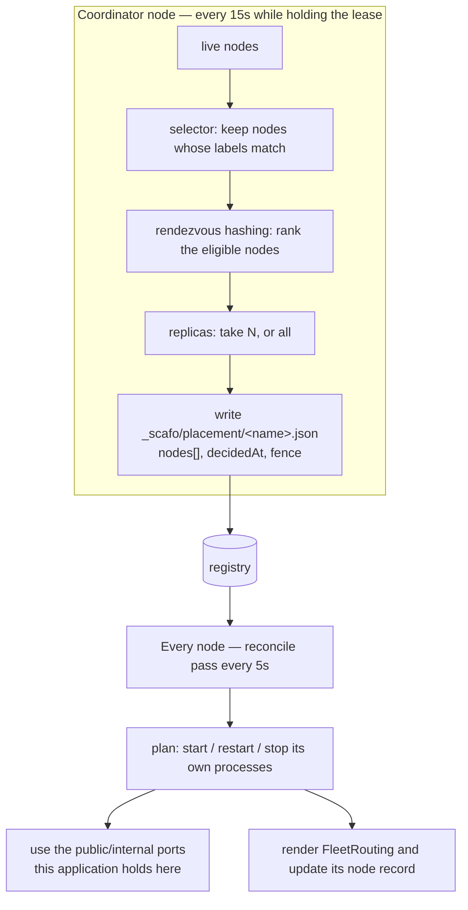

# Placement

> The coordinator decides which nodes serve each application; each node then starts or stops only its own processes.

## The two halves



A node acts only on the placements that name it. No node starts a process on behalf of another.

The coordinator's tick is its lease-renewal cadence: a third of `coordinator.leaseTtlMs`, so 15 seconds by default. A tick **skips the assignment pass entirely** unless something it decides from has moved since the last completed pass — which applications exist, their replica counts, their selectors, whether they are retired or blocked, their placements as they stand, and which nodes are live. Rendezvous hashing is a function of exactly those, so a pass over unchanged inputs can only decide what is already decided. Anything the decision does not read — a deployment revision, a domain, a label on the application — is left out of that comparison, or every deploy in the installation would re-run a pass with one possible answer.

## Selectors

A selector narrows which nodes may serve an application at all. It is AND over exact values: every entry must be present in the node's labels with that value. Labels the selector does not mention are ignored.

```sh
scafo app selector --name shop --set region=eu-west-1 --set tier=fast
scafo app selector --name shop --clear
```

| Case | Result |
|---|---|
| No selector | Every live node is eligible. |
| Empty selector | Every live node is eligible. |
| Selector with entries | Only nodes carrying all of them. |
| A node with no labels | Eligible only in the first two cases. |

`scafo deploy --node-selector key=value`, one pair per flag, sets the same field on the deploy. Neither `--node-selector` nor `--replicas` on a deploy can lift a constraint; a deploy that names neither leaves whatever the application already carries untouched. Removing a constraint is `scafo app selector --clear`.

::warning
A selector matching no live node leaves the application unplaced. Nothing is written down as a placement.
::

## Rendezvous hashing

Among the eligible nodes, each node scores each application with `sha256("<name>\n<nodeId>")`, and the highest scores win. Ties fall back to the node id, so the order is total.

| Property | Consequence |
|---|---|
| Deterministic | The same application and node set give the same answer on any node, at any time, with nothing to keep in sync. |
| Stable | Adding or removing a node moves only the applications that node was involved in. |
| Balanced | The digest spreads applications evenly without anyone counting. |

## Replicas

```sh
scafo deploy ./app --name shop --replicas all
scafo deploy ./app --name shop --env preview --replicas 1
scafo app replicas --name shop --count 1
```

| Value | Meaning |
|---|---|
| `all` | Every eligible node. |
| `N` | The top `N` eligible nodes by rendezvous rank. Must be a whole number ≥ 1. |

`0` is refused: an application nothing runs is expressed by retiring or deleting it.

An application that names no replica count runs on every node that may serve it, which is what `all` means. Under a selector, `all` means all *matching* live nodes.

Scafo neither infers nor reserves host resources. Runtime policy is set through Celld and the host or container platform.

## Placement records

`_scafo/placement/<name>.json`:

| Field | Meaning |
|---|---|
| `nodes` | Ids of the nodes that should run this application, sorted. |
| `decidedAt` | When the decision was made. |
| `fence` | The coordinator lease fence it was decided under. |

The fence is what keeps a stale coordinator from overwriting a newer decision.

A missing placement record is *pending*, never implicit assignment.

## Unplaced applications

When no live node is eligible, the coordinator records the application as unplaced with reason `placement-unavailable`, emits a `placement.pending` observability event, and lists it under `coordinator.unplaced` in `GET /v1/state`. When no node is live at all, the whole assignment pass raises `placement-unavailable`.

## One process per application per node

An assigned node runs exactly one Celld process for that application. Each pass plans what the assigned applications need before the stops that belong to nothing it still serves:

| Situation | Action |
|---|---|
| Assigned, deployed, no process running | **start**, on the ports this application already holds here |
| Running, but its runtime teardown is pending | **stop** (`runtime teardown is pending`) |
| Running but no longer assigned to this node | **stop** (`application is no longer served by this node`) |
| Assigned but never deployed (`deployment: null`) | nothing |

So the trigger is always the same one: retirement, reassignment, blocking or deletion stops a process, and the next pass starts it again wherever it is now assigned.

Stopping a process leaves what the application keeps on that node — its working directory and its ports — where it is. Only deletion from the registry clears it, on a later pass, once nothing for that application is running there. See [durability and the state directory](/config/celld#durability-and-the-state-directory).

The reconcile loop runs every **5 seconds**, and is also kicked immediately when what this node serves changes. Each pass renders the routing document and, when its serving set changed, updates the node record — and mints a change token with it — so other nodes' routing reflects it within a pass rather than on their node-refresh timer.

A pass begins by reading the registry change hint: one `GET`, and nothing else when the token has not moved and no timer is up. So the loop's cost is flat in the number of applications the node serves.

::read-more{to="/docs/registry#how-a-node-follows-the-registry"}
What a pass reads, and when.
::

## Port pairs

Each process listens on two ports: `public`, which the ingress dials, and `internal`, Celld's peer listener, advertised to other nodes at the node's advertised host. Both bind `runtime.bindHost`.

| Setting | Default |
|---|---|
| Range start (`--port-range-start`, `SCAFO_PORT_RANGE_START`, `runtime.portRangeStart`) | `24000` |
| Range end (`--port-range-end`, `SCAFO_PORT_RANGE_END`, `runtime.portRangeEnd`) | `24998` — the start plus 998, never past `65535` |
| Quarantine (`--port-quarantine-ms`, `SCAFO_PORT_QUARANTINE_MS`, `runtime.portQuarantineMs`) | `600000` ms (10 min) |

The default range sits **below `32768`** on purpose. Linux hands out the source ports of outgoing connections from `32768`–`60999`, and a port in use that way refuses a listener — so a range up there has any connection on the machine able to take, for a moment, a port an application holds. Keep a range of your own below it too.

**A port belongs to an application for as long as the node knows it.** A runtime process answers everything sent to its port, whatever `Host` the request names, and an ingress re-reads the routing on a timer — so for a while after a port changed hands, traffic for the old application still arrives there, and the new one would answer it. Keeping each pair still is what prevents that.

So, per application per node:

- Both ports are drawn **at random and independently** from the range. The internal port is never the public one plus one, so a stale public port cannot accidentally name an internal listener either.
- Neither is a port another application of this node holds, and each is taken only after the node has really bound and released it: the range is the node's by convention, and anything on the machine may be listening in it. With `--network host` that machine is the host, so size the range to fit it.
- The pair is recorded beside the application's other local state and **reused on every later start** — after the process exits, after the daemon restarts, after the container is re-created on the same state volume. That is what keeps what this node publishes about itself correct across a restart.
- A recorded pair the node finds taken does not wedge the application: a new pair is chosen and recorded, the node logs the application and both pairs, and the next heartbeat publishes the move.
- The pair is released only when the application's local state is removed, which happens once the application is gone from the registry. It then sits in quarantine for `runtime.portQuarantineMs` before any *other* application may be given it.

Fewer than two free ports left in the range raises `placement-unavailable`, naming the range.

::warning
Celld's internal operator API is mostly unauthenticated. The internal listener is not a public surface: keep it on loopback, a private network, or the tunnel.
::

## Inspecting placement

```sh
curl -s -H "Authorization: Bearer $TOKEN" http://127.0.0.1:7400/v1/state
```

`GET /v1/state` reports this node's record, the coordinator lease and its fence, whether this node is coordinating, its running processes, its placement views, its last reconcile pass, and any unplaced applications.

::read-more{to="/reference/node-api"}
The full `/v1/state` document.
::
