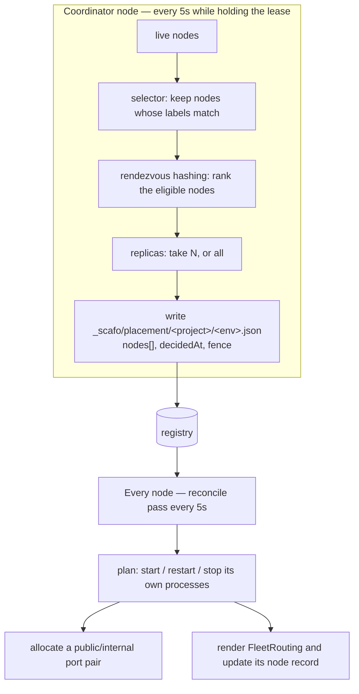

# Placement

> The coordinator decides which nodes serve each environment; each node then starts or stops only its own processes.

## The two halves



A node acts only on the placements that name it. No node starts a process on behalf of another.

## Selectors

A selector narrows which nodes may serve an environment at all. It is AND over exact values: every entry must be present in the node's labels with that value. Labels the selector does not mention are ignored.

```sh
scafo env selector --project shop --env production --set region=eu-west-1,tier=fast
scafo env selector --project shop --env production --clear
```

| Case | Result |
|---|---|
| No selector | Every live node is eligible. |
| Empty selector | Every live node is eligible. |
| Selector with entries | Only nodes carrying all of them. |
| A node with no labels | Eligible only in the first two cases. |

`scafo deploy --node-selector k=v,...` sets the same field on the deploy. Neither `--node-selector` nor `--replicas` on a deploy can lift a constraint; a deploy that names neither leaves whatever the environment already carries untouched. Removing a constraint is `scafo env selector --clear`.

::warning
A selector matching no live node leaves the environment unplaced. Nothing is written down as a placement.
::

## Rendezvous hashing

Among the eligible nodes, each node scores each environment with `sha256("<project>/<env>\n<nodeId>")`, and the highest scores win. Ties fall back to the node id, so the order is total.

| Property | Consequence |
|---|---|
| Deterministic | The same environment and node set give the same answer on any node, at any time, with nothing to keep in sync. |
| Stable | Adding or removing a node moves only the environments that node was involved in. |
| Balanced | The digest spreads environments evenly without anyone counting. |

## Replicas

```sh
scafo deploy ./app --project shop --env production --replicas all
scafo deploy ./app --project shop --env preview    --replicas 1
```

| Value | Meaning |
|---|---|
| `all` | Every eligible node. |
| `N` | The top `N` eligible nodes by rendezvous rank. Must be a whole number ≥ 1. |

`0` is refused: an environment nothing runs is expressed by deleting it.

An environment that names no replica count takes the default for its kind: `all` for a long-lived environment, `1` for an ephemeral one. Under a selector, `all` means all *matching* live nodes.

Scafo neither infers nor reserves host resources. Runtime policy is set through Celld and the host or container platform.

## Placement records

`_scafo/placement/<project>/<env>.json`:

| Field | Meaning |
|---|---|
| `nodes` | Ids of the nodes that should run this environment, sorted. |
| `decidedAt` | When the decision was made. |
| `fence` | The coordinator lease fence it was decided under. |

The fence is what keeps a stale coordinator from overwriting a newer decision.

A missing placement record is *pending*, never implicit assignment.

## Unplaced environments

When no live node is eligible, the coordinator records the environment as unplaced with reason `placement-unavailable`, emits a `placement.pending` observability event, and lists it under `coordinator.unplaced` in `GET /v1/state`. When no node is live at all, the whole assignment pass raises `placement-unavailable`.

## One process per environment per node

An assigned node runs exactly one Celld process for that environment. Each pass plans starts and restarts before unrelated stops:

| Situation | Action |
|---|---|
| Assigned, deployed, no process running | **start** with a fresh port pair |
| Running, but its runtime teardown is pending | **stop** |
| Running with a different varset than the environment now points at | **restart**, keeping its ports when it had them |
| Running but no longer assigned to this node | **stop** (`environment is no longer served by this node`) |
| Assigned but never deployed (`deployment: null`) | nothing |

So the triggers are: a varset change restarts the process; retirement, reassignment or project deletion stops it.

The reconcile loop runs every **5 seconds**, and is also kicked immediately when what this node serves changes. Each pass renders the routing document and, when its serving set changed, updates the node record so other nodes' routing reflects it.

## Port pairs

Each process gets two consecutive ports at an even offset from the start of the range — `public` and `internal` — so both halves always belong to the same process.

| Setting | Default |
|---|---|
| Range start (`--port-range-start`, `SCAFO_PORT_RANGE_START`, `runtime.portRangeStart`) | `42000` |
| Range span | 998 ports, giving `42000`–`42998` |

Pairs overlapping a port already in use are skipped. Exhausting the range raises `placement-unavailable`.

The `public` port is what the ingress dials; the `internal` port is Celld's peer listener, advertised to other nodes at the node's advertised host. Both bind `runtime.bindHost`.

::warning
Celld's internal operator API is mostly unauthenticated. The internal listener is not a public surface: keep it on loopback, a private network, or the tunnel.
::

## Inspecting placement

```sh
curl -s -H "Authorization: Bearer $TOKEN" http://127.0.0.1:7400/v1/state
```

`GET /v1/state` reports this node's record, the coordinator lease and its fence, whether this node is coordinating, its running processes, its placement views, its last reconcile pass, and any unplaced environments.

::read-more{to="/reference/node-api"}
The full `/v1/state` document.
::
