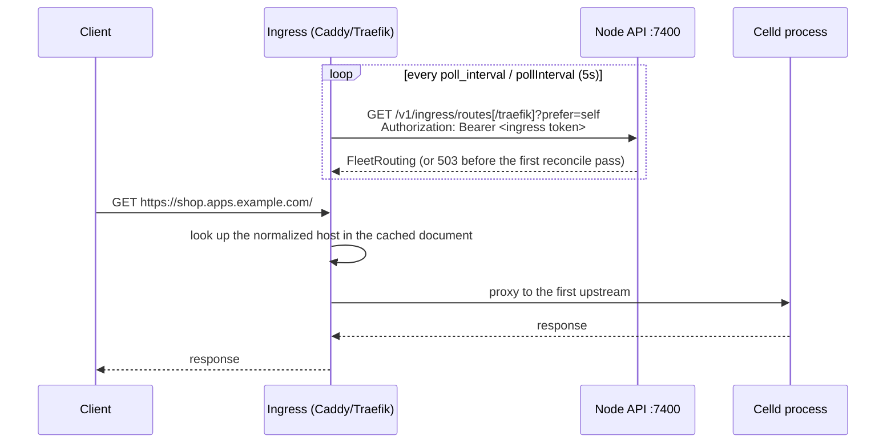

# Routing and ingress

> Every node renders the whole fleet's routing from the registry. Every ingress pulls it. Scafo never writes ingress configuration.

## The shape of it



The node serves the document; the ingress decides what to do with it. Nothing is pushed into an ingress, and operator-authored routes in the ingress configuration are never rewritten.

## Endpoints

| Path | Consumer | Auth |
|---|---|---|
| `GET /v1/ingress/routes` | Caddy, through the `scafo` dynamic-upstreams module | ingress bearer token |
| `GET /v1/ingress/routes/traefik` | Traefik, through its http provider | ingress bearer token |
| `GET /v1/ingress/ask?domain=` | Caddy on-demand TLS | none — public |

`traefik` is the only registered native format; any other name is `404`. Both routing paths accept `?prefer=<node>` or `?prefer=self`.

The token comes from `--ingress-token` / `SCAFO_INGRESS_TOKEN` / `ingress.token`. When none is supplied the node mints one and writes it to `<state-dir>/ingress-token`, owner-readable.

## The routing document

```json
{
  "v": 1,
  "routes": [
    {
      "host": "shop.apps.example.com",
      "project": "shop",
      "env": "production",
      "upstreams": [
        { "node": "vps-a", "address": "10.83.0.1:42000" },
        { "node": "vps-b", "address": "10.83.0.2:42000" }
      ]
    }
  ],
  "api": {
    "hosts": ["apps.example.com"],
    "upstreams": [{ "node": "vps-a", "address": "10.83.0.1:7400" }],
    "denied": ["/v1/storage", "/v1/ingress/routes"]
  }
}
```

| Field | Meaning |
|---|---|
| `routes[].host` | A fully qualified host: an environment label under a platform domain, or a custom domain claimed for it. Sorted. |
| `routes[].upstreams` | Every live node serving that environment, at its advertised address and the process's public port. |
| `api` | Present only when the node publishes the platform API apex. |

### How it is built

1. Only **live, non-draining** nodes contribute upstreams. Stale and draining nodes are dropped here rather than left to a health check.
2. For each environment with at least one upstream: `<project>--<env>.<domain>` under every platform domain, plus `<project>.<domain>` when the environment is `production`.
3. Then every custom domain claimed for that environment.
4. First writer wins across those classes, so a custom-domain claim can never shadow a platform host.
5. A host nobody serves is left out entirely.

There is no wildcard application fallback. An unknown host resolves to no upstream, and the ingress answers it itself.

### Upstream order and `prefer`

`upstreams` is an ordered **priority list**, never a weighting. The first entry is where the request goes; the rest exist for when it fails.

| Query | Effect |
|---|---|
| *(none)* | The fleet's own order, by node id. |
| `?prefer=self` | The node answering the request goes first on every route. |
| `?prefer=<node-id>` | That node goes first. A node id nobody matches has no effect. |

Order among the remaining upstreams is preserved. Traefik's renderer uses the name rather than just the order: it emits a `failover` service, using the preferred node's upstreams while healthy and the others only when they are not.

## The platform API apex

When `api.public` is on (the default), the bare apex of each platform domain routes to the node API, so any node of the installation is reachable at one well-known name.

| Setting | Flag | Environment | Config key | Default |
|---|---|---|---|---|
| Publish the API apex | `--api-public` / `--no-api-public` | `SCAFO_API_PUBLIC` | `api.public` | `true` |

An apex an application already claims is left out of `api.hosts`: application routes win.

### Denied prefixes

```
/v1/storage
/v1/ingress/routes
```

::important
`denied` is the security rule of that surface, and **the ingress must enforce it itself** rather than trusting the daemon behind it. A request for one of these prefixes on a platform API host must be answered by the ingress and never proxied. Both are matched at a path **segment** boundary: the prefix exactly, or the prefix followed by `/` and anything.
::

The routing surface reveals every node's address for every host; the storage surface carries private keys in both directions. Both stay on the node's own listener behind the ingress token.

## Before the first reconcile pass

A node that has not completed a reconcile pass has no document at all. Both routing routes then refuse with `draining` (503) rather than serving `{"v":1,"routes":[]}` — an empty document is a statement that the fleet answers on nothing, and every route would be withdrawn.

How each ingress behaves on a failed poll:

| Ingress | Behaviour |
|---|---|
| Caddy (`scafo` module) | Keeps the last document that parsed and logs the failure once. With no document ever received, it resolves `scafo.route=unavailable` and Caddy answers `503`. |
| Traefik (http provider) | Logs the error and keeps its previous configuration. |

So a 503 for a few seconds after a node restart is a pause in one poller, not a withdrawal.

## Certificates

### On-demand TLS eligibility

`GET /v1/ingress/ask?domain=<host>` answers `200` with an empty body when the fleet will serve that host, and `404` otherwise. It is the one Scafo path an ingress calls without a token, because it is public-facing input to a private decision.

A host is eligible when:

| Host kind | Condition |
|---|---|
| Bare platform apex | `api.public` is on. |
| `<label>.<platform domain>` | The label parses as `project` or `project--env`; the environment exists, is not retired, has a deployment, and its project is not blocked. |
| Custom domain | A claim exists for it, and the same environment and project checks pass. |

A wildcard certificate for a platform domain does not cover its bare apex, which mints its own.

### Certificate storage

Caddy's `caddy.storage.scafo` module keeps certificates, private keys, ACME account material and issuance locks in the bucket **through the node**, over `/v1/storage` with the ingress token. The ingress holds no bucket credential. Every node in the fleet therefore serves from one certificate store.

| Path | Purpose |
|---|---|
| `PUT`/`GET`/`DELETE /v1/storage/objects/**` | Raw bytes. A delete removes the key and everything beneath it. |
| `GET /v1/storage/list?prefix=&recursive=` | Key listing; an empty result is `404`. |
| `GET /v1/storage/stat?key=` | Size and modification time. |
| `POST`/`DELETE /v1/storage/locks/**` | Try-acquire (`409` when held, never waits) and idempotent release. |

::read-more{to="/reference/ingress-protocol"}
The wire contract both surfaces implement.
::

## Platform domains versus custom domains

| | Platform domains | Custom domains |
|---|---|---|
| Configured on | The node (`SCAFO_PLATFORM_DOMAINS`) | The environment's claim in the registry |
| Host shape | `<project>[--<env>].<domain>` and the bare apex | The claimed host, verbatim |
| Certificates | One DNS-01 wildcard covers every subdomain; the apex is separate. HTTP-01 per name works without a DNS plugin. | Issued per name through on-demand TLS, gated by `/v1/ingress/ask`. |
| API apex | Yes, when `api.public` is on | No |

::read-more{to="/docs/ingress-caddy"}
Configuring Caddy with the scafo modules.
::

::read-more{to="/docs/ingress-traefik"}
Configuring Traefik v3 with the http provider.
::
