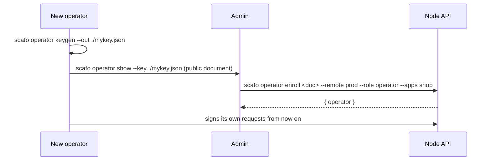

# Operators and authentication

> Operators hold Ed25519 keys the fleet trusts. Every node API call but health and the TLS ask carries a token.

## Operator keys

```sh
scafo operator keygen --register
```

A key pair is written to `./scafo-operator.json` by default, under an id of the form `op-<hex>`. `--out` names another file, `--id` pins the id. The public half is registered at `_scafo/operators/<id>.json`.

| Record field | Meaning |
|---|---|
| `id` | The id its tokens carry as `kid`. |
| `publicKey` | The Ed25519 JWK every token is verified against. |
| `role` | `admin` or `operator`. |
| `supersedes` | The key this one replaced, recorded by a rotation. |
| `applications` | Application scope. |

Operator and node ids share one keyspace and cannot collide; registering a node under a trusted key's id is refused with `reference-held`.

Tokens are short-lived, single-use EdDSA bearer tokens with a hard 60-second lifetime ceiling, audience `scafo-node`.

## Roles and scopes

| Tier | May do |
|---|---|
| `admin` | Everything, including `app block`/`unblock`/`label`, `fleet freeze`/`unfreeze`, enrolling admin-tier keys, and revoking any key. Sees every application. |
| `operator` | Application-scoped work only. May enrol keys no higher than its own tier and no wider than its own scope, and may revoke only the key it was registered to replace. |

A scope entry is one of three things: `*`, an exact application name, or a **prefix glob** — a run of name characters, which may end in a hyphen, followed by one trailing `*`.

| Scope | Meaning |
|---|---|
| `applications` omitted, admin tier | Every application. |
| `applications` omitted, operator tier | No applications. |
| `["*"]` | Every application. Must be the sole entry; listing it beside names is `invalid-input`. |
| `["shop", "blog"]` | Those two applications, exactly. |
| `["shop-*"]` | Every application whose name starts with `shop-`, so `shop-preview` but **not** `shop`. |

A `*` anywhere else in an entry is `invalid-input`. An empty scope list is refused too: a key that reaches nothing is not a grant.

A call naming an application the key does not reach is refused with `auth-scope`, without disclosing whether the application exists. Scoped callers see only their own key lineage and the applications they reach; scope-filtered responses carry `scoped: true`, and a non-admin's view of an application omits the fleet-owned labels.

::warning
Scopes authorize actions. They do not isolate hostile workloads. One installation is one trusted workload domain.
::

## Bucket credentials are root

Bucket credentials rewrite the registry directly and outrank every operator key. Some commands use them on purpose — `fleet nodes`, `trust`, `metrics`, `traces`, `deployment prune`, the `scafo app` verbs that can write the bucket directly, and `--register` — because they must work when no node is up. Keep them out of tenant workflows and out of the ingress.

## Remotes

A remote names an installation and holds the key that speaks to it. Remotes live in the operator home: `$SCAFO_HOME` when set (must be absolute), else `$XDG_CONFIG_HOME/scafo`, else `~/.scafo`.

```sh
scafo remote add prod \
  --endpoint https://node-a.example.com \
  --endpoint https://node-b.example.com \
  --register
scafo remote list
scafo remote export prod --out prod-remote.json
scafo remote remove prod
```

| Command | Effect |
|---|---|
| `add [name] --endpoint <url>` | Registers a remote with a key of its own. Repeat `--endpoint` for several nodes. `--key` reuses a key already in the home, `--from` imports a portable file or an inline `base64:` value, `--register` records the public half bucket-side. |
| `list` | The remotes this operator can reach. |
| `export <name> [--out <file>]` | Writes the remote out as one portable, self-contained, owner-readable file. |
| `remove <name>` | Unregisters a remote, and its key if nothing else shares it. |

`--register` on `remote add` reads the bucket from the config file named by `--config` and from the environment — `remote add` takes no bucket flags of its own, because its `--endpoint` names a node — and admits admin tier only.

A key is resolved for a command in this order: `--key` (a keygen file, an exported remote file, or an inline `base64:` value), then `SCAFO_OPERATOR_KEY` in the same three forms, then the key of the remote the invocation resolved to, and finally `./scafo-operator.json` when the home holds no remote at all. The remote itself comes from `--remote`, then `SCAFO_REMOTE`, then the `remote` pin in the config file named by `--config`, then the only remote in the home.

## Enrolling somebody else



```sh
scafo operator show --key ./mykey.json
scafo operator enroll ./their-key.pub.json --remote prod --role operator --apps shop --apps 'shop-*'
scafo operator list --remote prod
scafo operator revoke --id op-1a2b3c --remote prod
```

| Rule | Enforcement |
|---|---|
| A key may not register a tier above its own | `auth-scope` |
| A key may not register a scope wider than its own | `auth-scope` |
| An operator-tier key requires an application scope | Only the node API path can grant one, so bucket-side registration is admin only |
| A key may only register a replacement that supersedes *itself* | `auth-scope` |
| Self-revocation | Refused with `invalid-input`; rotate instead |
| A non-admin may revoke only the key it replaced | `auth-scope` |

The registry additionally preserves the last trusted key and the last admin.

## Rotation

```sh
scafo operator rotate --remote prod
scafo operator rotate --remote prod --keep-old
scafo operator rotate --remote prod --purge-old
```

Rotation registers the new key as superseding the old one, proves the new key against the node, then drops the old. `--keep-old` stops after the flip, leaving both trusted; `--purge-old` deletes the old key file once it is untrusted.

## Node tokens and workload tokens

| Credential | Where it comes from | Notes |
|---|---|---|
| Operator token | Signed on demand from an operator key | Short-lived, single-use, minted per request. |
| Node token | Signed by a node for calls to its peers | Single-use: the first request that presents it spends it. |
| Workload (OIDC) token | The CI provider, admitted by the application's trust policy | Not spent; it can watch a deploy to its end. |
| Ingress token | `SCAFO_INGRESS_TOKEN`, or minted by the node | Authorizes `/v1/storage` and `/v1/ingress/routes` only. |

`scafo deploy --token <t>` presents a token instead of signing one. A single-use node token cannot also poll the deploy status; that attempt fails with a clarified `auth-invalid`.

::read-more{to="/docs/applications"}
Trust policies for workload deploys.
::

## `auth-invalid` versus `trust-mismatch`

| Code | Status | Means |
|---|---|---|
| `auth-invalid` | 401 | The token itself did not hold up: bad, expired, forged, replayed, or signed by a key the fleet does not know. Uniform on purpose — it never says which. |
| `auth-scope` | 403 | The caller is known but the action is outside its tier or its applications. |
| `trust-mismatch` | 403 | A workload token verified against a trusted issuer, but no policy entry admits that subject or audience for this application. |

::read-more{to="/reference/errors"}
Every error code, its status and what to do about it.
::

## Public and privileged surfaces

| Surface | Auth |
|---|---|
| `GET /.well-known/scafo/health` | none |
| `GET /v1/ingress/ask` | none |
| `/v1/ingress/routes*`, `/v1/storage/**` | ingress bearer token |
| everything else | node, operator or workload token |
