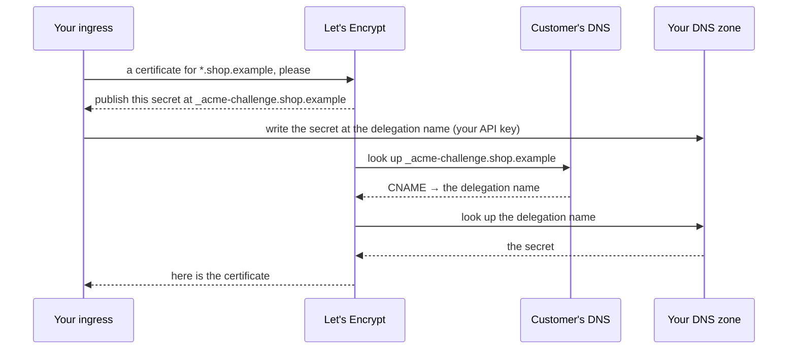

# Wildcard certificates, step by step

> How the ingress gets a certificate for `*.something` without anyone handing out DNS passwords — explained from zero, with the exact records to create.

## The problem in one minute

A certificate for one name — `shop.example` — is easy. The certificate authority (Let's Encrypt) calls the name, your ingress answers, done. Nothing to set up.

A certificate for a **wildcard** — `*.shop.example`, every subdomain at once — is different. There is no single name to call, so the authority asks for another kind of proof:

1. It hands your ingress a random secret.
2. It says: *publish this secret in the domain's DNS, at the name `_acme-challenge.shop.example`.*
3. It looks that name up. If the secret is there, whoever asked clearly controls the domain, and the certificate is issued.

This is called the **DNS-01 challenge**. The secret is different for every certificate and every renewal (about every two months), so a person cannot do it by hand: a program has to write that DNS record, and to write DNS records a program needs an **API key of the DNS provider**.

So the real question is only ever this one:

::important
**Can the ingress write a DNS record at the name the authority is going to look up?**
::

Everything below is the two situations that question has.

## Situation 1 — your own platform domain

Your platform domain (`apps.example.com`) lives at your DNS provider, and you have that provider's API key. Give the key to the ingress and it does the whole challenge by itself, for `*.apps.example.com`.

There is nothing else to create. This is the ordinary setup of every recipe in these docs.

## Situation 2 — a customer's domain

A customer wants `shop.example` and all its subdomains served by your installation (`scafo app domain add shop.example --name shop --wildcard`, see [custom domains](/docs/custom-domains)).

`shop.example` lives in the **customer's** DNS account. Your ingress has **your** API key, not theirs — and you do not want theirs. So when the authority says "publish the secret at `_acme-challenge.shop.example`", your ingress cannot: that name is not yours to write.

DNS has a tool for exactly this: a **CNAME** record, which says *"for this name, go and look at that other name instead"*. If `_acme-challenge.shop.example` is a CNAME pointing at a name inside **your** zone, the authority follows it, ends up in your zone, and finds the secret your ingress published there. Only the owner of `shop.example` could have created that CNAME, so it is still valid proof — and the customer creates it **once**, then never thinks about certificates again.

That name inside your zone is the **delegation name**. You pick it once for the whole installation.



### The shortcut: one record does both jobs

A DNS wildcard record matches **every** name under it — including `_acme-challenge`. So if the customer points their subdomains at you with a wildcard **CNAME**, and that CNAME's target is your delegation name, the challenge is already forwarded. No separate `_acme-challenge` record is needed.

Pick a delegation name that also resolves to your ingress — typically the platform domain itself — and tell the customer to create:

| Record at the customer's DNS | Type | Value | What it is for |
|---|---|---|---|
| `*.shop.example` | CNAME | `apps.example.com` (your delegation name) | Traffic for every subdomain **and** the certificate challenge |
| `shop.example` | A / AAAA | your ingress addresses | Traffic for the bare domain, which DNS does not allow to be a plain CNAME |

The bare domain gets its own certificate the easy way, on its first request. The wildcard certificate covers everything under it.

::warning
**"It already resolves" does not mean a dedicated record exists.** Looking up `_acme-challenge.shop.example` answers as soon as the wildcard exists, because the wildcard matches it. That is the shortcut working — not a record somebody created for the challenge.
::

## Setting it up on the `scafo` Caddy image

Everything is environment variables; no Caddyfile to write.

```sh
# the fleet(s) this ingress serves
SCAFO_FLEET_ENDPOINT=http://10.83.0.1:7400
SCAFO_FLEET_TOKEN=…                      # the node's ingress token

# your DNS provider: the module name, then its own settings
SCAFO_DNS_PROVIDER=bunny
SCAFO_DNS_ACCESS_KEY=…                   # becomes the provider's "access_key"
SCAFO_DNS_ZONES=apps.example.com         # the zone(s) this key can write

# where customers' challenges are forwarded to (situation 2)
SCAFO_ACME_DELEGATION=apps.example.com
```

`SCAFO_DNS_ZONES` is what tells the ingress which names are *yours* (written directly) and which are *not* (written at the delegation name instead). The zone is the part of the name your provider actually hosts — if only `apps.example.com` is delegated to it, say `apps.example.com`, not `example.com`.

With that in place the ingress reads, from every fleet, the list of bases that want a wildcard certificate — your platform domains, and every custom domain claimed with `--wildcard` — and obtains them by itself. Certificates of one fleet are stored with that fleet and never with another.

## Setting it up on Traefik

Traefik obtains certificates through a *certificate resolver* you define in its static configuration, with a DNS challenge for your provider. Tell scafo the resolver's name:

```sh
SCAFO_INGRESS_TRAEFIK_CERT_RESOLVER=le
SCAFO_TRAEFIK_ENTRYPOINTS=websecure
```

Scafo then writes, on every router it renders, which certificate to ask that resolver for — one `apps.example.com` + `*.apps.example.com` certificate for the whole platform domain instead of one per application — and Traefik does the rest.

```yaml [traefik.yml]
entryPoints:
  web:
    address: ":80"
    http:
      redirections:
        entryPoint: { to: websecure, scheme: https }
  websecure:
    address: ":443"
providers:
  http:
    endpoint: "http://10.83.0.1:7400/v1/ingress/routes/traefik?prefer=self"
    pollInterval: 5s
    headers:
      Authorization: "Bearer <the node's ingress token>"
certificatesResolvers:
  le:
    acme:
      storage: /acme/acme.json
      dnsChallenge:
        provider: bunny        # reads BUNNY_API_KEY from Traefik's environment
```

## What is approved without any of this

Without a wildcard certificate nothing breaks: the claimed host itself, and a subdomain that names an existing application (`preview.shop.example` → `shop-preview`), each get their own certificate on their first request. Only the *other* subdomains — the catch-all — need the wildcard, because scafo never approves a certificate for an arbitrary name: anyone could otherwise request thousands of them and exhaust the authority's weekly limit for that domain.

::read-more{to="/docs/custom-domains#certificates"}
The approval rule, and why it is a deliberate limit.
::
