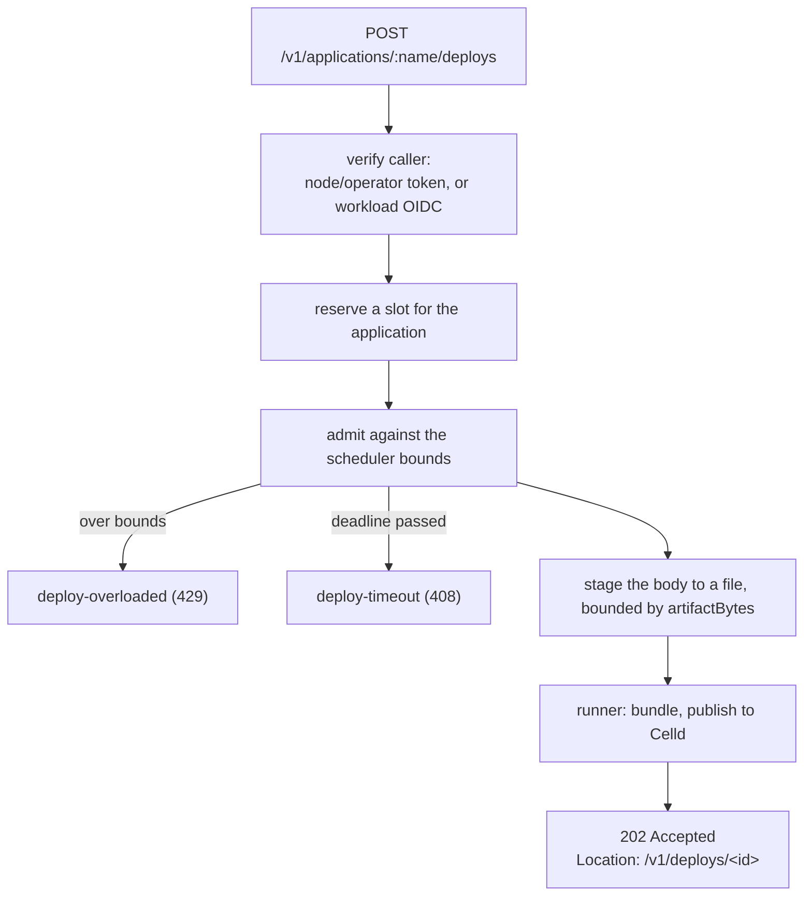

# Deploying

> `scafo deploy` packs a built project directory, hands it to a node, and watches it land.

## The command

```sh
scafo deploy ./my-app --remote prod
scafo deploy ./my-app --name shop --remote prod
scafo deploy ./my-app --name shop --env preview --remote prod
```

| Flag | Meaning |
|---|---|
| `[dir]` | The built project directory to pack. Positional, defaults to `.`. |
| `--name <name>` | Application to deploy into. Without it, the CLI reads `name` from the directory's `wrangler.jsonc` or `wrangler.json`. |
| `--env <name>` | Deploy into the application `<name>-<env>` instead. |
| `--var KEY:VALUE` | Set a variable in the artifact's runtime config, overriding the config's own `vars`. Repeat the flag for several. |
| `--bundle` / `--no-bundle` | Build the Worker entry on the node, or ship a pre-bundled, self-contained entry. Default: bundle. |
| `--replicas <N\|all>` | How many nodes serve this application. |
| `--node-selector key=value` | A label a node must carry to serve this application. One pair per flag; repeat it for several. |
| `--wait` / `--no-wait` | Wait for a place in the node's deploy queue when it is full, or fail at once. Default: wait. |
| `--queue-timeout <seconds>` | How long the waiting may go on, measured from the first try. Default `600`, the node's own queue deadline. |
| `--node <url>` | Base URL of the node daemon. |
| `--remote <name>` | Remote to deploy to, out of the operator home. |
| `--key <form>` | Operator key to sign with: a keygen file, an exported remote file, or an inline `base64:` value. |
| `--token <t>` | Present this bearer token instead of signing one. |
| `--config <path>` | `scafo.config.jsonc` to read for its remote pin. |

With neither `--node` nor a resolvable remote, the command fails with `invalid-input` ("No node to deploy to").

### Which application a deploy lands in

Without `--name`, the CLI reads `name` out of the project directory's `wrangler.jsonc`, then `wrangler.json`. It is read only: nothing writes that file back, and the `name` it carries reaches Celld exactly as written. A directory with no config, or one whose `name` is missing, blank or not an application name, is refused with `invalid-input` telling you to pass `--name`.

`--env` appends to the name: `--name shop --env preview` deploys into the application `shop-preview`, exactly as `--name shop-preview` would. The node never sees an environment.

::read-more{to="/docs/applications#production-and-preview"}
The production-and-preview pattern `--env` exists for.
::

::note
`--replicas` and `--node-selector` are only sent when given, and neither can lift a constraint the application already carries. Removing one is `scafo app selector --clear`, and changing a count is `scafo app replicas`.
::

## What is packed

The whole directory is streamed into a file-backed `tar` + zstd artifact — no exclusion list — and sent as the raw request body of `POST /v1/applications/<name>/deploys` with `content-type: application/octet-stream` and the metadata in an `x-scafo-deploy` header (bounded to 8 KiB).

The artifact must carry a runtime config named `wrangler.jsonc` or `wrangler.json` at its root; one that carries neither is refused with `invalid-input`. The node never parses or rewrites that file: it locates it and hands it to Celld exactly as it arrived, so what the runtime reads is byte for byte what was uploaded. The `name` Celld sees is whatever the config itself says; `--name` and `--env` choose the Scafo application and change nothing in the file.

The node unpacks the artifact before it publishes, and refuses with `invalid-input` a tar compressed twice, and an entry whose path or link leaves the directory it unpacks into, naming that entry — a relative link that stays inside is fine. An entry the node cannot write on its own disk fails the deploy as `internal`. Both land on the deploy's record, after the `202`.

Anything the flags change is changed by the CLI, before the directory is packed: it reads the config, applies the edit in memory, and puts the result into the archive. The file in the project directory is never written, whatever flags were given. With neither `--var` nor `--no-bundle`, the config is uploaded byte for byte.

## Variables

An application's variables live in its own config's `vars` — that is the runtime's only variable channel. Keep the defaults there, committed with the project:

```jsonc
// wrangler.jsonc
{
  "name": "shop",
  "main": "dist/index.js",
  "compatibility_date": "2025-01-01",
  "vars": {
    "LOG_LEVEL": "info",
    "DATABASE_URL": "postgres://localhost/shop"
  }
}
```

`--var KEY:VALUE` overrides one entry for one deploy and leaves every other entry as written:

```sh
scafo deploy ./my-app --name shop --var DATABASE_URL:"$DATABASE_URL"
```

| Rule | Behaviour |
|---|---|
| Repeating | The flag may be given as many times as there are variables. |
| Splitting | At the **first** colon, so a value may contain colons — a URL is the ordinary case. A pair with no colon at all is `invalid-input`. |
| Empty value | Allowed: `--var LOG_LEVEL:` sets the variable to nothing rather than leaving it unset. |
| Duplicates | A name given twice is refused with `invalid-input` rather than resolved. |
| Names | Letters, digits and underscores, never beginning on a digit, and never `__proto__`, `constructor` or `prototype`. |

::warning
A value passed with `--var` is visible in the process list and the CI log of the machine running the CLI, and Celld stores variables as plain text in the bucket, so anyone with bucket read access can read them. Celld has no secret store.

Keep defaults in the config's `vars`, pass the values that differ between applications from the CI's secret store as `--var`, mask them in CI logs, and treat bucket read access as access to every variable.
::

::warning
Wrangler's `env.<name>` configuration sections are not supported: Celld refuses a config that carries an `env` key. A project that needs different settings per deployment target keeps them out of the config and passes them with `--var`.
::

## Bundling

By default the node bundles the Worker entry with esbuild before Celld publishes it. The image sets `CELLD_ESBUILD=/usr/local/bin/esbuild`; the Linux installer installs esbuild beside the other binaries.

`--no-bundle` is for an entry that is already a self-contained module — bundled by your own toolchain, with no bare imports. It sets `no_bundle: true` in the config the archive carries, and Celld then skips esbuild entirely. A config that already declares `no_bundle: true` needs no flag.

## Python Workers

A Python Worker deploys like any other application: a `wrangler.jsonc` whose `main` is a `.py` file, with its packages vendored into `python_modules/` by `uv run pywrangler sync` on the machine that runs `scafo deploy`. What such a project must declare, and what Celld supports of it, is Celld's, in its [Python Workers documentation](https://github.com/denoland/celld/blob/v0.6.1/docs/services/workers.md#python-workers).

Deploy from a directory with no `.venv*` in it. The whole directory is packed, and uv's virtual environments carry symlinks to absolute paths, which a node refuses with `invalid-input` naming the entry.

The first Python build on each node downloads the Pyodide runtime, about 12 MB, from `cdn.jsdelivr.net` into Celld's cache under the node's home — in the image, `/var/lib/scafo`, on the state volume — and later builds reuse it. `CELLD_PYTHON_RUNTIME_DIR` in the node's own environment puts it elsewhere; see [container engine](/config/celld#container-engine). Serving a Python deployment needs nothing more of a node.

::warning
Every node of the installation must run Celld 0.6.1 before the first Python deploy. A rolling upgrade from 0.6.0 keeps deploys frozen until it is done; see [a rolling upgrade](/docs/operations#a-rolling-upgrade).
::

## The intake path



A node with no deploy runner or no artifact stager refuses with `capability-missing`. Under `scafo sail` both are always configured.

## Bursts: one publishes, the rest queue

A node publishes **one deploy at a time** and queues the rest: up to 64 across the node, of which at most 4 may belong to any one application, and the whole queue is bounded independently by the staged bytes those artifacts occupy.

| Bound | Default | Why that size |
|---|---|---|
| Publishing at once, node | 1 | Publishing is the serialized step. |
| Queued, node | 64 | Sized for a team. Thirty to fifty people pushing inside one publish is ordinary; queueing is nearly free, and refusing is a red pipeline somebody re-runs by hand. |
| Queued, per application | 4 | A pipeline that pushes the same application four times over has three runs nobody will serve. It bounds one noisy repository without reaching the queue everyone else shares. |
| Queue deadline | 600 s | What stops the queue from becoming a place work goes to be forgotten. |

A node whose queue is full answers `deploy-overloaded` (429) with a `retry-after`. `scafo deploy` honours that number, backs off with jitter when the node named none, and keeps coming back until `--queue-timeout` has passed — printing one line when the waiting starts and one when it is admitted, and nothing in between. The staged artifact is re-sent rather than re-packed.

```text
scafo: the node's deploy queue is full; waiting up to 600s for a place in it (--no-wait fails at once instead)
scafo: admitted after waiting 47s for a place in the node's deploy queue
```

`--no-wait` fails on the first refusal, which is what a caller that would rather see the queue than sit in it asks for.

## Watching the deploy

The CLI follows the `Location` header, polling `GET /v1/deploys/<id>` every second and printing each state it enters.

| State | Meaning |
|---|---|
| `accepted` | Admitted. |
| `uploading` | The artifact is being received and staged. |
| `deployed` | Terminal success. The deployment's version is printed. |
| `failed` | Terminal failure, with a bounded detail. |

::note
A deploy's state is a registry record, so any node of the installation answers a poll and a node restarting mid-deploy loses nothing. The accepting node answers from memory, which is the same record a moment sooner. A finished deploy's record is kept for a week and then removed by the reaper; the application record and its deployment stay.
::

A deploy that stops moving for longer than the 90-second liveness window, on a node that has stopped answering, is answered as `failed` with `deploy-timeout` **by the poll itself** — the record is judged at read time, and the coordinator's sweep writes the same judgement down later. Nobody waits for the sweep to hear it.

### Going live

`deployed` means the deployment is recorded. Serving it follows within seconds:

1. The accepting node asks its **local** Celld process to adopt the new deployment at once, over that process's internal listener, bounded to a few seconds. So the node the deploy landed on is already serving it by the time the caller reads `deployed`.
2. Every other node serving that application does the same on the reconcile pass that sees the application's deployment revision move.
3. If either request fails, it is one line in the node's log and nothing more: Celld's own pointer poll, about every 30 seconds, adopts the deployment anyway. Nothing depends on the request having landed.

A process this pass has just *started* is never asked: it reads the pointer as it boots.

## Admission bounds

These are scheduling bounds, not OS resource admission. Apply host or container CPU, memory, process, filesystem and network limits separately.

| Bound | Flag | Environment | Default |
|---|---|---|---|
| Artifact bytes (compressed and, independently, expanded) | `--artifact-bytes` | `SCAFO_ARTIFACT_BYTES` | 1 GiB |
| Archive entries | `--archive-entries` | `SCAFO_ARCHIVE_ENTRIES` | 20000 |
| Active tasks, node | `--active-tasks` | `SCAFO_ACTIVE_TASKS` | 1 |
| Active tasks, per application | `--application-active-tasks` | `SCAFO_APPLICATION_ACTIVE_TASKS` | 1 |
| Queued tasks, node | `--queued-tasks` | `SCAFO_QUEUED_TASKS` | 64 |
| Queued tasks, per application | `--application-queued-tasks` | `SCAFO_APPLICATION_QUEUED_TASKS` | 4 |
| Staged bytes, node | `--staged-bytes` | `SCAFO_STAGED_BYTES` | 5 GiB |
| Staged bytes, per application | `--application-staged-bytes` | `SCAFO_APPLICATION_STAGED_BYTES` | 3 GiB |
| Receive timeout | `--receive-timeout-ms` | `SCAFO_RECEIVE_TIMEOUT_MS` | 600000 (10 min) |
| Queue timeout | `--queue-timeout-ms` | `SCAFO_QUEUE_TIMEOUT_MS` | 600000 (10 min) |
| Task timeout | `--task-timeout-ms` | `SCAFO_TASK_TIMEOUT_MS` | 300000 (5 min) |
| Retained builder output tail | `--output-bytes` | `SCAFO_OUTPUT_BYTES` | 65536 |

Per-application values must not exceed their node-wide counterparts, and staged bytes must be at least `artifactBytes`.

| Refusal | Status | Cause |
|---|---|---|
| `deploy-overloaded` | 429 | Active or queued task limits, or staged-byte limits, are full. Carries a `retry-after`; `scafo deploy` waits and comes back unless `--no-wait`. |
| `deploy-timeout` | 408 | A receive, queue or task deadline passed. |
| `resource-limit` | 413 | The artifact exceeded `artifactBytes` or `archiveEntries`. |
| `application-blocked` | 409 | The application is blocked. |
| `deploys-frozen` | 409 | An admin has frozen deploy intake for the whole installation. |

::read-more{to="/config#deploy"}
Every bound, with its config-file key.
::

## Deploying from CI with OIDC

A workload deploys with the token its CI provider issues, without holding an operator key.

::steps

### Give the application a trust policy

```sh
# A repository created before 15 July 2026, never renamed or transferred since.
scafo trust set --name shop \
  --issuer https://token.actions.githubusercontent.com \
  --subject 'repo:acme/shop:ref:refs/heads/main'

# One created after that date, or renamed, transferred or opted in since.
scafo trust set --name shop \
  --issuer https://token.actions.githubusercontent.com \
  --subject 'repo:acme@123456/shop@456789:ref:refs/heads/main'
```

The policy may be written before the application exists: the first deploy creates it under the name the policy already names.

GitHub gives repositories created after 15 July 2026 an immutable subject carrying the owner and repository ids; older ones keep the plain form until they are renamed, transferred, or opted in through the repository's OIDC settings. The simplest way to get the subject right is to run the job once and copy it from the `trust-mismatch` refusal, which prints exactly what the token carried. The ids are also the `github.repository_owner_id` and `github.repository_id` contexts of any workflow run, or `gh api repos/OWNER/REPO --jq '"\(.owner.id) \(.id)"'`.

`--audience` defaults to `scafo`; the workload must request its token for that audience. `--subject` takes `*` as a wildcard for any run of characters. Repeat the flag for several subjects: each `--subject` is one subject, whole, and nothing is split on commas. Scafo matches the raw `sub` claim.

#### Subject shapes

The part after the repository says which runs are admitted. GitHub fills it from the trigger, so the choice is about which runs should be able to deploy at all:

| Subject tail | Admits | Use it when |
|---|---|---|
| `ref:refs/heads/main` | Pushes to one branch | One branch is the only thing that deploys — the usual production setup |
| `ref:refs/heads/*` | Pushes to any branch | Every branch deploys |
| `ref:refs/heads/release/*` | Pushes to branches under a prefix | Release branches deploy, feature branches do not |
| `ref:refs/tags/*` | Pushes of any tag | Deploys happen by tagging, not by merging |
| `ref:refs/tags/v*` | Pushes of tags starting with `v` | Version tags only |
| `environment:production` | Jobs bound to a GitHub environment | The repository already gates that environment with reviewers or wait timers, and the policy should follow it |
| `pull_request` | Pull request runs | Almost never — a fork's pull request carries the base repository's subject |

The tail follows what triggered the run: a tag push carries `ref:refs/tags/…`, a branch push `ref:refs/heads/…`, and a job with an `environment:` key carries `environment:<name>` instead of the ref. Several shapes are several `--subject` flags on one command.

#### One policy per application

A policy admits subjects to **one application**, exactly. `shop` and `shop-preview` are two applications with two policies, so "main deploys to production, other branches deploy previews" is a rule two policies state: one admitting the production ref to `shop`, one admitting the preview refs to `shop-preview`.

A wildcard such as `ref:refs/heads/*` admits every branch to whichever application its policy is filed under, and to that one only.

### Request the token in the job and deploy with it

```sh
scafo deploy ./dist \
  --name shop \
  --node https://apps.example.com \
  --token "$OIDC_TOKEN"
```

A workload token is not spent by the first request, so it watches the deploy to its end.

### Read the refusals

`auth-invalid` means the token did not hold up. `trust-mismatch` means it verified against a trusted issuer, but no policy entry admits that subject or audience for this application. Its detail names the issuer, the subject the token presented and the application it was presented for, and ends with the command that admits exactly that subject.

```text
scafo: Trust policy does not admit this token: "repo:acme@123456/shop@456789:ref:refs/heads/main" is not a trusted subject of "https://token.actions.githubusercontent.com" for "shop"; an admin of this fleet admits exactly that subject with "scafo trust add --name shop --issuer https://token.actions.githubusercontent.com --subject repo:acme@123456/shop@456789:ref:refs/heads/main" [urn:scafo:trust-mismatch]
```

Run that command, with the bucket flags, to admit that one subject: `scafo trust add` keeps every subject the issuer is already trusted for. To widen it with `*` where a branch or a tag should vary, state the list with `scafo trust set` instead, which **replaces** the issuer's subjects.

The refusal only ever repeats what the token itself said. Any workflow of a shared issuer such as GitHub can earn one, so it never lists what the application does trust, and a subject carrying a `*`, a quote or whitespace is named without a command: pasted, it would grant something other than that one subject.

::

## Checking the result

```sh
# Is the application placed, and is a process running for it?
curl -s -H "Authorization: Bearer $TOKEN" http://127.0.0.1:7400/v1/state

# Does the node itself answer?
scafo health
curl -s http://127.0.0.1:7400/.well-known/scafo/health

# Does the application answer, on its own host?
curl -s https://shop.apps.example.com/.well-known/celld/health
```

| Endpoint | What it reports |
|---|---|
| `/.well-known/scafo/health` | The Scafo node/API daemon. Does not aggregate application health. |
| `/.well-known/celld/health` | The deployed application, on an application host. |

`GET /v1/state` shows the node record, the coordinator lease and fence, this node's processes, its placement views, its last reconcile pass, and any applications the coordinator could not place. Operator callers see it filtered to their application scope.

::read-more{to="/docs/placement"}
Why an application might be placed on a different node than the one you deployed to.
::
