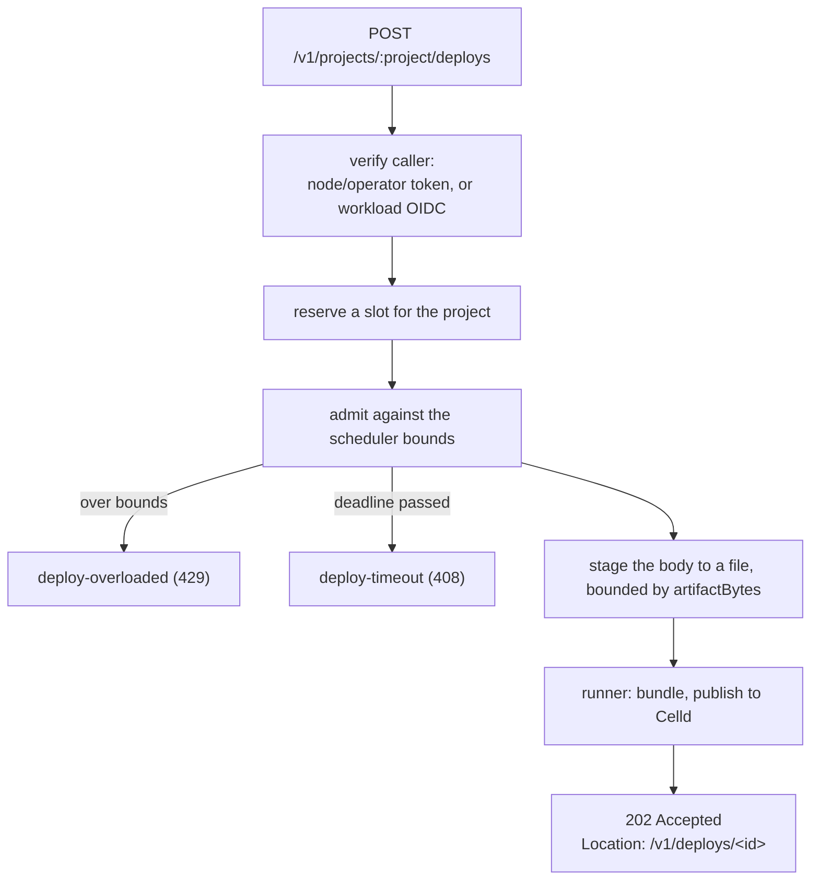

# Deploying a project

> `scafo deploy` packs a built directory, hands it to a node, and watches it land.

## The command

```sh
scafo deploy ./my-app --project shop --env production --remote prod
```

| Flag | Meaning |
|---|---|
| `[dir]` | Directory holding the built project. Positional, defaults to `.`. |
| `--project <slug>` | **Required.** Project slug to deploy into. |
| `--env <name>` | Environment to deploy into. Defaults to `production`. |
| `--script <name>` | Name the runtime files the app under. Defaults to the project slug. |
| `--bundle` / `--no-bundle` | Build the Worker entry on the node, or ship a pre-bundled, self-contained entry. Default: bundle. |
| `--replicas <N\|all>` | How many nodes serve this environment. |
| `--node-selector k=v,...` | Labels a node must carry to serve this environment. |
| `--node <url>` | Base URL of the node daemon. |
| `--remote <name>` | Remote to deploy to, out of the operator home. |
| `--key <form>` | Operator key to sign with: a keygen file, an exported remote file, or an inline `base64:` value. |
| `--token <t>` | Present this bearer token instead of signing one. |
| `--config <path>` | `scafo.config.jsonc` to read for its remote pin. |

With neither `--node` nor a resolvable remote, the command fails with `invalid-input` ("No node to deploy to").

::note
`--replicas` and `--node-selector` are only sent when given, and neither can lift a constraint the environment already carries. Removing one is `scafo env selector --clear`.
::

## What is packed

The whole directory is streamed into a file-backed `tar` + zstd artifact — no exclusion list — and sent as the raw request body of `POST /v1/projects/<project>/deploys` with `content-type: application/octet-stream` and the metadata in an `x-scafo-deploy` header (bounded to 8 KiB).

The artifact must carry a runtime config named `wrangler.jsonc` or `wrangler.json`. The node rewrites its `name` to the `--script` value, and adds `no_bundle: true` when `--no-bundle` was passed.

## Bundling

By default the node bundles the Worker entry with esbuild before Celld publishes it. The image sets `CELLD_ESBUILD=/usr/local/bin/esbuild`; the Linux installer installs esbuild beside the other binaries.

`--no-bundle` is for an entry that is already a self-contained module — bundled by your own toolchain, with no bare imports. The node then records `no_bundle` in the Celld config and skips esbuild entirely.

## The intake path



A node with no deploy runner or no artifact stager refuses with `capability-missing`. Under `scafo sail` both are always configured.

## Watching the deploy

The CLI follows the `Location` header, polling `GET /v1/deploys/<id>` every second and printing each state it enters.

| State | Meaning |
|---|---|
| `accepted` | Admitted. |
| `uploading` | The artifact is being received and staged. |
| `deployed` | Terminal success. The immutable build id is printed. |
| `failed` | Terminal failure, with a bounded detail. |

::warning
Deploy status is in-memory. It is forgotten when the daemon restarts, and `GET /v1/deploys/<id>` then answers `not-found`. The environment record and its build are in the registry and survive.
::

## Admission bounds

These are scheduling bounds, not OS resource admission. Apply host or container CPU, memory, process, filesystem and network limits separately.

| Bound | Flag | Environment | Default |
|---|---|---|---|
| Artifact bytes (compressed and, independently, expanded) | `--artifact-bytes` | `SCAFO_ARTIFACT_BYTES` | 1 GiB |
| Archive entries | `--archive-entries` | `SCAFO_ARCHIVE_ENTRIES` | 20000 |
| Active tasks, node | `--active-tasks` | `SCAFO_ACTIVE_TASKS` | 1 |
| Active tasks, per project | `--project-active-tasks` | `SCAFO_PROJECT_ACTIVE_TASKS` | 1 |
| Queued tasks, node | `--queued-tasks` | `SCAFO_QUEUED_TASKS` | 4 |
| Queued tasks, per project | `--project-queued-tasks` | `SCAFO_PROJECT_QUEUED_TASKS` | 2 |
| Staged bytes, node | `--staged-bytes` | `SCAFO_STAGED_BYTES` | 5 GiB |
| Staged bytes, per project | `--project-staged-bytes` | `SCAFO_PROJECT_STAGED_BYTES` | 3 GiB |
| Receive timeout | `--receive-timeout-ms` | `SCAFO_RECEIVE_TIMEOUT_MS` | 600000 (10 min) |
| Queue timeout | `--queue-timeout-ms` | `SCAFO_QUEUE_TIMEOUT_MS` | 600000 (10 min) |
| Task timeout | `--task-timeout-ms` | `SCAFO_TASK_TIMEOUT_MS` | 300000 (5 min) |
| Retained builder output tail | `--output-bytes` | `SCAFO_OUTPUT_BYTES` | 65536 |

Per-project values must not exceed their node-wide counterparts, and staged bytes must be at least `artifactBytes`.

| Refusal | Status | Cause |
|---|---|---|
| `deploy-overloaded` | 429 | Active or queued task limits, or staged-byte limits, are full. |
| `deploy-timeout` | 408 | A receive, queue or task deadline passed. |
| `resource-limit` | 413 | The artifact exceeded `artifactBytes` or `archiveEntries`. |
| `project-blocked` | 409 | The project is blocked. |

::read-more{to="/config/operator"}
Every bound, with its config-file key.
::

## Deploying from CI with OIDC

A workload deploys with the token its CI provider issues, without holding an operator key.

::steps

### Give the project a trust policy

```sh
# A repository created before 15 July 2026, never renamed or transferred since.
scafo trust set --project shop \
  --issuer https://token.actions.githubusercontent.com \
  --subject 'repo:acme/shop:ref:refs/heads/main'

# One created after that date, or renamed, transferred or opted in since.
scafo trust set --project shop \
  --issuer https://token.actions.githubusercontent.com \
  --subject 'repo:acme@123456/shop@456789:ref:refs/heads/main'
```

GitHub gives repositories created after 15 July 2026 an immutable subject carrying the owner and repository ids; older ones keep the plain form until they are renamed, transferred, or opted in through the repository's OIDC settings. The simplest way to get the subject right is to run the job once and copy it from the `trust-mismatch` refusal, which prints exactly what the token carried. The ids are also the `github.repository_owner_id` and `github.repository_id` contexts of any workflow run, or `gh api repos/OWNER/REPO --jq '"\(.owner.id) \(.id)"'`.

`--audience` defaults to `scafo`; the workload must request its token for that audience. `--subject` takes `*` as a wildcard for any run of characters, and accepts a comma-separated list. Scafo matches the raw `sub` claim.

#### Subject shapes

The part after the repository says which runs are admitted. GitHub fills it from the trigger, so the choice is about which runs should be able to deploy at all:

| Subject tail | Admits | Use it when |
|---|---|---|
| `ref:refs/heads/main` | Pushes to one branch | One branch is the only thing that deploys — the usual production setup |
| `ref:refs/heads/*` | Pushes to any branch | Every branch deploys, typically each to a preview environment named after it |
| `ref:refs/heads/release/*` | Pushes to branches under a prefix | Release branches deploy, feature branches do not |
| `ref:refs/tags/*` | Pushes of any tag | Deploys happen by tagging, not by merging |
| `ref:refs/tags/v*` | Pushes of tags starting with `v` | Version tags only |
| `environment:production` | Jobs bound to a GitHub environment | The repository already gates that environment with reviewers or wait timers, and the policy should follow it |
| `pull_request` | Pull request runs | Almost never — a fork's pull request carries the base repository's subject |

The tail follows what triggered the run: a tag push carries `ref:refs/tags/…`, a branch push `ref:refs/heads/…`, and a job with an `environment:` key carries `environment:<name>` instead of the ref. Several shapes go in one comma-separated `--subject`.

#### What a policy does not decide

A policy admits subjects to a **project**. It says nothing about environments: the job chooses the environment with `--env`, and any admitted subject may deploy to any environment of the project, production included. "Main deploys to production, other branches to preview" is therefore a rule the workflow implements — deriving `--env` from the branch — and not one the node enforces. A wildcard such as `ref:refs/heads/*` admits every branch to every environment. Keep that in mind before widening a subject.

### Request the token in the job and deploy with it

```sh
scafo deploy ./dist \
  --project shop --env production \
  --node https://apps.example.com \
  --token "$OIDC_TOKEN"
```

A workload token is not spent by the first request, so it watches the deploy to its end.

### Read the refusals

`auth-invalid` means the token did not hold up. `trust-mismatch` means it verified against a trusted issuer, but no policy entry admits that subject or audience for this project. The refusal carries the fix: its detail names the issuer and the subject the token presented, and ends with the `scafo trust set` line that admits exactly that subject.

```text
scafo: Trust policy does not admit this token: "repo:acme@123456/shop@456789:ref:refs/heads/main" is not a trusted subject of "https://token.actions.githubusercontent.com" for "shop" [urn:scafo:trust-mismatch]
  to admit it: scafo trust set --project shop --issuer https://token.actions.githubusercontent.com --subject 'repo:acme@123456/shop@456789:ref:refs/heads/main'
```

The line is verbatim, so it admits that one subject only. Widen it yourself with `*` where a branch or an environment should vary.

::

## Checking the result

```sh
# Is the environment placed, and is a process running for it?
curl -s -H "Authorization: Bearer $TOKEN" http://127.0.0.1:7400/v1/state

# Does the node itself answer?
scafo health
curl -s http://127.0.0.1:7400/.well-known/scafo/health

# Does the application answer, on its own host?
curl -s https://shop.apps.example.com/.well-known/celld/health
```

| Endpoint | What it reports |
|---|---|
| `/.well-known/scafo/health` | The Scafo node/API daemon. Does not aggregate application health. |
| `/.well-known/celld/health` | The deployed application, on an application host. |

`GET /v1/state` shows the node record, the coordinator lease and fence, this node's processes, its placement views, its last reconcile pass, and any environments the coordinator could not place. Operator callers see it filtered to their project scope.

::read-more{to="/docs/placement"}
Why an environment might be placed on a different node than the one you deployed to.
::
