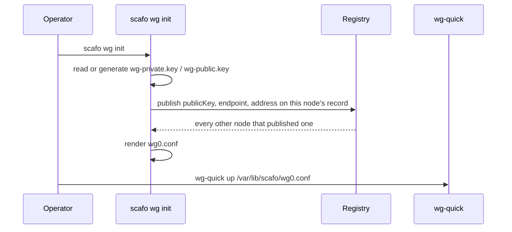

# WireGuard transport

> `scafo wg` publishes a node's tunnel details in the registry and renders its `wg0.conf` from every peer that has done the same. Bringing the interface up stays yours.

## When to use it

A node whose API, advertised address or runtime bind host reaches beyond loopback must declare what network that is. `wireguard` is the answer when the network between the machines is the public internet.

::warning
`wireguard-tools` is an operating-system prerequisite. Install it with the host package manager: `apt install wireguard-tools`, or `dnf`/`apk`/`pacman`. Scafo never brings an interface up — that needs a kernel module and `NET_ADMIN`.
::

## Configuration

| Setting | Flag | Environment | Config key | Default |
|---|---|---|---|---|
| Transport | `--transport` | `SCAFO_TRANSPORT` | `transport.driver` | — |
| Tunnel address | `--wg-address` | `SCAFO_WG_ADDRESS` | `wireguard.address` | — |
| Public endpoint | `--wg-endpoint` | `SCAFO_WG_ENDPOINT` | `wireguard.endpoint` | — |
| Listen port | `--wg-port` | `SCAFO_WG_PORT` | `wireguard.port` | `51820` |

```sh
SCAFO_TRANSPORT=wireguard
SCAFO_WG_ADDRESS=10.83.0.1/24
SCAFO_WG_ENDPOINT=203.0.113.10:51820
```

`address` is this node's tunnel address with its prefix length; every node in the fleet shares one subnet. `endpoint` is the `host:port` peers send this node's tunnel traffic to — its public address.

Both are required with `transport: wireguard`; either missing raises `invalid-input` naming it. WireGuard settings on a node running another transport are reported and dropped.

## What follows the tunnel

With `transport: wireguard` and an address configured, three defaults move onto the tunnel:

| Setting | Default with a tunnel |
|---|---|
| `node.listen` | The tunnel host on port `7400` |
| `node.advertise` | The tunnel host on the listen port |
| `runtime.bindHost` | The tunnel host |

So the node API is private without being loopback-only: a colocated ingress reaches it over the tunnel interface, a peer's ingress reaches this host's application processes the same way, and nothing on the public interfaces answers on port 7400. Explicit values for any of the three still win.

## Files in the state directory

Everything lives in the node's own state directory — the same one that holds `node.json` — owner-readable, in a directory nobody else can enter.

| File | Contents |
|---|---|
| `wg-private.key` | The private half. Generated with `wg genkey` when missing. |
| `wg-public.key` | The public half. Derived with `wg pubkey` when missing. |
| `wg0.conf` | The rendered interface configuration, including the private key. |

Once both key halves exist, no later call needs `wg` again: a node whose tunnel is set up boots on a host that never had `wireguard-tools`. A key file that exists but does not hold a key is refused rather than replaced.

::warning
`scafo sail` with `transport: wireguard` reads the keys and never makes them. A node whose keys are not on disk has not had `scafo wg init` run on it and is refused at boot: registering an address the tunnel does not carry is exactly what the transport decision prevents.
::

## Setting a node up



```sh
scafo wg init
# scafo: generated a private key with "wg genkey" and wrote it to /var/lib/scafo/wg-private.key
# scafo: derived the public key with "wg pubkey"
# scafo: node "vps-a" is on the tunnel at 10.83.0.1/24, reachable at 203.0.113.10:51820
# scafo: wrote /var/lib/scafo/wg0.conf with 1 peer
# scafo: bring the tunnel up with "wg-quick up /var/lib/scafo/wg0.conf"

wg-quick up /var/lib/scafo/wg0.conf
```

`scafo wg init` takes the same bucket, node and tunnel flags as `scafo sail`, plus `--stdout`.

```sh
scafo wg init --stdout > /etc/wireguard/wg0.conf
```

`--stdout` prints the configuration and writes nothing. It is the only thing the command puts on stdout; everything else it says goes to stderr, so the redirect captures a file `wg-quick` can parse and nothing it cannot.

## Refreshing the peer list

```sh
scafo wg peers
wg syncconf wg0 <(wg-quick strip /var/lib/scafo/wg0.conf)
```

`scafo wg peers` re-renders the configuration from the nodes registered right now. It **reads** the keypair and never makes one: refreshing a peer list must not be able to hand this node a new identity that every peer's file is then missing. Without a keypair it refuses with `invalid-input` telling you to run `scafo wg init` first.

Use `wg-quick up` for the first bring-up and `wg syncconf` afterwards, so refreshing peers does not tear the interface down.

## What the rendered file contains

```ini
[Interface]
Address = 10.83.0.1/24
ListenPort = 51820
PrivateKey = <this node's private key>

# vps-b
[Peer]
PublicKey = <vps-b's public key>
Endpoint = 203.0.113.11:51820
AllowedIPs = 10.83.0.2/32
```

| Detail | Reason |
|---|---|
| One `[Peer]` per other node, in node-id order | Re-rendering an unchanged fleet produces an unchanged file. |
| `AllowedIPs` is the peer's own address alone (`/32`, or `/128` for IPv6) | A peer allowed the whole subnet would claim every other node's routes, and which peer won would depend on section order. |
| A node with no `wireguard` record is skipped | A fleet migrates one node at a time; the ones already on the tunnel keep reaching each other. |
| A node whose record vanished between listing and read is skipped | Nothing deregisters a node, so that only happens if an operator empties the key by hand. |

## Adding a node

::steps

### Configure the new host

Give it a free address in the same subnet, its own public endpoint, and the fleet's bucket settings.

### Put it on the tunnel

```sh
scafo wg init
wg-quick up /var/lib/scafo/wg0.conf
```

It publishes its details and renders a file containing every node already registered.

### Refresh every other host

```sh
scafo wg peers
wg syncconf wg0 <(wg-quick strip /var/lib/scafo/wg0.conf)
```

A node that is not in a peer's file is a node that peer cannot reach. Run this on every existing host.

### Start the node

Placement moves environments onto it by rendezvous hashing as it joins; `--replicas all` environments start there on the next reconcile pass.

::

## Removing a node

::steps

### Drain it

Stop `scafo sail` gracefully. It writes `drainingAt` first, so the coordinator counts it out on its next pass rather than waiting out the liveness window.

### Bring its interface down

```sh
wg-quick down /var/lib/scafo/wg0.conf
```

### Refresh the remaining hosts

```sh
scafo wg peers
wg syncconf wg0 <(wg-quick strip /var/lib/scafo/wg0.conf)
```

::

::note
Nothing in Scafo deregisters a node: a node on its way out marks itself draining and its record stays. A departed node keeps appearing in `scafo fleet nodes` as `draining` or `lost`. Removing its registry key is a manual bucket operation.
::

## Firewall

| Port | Scope |
|---|---|
| TCP 80, 443 and UDP 443 | Open to the world, for application traffic. |
| UDP 51820 | Open between the hosts only. |
| TCP 7400 | No rule needed: it stays on the tunnel. |

::read-more{to="/deploy/vps"}
A worked two-VPS recipe with a WireGuard mesh and colocated Caddy on each host.
::
