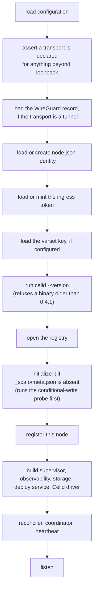

# Operating a fleet

> Boot, shutdown, upgrades, rotations and the routine checks.

## Boot sequence



What the node prints, once each, at boot:

| Line | Meaning |
|---|---|
| `scafo: celld 0.4.1 at "celld"` | The Celld binary the node probed, and its version. A binary older than 0.4.1, one that cannot be run, or one whose version cannot be read stops the boot here with `capability-missing`. |
| `scafo: observability on; this node records its own events in a ring of 512 …` | Observability is enabled. |
| `scafo: flushing them to "…" every 60s, keeping 30 days …` | Where observations go and for how long. |
| `scafo: no ingress access log configured …` | Observability is on but no access-log path was named, so this node counts no requests. This is the ordinary case, not a warning. |
| `scafo: this node serves the fleet's routing at /v1/ingress/routes … Traefik routers attach to entryPoint(s) …` | Point your ingress here. An ingress that was never pointed at the node API stays silent rather than failing. |
| the ingress-token notice | Where the token file is, and whether the token was minted or supplied. |
| `scafo <version> listening on <url> as node "<id>"` | The listener is up. |
| `scafo: process "<id>" exited with code <n>` | A supervised runtime process exited. Reporting only; the reconcile loop decides what to do. |

## Graceful shutdown

`SIGINT` or `SIGTERM` runs, in this order:

1. The reconciler closes intake **synchronously**, before any awaited work, so no timer can start a process while the node is leaving.
2. `drainingAt` is written to the node record. Best effort; it never throws.
3. Deploy intake is closed and in-flight deploy work cancelled.
4. The observation flusher stops.
5. The heartbeat stops.
6. The storage service stops, so held locks stop being restamped.
7. The coordinator stops and releases its lease, awaited — the next node takes it at once instead of waiting out the TTL.
8. The reconciler's in-flight pass quiesces.
9. The access-log tailer is read to the end and closed.
10. A final observation flush.
11. The listener closes.
12. Every running runtime process is stopped with the driver's grace.

### Stop grace

| Value | Source |
|---|---|
| Celld's own shutdown bound | `CELLD_SHUTDOWN_TOTAL_MS`, default 40000 |
| Supervisor grace per process | that value plus 5 s, so 45 s by default |
| Enclosing supervisor grace | **at least 50 s**, or `CELLD_SHUTDOWN_TOTAL_MS` plus at least 10 s when raised |

```yaml
# Compose
stop_grace_period: 50s
```

```ini
# systemd
TimeoutStopSec=50
```

::warning
The supervisor must signal the daemon alone, not every process beside it: the daemon drains its runtimes itself, in an order that matters. In containers keep the direct Node entrypoint as PID 1 in a private PID namespace.
::

The grace is a ceiling, not a fixed wait. With no requests in flight, a node normally stops much sooner.

## Draining a node

A graceful stop is the drain: `drainingAt` is written first, and the coordinator counts the node out on its next pass. A node that dies uncatchably cannot write it and must age past the 90-second liveness window before its environments are reassigned.

An ingress sharing the node's network namespace stays attached to the old namespace if only the node restarts. Restart the pair together:

```sh
docker compose restart node caddy
```

## Upgrading nodes

::steps

### Pin a version

Move the image tag or the installed binary on one host. `:edge` tracks every commit on `main`; version tags are releases.

### Restart that node alone

Its environments move to the remaining nodes while it is down, and rendezvous hashing moves them back when it returns. Allow the full stop grace.

### Verify before continuing

```sh
scafo health
scafo fleet nodes
```

The node should be `live` again, `scafo fleet nodes` should report the size you expect, and its `CELLD` and `SCAFO` columns should show the versions you moved it to. The `celld:` and `scafo:` lines under the count say how many nodes run each version, newest first, so a half-done roll reads as such.

### Repeat, one node at a time

::

Pin and review the Celld release along with the Scafo build. A Celld upgrade rolls the same way: a node whose Celld is older than 0.4.1 refuses to start, while a node already running keeps serving what it started with until it restarts. Celld itself supports a fleet running mixed releases during the roll; see its release notes for the pair you are moving between.

## Rotating the ingress token

Expand, migrate, contract. The node always moves first: an ingress reload refills its certificate cache from storage, so it must find a node that already accepts the token it is about to present.

::steps

### Expand

```sh
SCAFO_INGRESS_TOKEN="new,old"
```

Restart the node. Both tokens are accepted, primary first; the node's token file now holds the new one.

### Migrate

Reload each ingress with the new token, one at a time. Caddy reloads are graceful. Traefik's provider is static configuration, so it needs a restart.

### Contract

```sh
SCAFO_INGRESS_TOKEN="new"
```

Restart the node. The old token stops working.

::

Serving is unaffected throughout: certificates come from the in-memory cache and routes from the last document that parsed, so a mismatched window stalls renewals and route updates rather than handshakes and requests.

::note
An ingress token is a node's own. It authorizes that node's storage and routing APIs only, and rotating one node's token does not disturb another's.
::

## Rotating an operator key

```sh
scafo operator rotate --remote prod
```

The new key is registered as superseding the old one, proved against the node, and the old one is then dropped. `--keep-old` leaves both trusted; `--purge-old` deletes the old key file once it is untrusted. An operator cannot revoke its own key — rotation is the path.

## Taking things out of service

```sh
# Stop serving one environment, reversibly
scafo env retire --project shop --env preview
scafo env unretire --project shop --env preview

# Delete it once the 24h grace has passed, or immediately
scafo env delete --project shop --env preview
scafo env delete --project shop --env preview --force

# Stop a whole project: deploys, runtime, routing and certificates
scafo project block shop
scafo project unblock shop
```

Retiring takes the environment out of the routing document and stops its processes. Blocking a project does the same for every environment it owns and refuses new deploys with `project-blocked`. Both keep every record.

## Routine checks

```sh
scafo health                                     # this machine's node
scafo fleet nodes                                # the whole fleet, read from the bucket
curl -s -H "Authorization: Bearer $TOKEN" \
  http://127.0.0.1:7400/v1/state                 # this node's own view
scafo metrics --since 1h                         # what was served
scafo traces  --since 1h                         # what the nodes did
```

`scafo health` resolves the listener from the same environment and config file the daemon boots from — not from `sail` flags — so it follows a listener moved onto the tunnel. It is the container image's healthcheck. A listener chosen only with `sail --listen` is in neither source, so pass the same flag or set `SCAFO_LISTEN`.

`GET /v1/state` reports the node record, the coordinator lease and fence, whether this node coordinates, its processes, its placement views, its last reconcile pass, and any unplaced environments. Operator callers get it filtered to their project scope, marked `scoped: true`.

## Common responses

| Code | Status | Typical cause |
|---|---|---|
| `draining` | 503 | The routing routes, before this node's first reconcile pass. Retry in a few seconds. |
| `auth-invalid` | 401 | The token did not hold up: bad, expired, forged, replayed, or an unknown key. |
| `auth-scope` | 403 | The key is known, but the action is beyond its tier or projects. |
| `trust-mismatch` | 403 | A workload token verified, but no trust policy entry admits that subject. |
| `cas-conflict` | 409 | A concurrent registry write. Re-read and retry. |
| `placement-unavailable` | 409 | No live node was eligible, or the node's port range is exhausted. |
| `project-blocked` | 409 | The project is blocked. |
| `capability-missing` | 409 | This node accepts no deploys. |
| `deploy-overloaded` | 429 | Deploy concurrency, queue or staged-byte limits are full. |
| `deploy-timeout` | 408 | A receive, queue or task deadline passed. |
| `resource-limit` | 413 | The artifact exceeded the byte or entry bound. |
| `store-nonconforming` | 500 | The bucket did not honour conditional writes or ranged reads. |
| `not-found` | 404 | Includes a deploy id forgotten across a daemon restart. |

::read-more{to="/reference/errors"}
Every code, in full.
::

## Celld lease note

Each runtime process renews its lease every third of `CELLD_TTL_MS` (default `10000`) and retries a failed renewal inside the remaining lifetime. A process that loses its lease logs a line starting with `SELF-FENCE:` — `node_lease_watchdog_fence` for an expired lease, `node_lease_record_missing_fence` for a removed record, `node_lease_record_mismatch_fence` for a replaced one — exits with code 3, and is restarted by the node. `RUST_LOG=celld=info,store=debug` on the daemon makes every process log each read and write of its own lease with its `outcome`.

Change `CELLD_TTL_MS` consistently on **every** node: an unplanned takeover waits up to the lifetime.

Runtime policy is set through `runtime.celldEnv`, `--celld-env` or `SCAFO_CELLD_ENV`. Scafo adds no Celld policy defaults.

::read-more{to="/config/celld"}
Which Celld variables an operator may set, and which are reserved.
::
