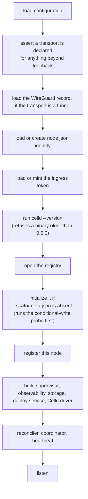

# Operating a fleet

> Boot, shutdown, upgrades, rotations and the routine checks.

## Boot sequence



What the node prints, once each, at boot:

| Line | Meaning |
|---|---|
| `scafo: celld 0.6.0 at "celld"` | The Celld binary the node probed, and its version. A binary older than 0.5.0, one that cannot be run, or one whose version cannot be read stops the boot here with `capability-missing`. |
| `scafo: observability on; this node records its own events in a ring of 512 …` | Observability is enabled. |
| `scafo: flushing them to "…" every 60s, keeping 30 days …` | Where observations go and for how long. |
| `scafo: no ingress access log configured …` | Observability is on but no access-log path was named, so this node counts no requests. This is the ordinary case, not a warning. |
| `scafo: this node serves the fleet's routing at /v1/ingress/routes … Traefik routers attach to entryPoint(s) …` | Point your ingress here. An ingress that was never pointed at the node API stays silent rather than failing. |
| the ingress-token notice | Where the token file is, and whether the token was minted or supplied. |
| `scafo <version> listening on <url> as node "<id>"` | The listener is up. |
| `scafo: process "<id>" exited with code <n>` | A supervised runtime process exited. Reporting only; the reconcile loop decides what to do. |

## Graceful shutdown

`SIGINT` or `SIGTERM` runs, in this order:

1. The reconciler closes intake **synchronously**, before any awaited work, so no timer can start a process while the node is leaving.
2. `drainingAt` is written to the node record. Best effort; it never throws.
3. Deploy intake is closed and in-flight deploy work cancelled.
4. The observation flusher stops.
5. The heartbeat stops.
6. The storage service stops, so held locks stop being restamped.
7. The coordinator stops and releases its lease, awaited — the next node takes it at once instead of waiting out the TTL.
8. The reconciler's in-flight pass quiesces.
9. The access-log tailer is read to the end and closed.
10. A final observation flush.
11. The listener closes.
12. Every running runtime process is stopped with the driver's grace.

### Stop grace

| Value | Source |
|---|---|
| Celld's own shutdown bound | `CELLD_SHUTDOWN_TOTAL_MS`, default 40000 |
| Supervisor grace per process | that value plus 5 s, so 45 s by default |
| Enclosing supervisor grace | **at least 50 s**, or `CELLD_SHUTDOWN_TOTAL_MS` plus at least 10 s when raised |

```yaml
# Compose
stop_grace_period: 50s
```

```ini
# systemd
TimeoutStopSec=50
```

::warning
The supervisor must signal the daemon alone, not every process beside it: the daemon drains its runtimes itself, in an order that matters. In containers keep the direct Node entrypoint as PID 1 in a private PID namespace.
::

The grace is a ceiling, not a fixed wait. With no requests in flight, a node normally stops much sooner.

## Draining a node

A graceful stop is the drain: `drainingAt` is written first, and the coordinator counts the node out on its next pass. A node that dies uncatchably cannot write it and must age past the 90-second liveness window before its applications are reassigned.

An ingress sharing the node's network namespace stays attached to the old namespace if only the node restarts. Restart the pair together:

```sh
docker compose restart node caddy
```

## Restarting or replacing a node

Whatever brings a node back — a restart, a re-created container, a new image tag, a reinstall — two things have to be the same on the other side:

- **Its id.** Each runtime process runs under it, and that is how the process finds what it left on disk.
- **Its state directory.** A write is acknowledged to the caller once a peer holds it there, before the bucket has a copy. Coming back on an empty directory is coming back without those writes. It also holds the ports each application is served on here, so a node that keeps it keeps publishing the same addresses; one that loses it hands its applications new ports.

An application's directory is kept on the node through every ordinary stop — retirement, blocking, reassignment, a drain. Only deleting the application from the registry clears it.

::warning
Do not "reset" a node by wiping its state directory. That is not a clean slate; it is acknowledged writes gone. Replacing hardware means moving or restoring the volume, not starting an empty one.
::

::read-more{to="/config/celld#durability-and-the-state-directory"}
What the node keeps there, and why.
::

## Upgrading nodes

There are two upgrades, and they are not the same procedure. Which one you are doing is decided by one question: **may the Celld the nodes run and the Celld they move to serve one fleet together?** They may when the Celld version does not change, and when the two releases are a rolling pair upstream declared — **0.5.0 ↔ 0.5.1**, see [mixed Celld versions](/config/celld#mixed-celld-versions). Then the upgrade rolls node by node. Any other move of Celld stops the whole installation, and that includes moving from 0.5.0 or 0.5.1 onto 0.6.0. The image bundles Celld, so moving the image tag usually moves both.

### A rolling upgrade

Every node keeps the Celld it was already running, or moves to the other release of a rolling pair. This one rolls node by node.

::steps

#### Pin a version

Move the image tag or the installed binary on one host. `:edge` tracks every commit on `main`; version tags are releases.

#### Restart that node alone

Its applications move to the remaining nodes while it is down, and rendezvous hashing moves them back when it returns. Allow the full stop grace, and bring it back under the same id and on the same state directory — see [restarting or replacing a node](#restarting-or-replacing-a-node).

#### Verify before continuing

```sh
scafo health
scafo fleet nodes
```

The node should be `live` again, `scafo fleet nodes` should report the size you expect, and its `SCAFO` column — and its `CELLD` column, when the upgrade moves Celld — should show the version you moved it to. Wait until its applications are served there again before you stop the next node: `scafo app show --name <app>` says `serving on N of M nodes`. That is upstream's own instruction for a rolling pair — stop one node, wait for its replacement to report healthy, then continue.

The `celld:` line names **one** version when Celld did not move. While a rolling pair is being crossed it names both halves of it — `celld: 0.5.1 on 1 node, 0.5.0 on 2` — the new one gaining a node each round. Any other second entry is a release outside the pair: that node refuses every application an answering peer serves on the other release (`version-skew`), and the fleet is in the state the next section exists to avoid.

#### Repeat, one node at a time

Until the `celld:` line names one version again. A second version there is work left to do.

::

### A stop-everything upgrade

Between two Celld releases that are not a rolling pair, a fleet takes one version: a node neither starts an application's process nor accepts a deploy for it while another answering node serving that application, or crash-looping on it, reports the other release (`version-skew`, 409). So this upgrade stops the whole installation rather than rolling it.

::warning
This is **upstream Celld's** requirement, not a limit scafo chose. A Celld release can change the format of the fleet state in the bucket, and a newer binary that upgrades that format will not do so while an older node still holds a lease in it — while an older binary writing after the upgrade corrupts what the newer one wrote. Neither failure is one scafo can repair afterwards. Read the release notes for the pair you are moving between at [denoland/celld](https://github.com/denoland/celld); a pair whose notes say it may be taken as a rolling update, and which scafo lists, rolls instead.
::

A Celld release can also change what an application's code must look like, apart from the upgrade itself. Scafo hands each application's Wrangler config and code to Celld untouched, so what an application needs on the release you move onto is in that release's notes — for 0.6.0, the [v0.6.0 release notes](https://github.com/denoland/celld/releases/tag/v0.6.0) — and nothing in scafo stands in for reading them first.

::steps

#### Freeze deploys

```sh
scafo fleet freeze --reason "moving every node to a new Celld release"
```

Admin only. Every node then refuses deploy intake with `deploys-frozen` before anything is created. Serving, reconciliation, retirement and `scafo app delete` carry on, so this changes nothing an application's traffic can see.

#### Stop every node of the installation

Every one, not one at a time. Allow the full stop grace on each, so each drains its runtime processes in order.

#### Wait out the liveness window

A stopped node keeps counting as *answering* — and so keeps blocking the applications it served — for **90 seconds** after its last heartbeat. That holds for a node stopped gracefully too: `drainingAt` takes it out of placement at once, but a draining node still counts as answering, because until it is gone its process holds a lease in the fleet.

#### Back up the bucket and the node state

The registry, the applications' Celld fleets and the certificates are all in the bucket; each node's identity and ingress token are in its state directory. Take both before a binary that may change the fleet format runs against them.

#### Move every node to the new image or binary

The same version everywhere. A node whose Celld is older than the floor refuses to start at all, with `capability-missing`.

#### Start them, and check one version everywhere

```sh
scafo fleet nodes
```

The `celld:` line must name exactly one version — `celld: X.Y.Z on 3 nodes` — with nothing `unreported` beside it. A second entry there is a node that has not been moved, and every application it serves is still refusing.

#### Unfreeze

```sh
scafo fleet unfreeze
```

::

Pin and review the Celld release along with the Scafo build.

## Rotating the ingress token

Expand, migrate, contract. The node always moves first: an ingress reload refills its certificate cache from storage, so it must find a node that already accepts the token it is about to present.

::steps

### Expand

```sh
SCAFO_INGRESS_TOKEN="new,old"
```

Restart the node. Both tokens are accepted, primary first; the node's token file now holds the new one.

### Migrate

Reload each ingress with the new token, one at a time. Caddy reloads are graceful. Traefik's provider is static configuration, so it needs a restart.

### Contract

```sh
SCAFO_INGRESS_TOKEN="new"
```

Restart the node. The old token stops working.

::

Serving is unaffected throughout: certificates come from the in-memory cache and routes from the last document that parsed, so a mismatched window stalls renewals and route updates rather than handshakes and requests.

::note
An ingress token is a node's own. It authorizes that node's storage and routing APIs only, and rotating one node's token does not disturb another's.
::

## Rotating an operator key

```sh
scafo operator rotate --remote prod
```

The new key is registered as superseding the old one, proved against the node, and the old one is then dropped. `--keep-old` leaves both trusted; `--purge-old` deletes the old key file once it is untrusted. An operator cannot revoke its own key — rotation is the path.

## Taking things out of service

```sh
# Stop serving one application, reversibly
scafo app retire   --name shop-preview
scafo app unretire --name shop-preview

# Delete it once the 24h grace has passed, or immediately
scafo app delete --name shop-preview
scafo app delete --name shop-preview --force

# Stop an application entirely: deploys, runtime, routing and certificates (admin only)
scafo app block   --name shop
scafo app unblock --name shop

# Stop every deploy of the installation, leaving serving alone (admin only)
scafo fleet freeze --reason "quarterly maintenance"
scafo fleet unfreeze
```

Retiring takes the application out of the routing document and stops its processes, reversibly for as long as its grace runs. Blocking does the same and also refuses new deploys with `application-blocked`; it is an admin's decision about an application the fleet hosts. Both keep every record.

Freezing is narrower than either, and fleet-wide: it stops **deploy intake only**, everywhere, with `deploys-frozen`, and the refusal names when, by whom, why and that `scafo fleet unfreeze` lifts it. Processes keep running, routes stay published, reconciliation and retirement carry on, and `scafo app delete` still works. The freeze lives at `_scafo/freeze.json`; its absence is what "this fleet takes deploys" means, and `scafo fleet nodes` prints a line for it while it stands. Setting it twice keeps the first admin's record, stamp and reason included.

## Bucket growth

Celld keeps every deployment it has ever published for an application and deletes none of them, so a long-lived application's fleet prefix grows with every deploy. Nothing reclaims that on its own.

```sh
scafo deployment prune --name shop --dry-run
scafo deployment prune --name shop
```

It keeps the newest `--keep` (default 10) and deletes only what is **also** older than `--older-than` (default 24h) — both gates always weighed — and never a version a Celld pointer names. It then collects the shared asset blobs and saved container images no kept deployment references, once they are older than the same window. It reads and deletes the bucket directly and calls no node, but it does read the node records there: at least one node must be heartbeating, so the command knows which Celld release the installation runs.

**Nothing runs it for you.** Until scafo automates retention, schedule it yourself — a cron entry or a CI job per application is enough, with bucket credentials and nothing else. `--yes` answers the confirmation a terminal would be asked:

```sh
# every night at 03:00, keep the newest 10 deployments and anything younger than a day
0 3 * * *  scafo deployment prune --name shop --yes
```

A run that is refused (a Celld release this build was not verified against, no node heartbeating) exits non-zero and deletes nothing, so a failing schedule is safe to leave failing until you look.

::warning
The command is unstable until Celld has a deployment lifecycle of its own, and warns on every run. It runs only while a node is answering on a Celld release this build of scafo was verified against, and refuses with `capability-missing` otherwise — so prune before a stop-everything upgrade stops the fleet, or after it is back up, never in between. Do not run it with `--older-than 0` while anyone is deploying: a deploy in flight uploads its files before it is visible.
::

::read-more{to="/reference/cli#scafo-deployment-prune"}
Every flag, what a pointer protects, and what prune never touches.
::

## What an installation costs its bucket

Scafo's own idle request rate is small, and **flat in the number of applications**: a node hosting three applications and a node hosting three hundred make the same requests on a quiet minute. Every number below is derived from the defaults on this page; change a default and the arithmetic moves with it.

Per node, per minute, on an installation where nothing is happening:

| What | Cadence | Requests per minute |
|---|---|---|
| Reconcile pass reads the change hint | every 5 s | 12 `GET` |
| Heartbeat stamps the node record | every 30 s | 2 `GET` + 2 `PUT` (it is a read-modify-write) |
| Full resync lists the three kinds | every 60 s | 3 listings |
| Node re-read lists the node records | every 30 s, one of the two shared with the resync | 1 listing |
| **Subtotal** | | **14 `GET`, 2 `PUT`, 4 listings** |

And on whichever node currently holds the coordinator lease, on top of that:

| What | Cadence | Requests per minute |
|---|---|---|
| Lease renewal | every 15 s, a third of the 45 s TTL | 4 `PUT` |
| The coordinator tick reads the change hint | every 15 s | 4 `GET` |
| Reap sweep lists the deploy history | every 10 min | 1 listing per 10 minutes |
| **Subtotal** | | **4 `GET`, 4 `PUT`, and a listing every tenth minute** |

So roughly **20 requests per minute for an ordinary node and 28 for the coordinator**, with a handful of extra reads whenever something actually changes — a listing of the kinds that could have moved, and a `GET` of each record whose ETag moved with them. A reap sweep past the first reads no deploy records at all: a terminal record never moves again, so it is read once and judged from what the coordinator already holds.

`pnpm scale` in the source repository counts these requests by driving the real reconcile, coordinator and deploy code against a metered store, from 5 applications to 5,000, and the test suite holds them to those budgets.

::warning
**Celld is the other half of the bill, and the larger one.** Each Celld process polls the bucket on its own seconds-scale cadence: it renews its lease about every 3 seconds, samples capacity about every 5, and reads the deployment pointer about every 30. Those cadences are upstream Celld's, documented at [denoland/celld](https://github.com/denoland/celld), and scafo neither sets nor tunes them.

Scafo runs **one Celld process per application per node**, so that traffic multiplies by the applications a node serves — which is exactly the axis scafo's own cost is flat in.

**Measured with Celld 0.5.0:** an installation of two nodes and ten applications that nobody is calling — twenty Celld processes — asked its bucket for about **1,380 requests a minute**: some 600 `GET`, 550 `PUT` and 200–230 listings. About 55–60 of them touched scafo's own keys, the same number as with three applications; the other 1,320, around **66 a minute for each Celld process**, touched Celld's. That is roughly 60 million requests a month for an installation at rest, more than half of them in the class providers charge most for, and it grows with applications × nodes. The store's latency changed none of it.

**So, as of Celld 0.5.0, use a flat-rate object store, or a self-hosted S3-compatible one on hardware you already pay for.** A store billed per request is a poor fit today: on typical per-request prices that idle installation is a three-figure monthly bill before it serves anything.

`pnpm scale:real` in the source repository reproduces the measurement on your own machine, against a real store, under the node sizes and store latencies you give it.
::

::read-more{to="/docs/registry#how-a-node-follows-the-registry"}
Why a quiet pass costs one `GET`.
::

## Sizing a node

Measured with Celld 0.5.0 on two nodes serving ten small applications each, with nobody calling them, under node sizes from 1 CPU / 2 GB to 4 CPUs / 8 GB and a store answering in 0, 100 and 300 ms (`pnpm scale:real` in the source repository runs the same sweep on your machine):

| What | Measured |
|---|---|
| Memory of one idle runtime process | about 65–80 MiB |
| A node serving ten idle applications | about 0.5–0.7 GiB, the node itself under 60 MiB of it |
| CPU at rest, and while deploying | 2–4 % of one core; identical on 1, 2 and 4 CPUs |
| One deploy, store at 0 / 100 / 300 ms | 1.2 s / 4.7 s / 11.7 s |
| Ten deploys at once | 2 s / 21 s / 61 s — queued, one at a time, none refused |
| A restarted node serving everything again | 6–21 s, on the ports each application already held |

What follows from it:

- **Memory is what a node runs out of, not CPU.** Count one runtime process per application the node serves and leave room for what they do under load: very roughly 25 idle applications on a 2 GB node and 50 on a 4 GB one. Your applications' own memory comes on top, and traffic was not part of this measurement.
- **The store's latency is the platform's latency.** Every deploy, every convergence and every restart stretched with it, and nothing else in the sweep moved them. A bucket close to the nodes matters more than a bigger node.
- Nothing in the sweep was killed for memory, missed a deadline, failed a deploy or changed port, on any size.

Use `replicas` and node selectors to keep an application off nodes that have no room for it — see [placement](/docs/placement).

## Routine checks

```sh
scafo health                                     # this machine's node
scafo fleet nodes                                # the whole fleet, read from the bucket
curl -s -H "Authorization: Bearer $TOKEN" \
  http://127.0.0.1:7400/v1/state                 # this node's own view
scafo metrics --since 1h                         # what was served
scafo traces  --since 1h                         # what the nodes did
```

`scafo health` resolves the listener from the same environment and config file the daemon boots from — not from `sail` flags — so it follows a listener moved onto the tunnel. It is the container image's healthcheck. A listener chosen only with `sail --listen` is in neither source, so pass the same flag or set `SCAFO_LISTEN`.

`GET /v1/state` reports the node record, the coordinator lease and fence, whether this node coordinates, its processes, its placement views, its last reconcile pass, and any unplaced applications. Operator callers get it filtered to their application scope, marked `scoped: true`.

## Common responses

| Code | Status | Typical cause |
|---|---|---|
| `draining` | 503 | The routing routes, before this node's first reconcile pass. Retry in a few seconds. |
| `auth-invalid` | 401 | The token did not hold up: bad, expired, forged, replayed, or an unknown key. |
| `auth-scope` | 403 | The key is known, but the action is beyond its tier or applications. |
| `trust-mismatch` | 403 | A workload token verified, but no trust policy entry admits that subject. |
| `cas-conflict` | 409 | A concurrent registry write. Re-read and retry. |
| `placement-unavailable` | 409 | No live node was eligible, or the node's port range is exhausted. |
| `application-blocked` | 409 | The application is blocked. |
| `deploys-frozen` | 409 | An admin has frozen this fleet's deploys. Refused at intake, before anything is created. |
| `version-skew` | 409 | Another answering node serves that application, or is crash-looping on it, on a different Celld version, outside a rolling pair upstream declared. |
| `capability-missing` | 409 | This node accepts no deploys. |
| `deploy-overloaded` | 429 | The node's deploy queue or staged-byte limits are full. Carries a `retry-after`; `scafo deploy` waits and comes back unless `--no-wait`. |
| `deploy-timeout` | 408 | A receive, queue or task deadline passed. |
| `resource-limit` | 413 | The artifact exceeded the byte or entry bound. |
| `store-nonconforming` | 500 | The bucket did not honour conditional writes or ranged reads. |
| `store-unavailable` | 503 | The store stopped answering, and the write was repeated until the tries ran out. |
| `not-found` | 404 | Includes a poll for a deploy whose record has been deleted — a finished deploy's record is kept for seven days. |

::read-more{to="/reference/errors"}
Every code, in full.
::

## Celld lease note

Each runtime process renews its lease every third of `CELLD_TTL_MS` (default `10000`) and retries a failed renewal inside the remaining lifetime. A process that loses its lease logs a line starting with `SELF-FENCE:` — `node_lease_watchdog_fence` for an expired lease, `node_lease_record_missing_fence` for a removed record, `node_lease_record_mismatch_fence` for a replaced one — exits with code 3, and is restarted by the node. `RUST_LOG=celld=info,store=debug` on the daemon makes every process log each read and write of its own lease with its `outcome`.

Change `CELLD_TTL_MS` consistently on **every** node: an unplanned takeover waits up to the lifetime.

Runtime policy is set through `runtime.celldEnv`, `--celld-env` or `SCAFO_CELLD_ENV`. Scafo adds no Celld policy defaults.

::read-more{to="/config/celld"}
Which Celld variables an operator may set, and which are reserved.
::
