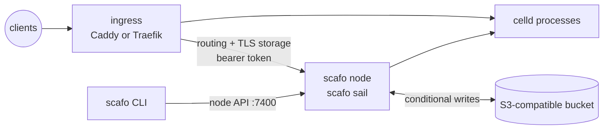

# Deploy

> The prerequisites every Scafo installation shares, and the recipe to follow for each kind of host and ingress.

Each recipe below runs one or more Scafo nodes against one S3-compatible bucket, and puts an ingress in front of them. The ingress always pulls: Caddy reads `/v1/ingress/routes` through the `scafo` dynamic-upstreams module, Traefik reads `/v1/ingress/routes/traefik` through its http provider. The node writes no ingress configuration.



## Common prerequisites

### Object store

An S3-compatible bucket that supports conditional writes with `If-Match` and `If-None-Match`. It is the whole registry: no recipe creates it, and the node refuses to boot without `SCAFO_S3_ENDPOINT`, `SCAFO_S3_BUCKET`, `SCAFO_S3_ACCESS_KEY` and `SCAFO_S3_SECRET_KEY`.

One bucket-and-prefix pair is one fleet. Every node pointed at the same bucket and the same `SCAFO_S3_PREFIX` is one installation; nothing else joins two nodes together. Use separate buckets or prefixes for separate installations.

::warning
The bucket is both the durable registry and the availability boundary. It must provide reliable, low-latency conditional writes. Bucket credentials are fleet-root authority — they never reach the ingress.
::

### DNS

Point an apex record and a wildcard record for the platform domain at the machines that terminate TLS, for example `apps.example.com` and `*.apps.example.com`. The same domain goes in `SCAFO_PLATFORM_DOMAINS` (comma-separated, no scheme and no wildcard); without it, applications get no host.

A wildcard DNS record does not imply a wildcard certificate. Whether the platform domain is covered by one wildcard certificate (DNS-01) or by a certificate per host (HTTP-01 or TLS-ALPN, issued on first request) is per recipe.

### Ports

On every host that terminates TLS, open TCP 80 and 443 and UDP 443 to the world. The node API on port 7400 is not one of them — it stays on loopback, on a private container network, or on the WireGuard tunnel, depending on the recipe.

With the WireGuard transport, also open UDP 51820 between the hosts.

### Ingress token

The ingress presents one bearer token to `/v1/ingress/routes` and `/v1/storage` on the node's own listener. Generate one per installation, or per host where the recipe says so:

```sh
openssl rand -hex 32
```

It goes to the node as `SCAFO_INGRESS_TOKEN` and to the ingress through whatever mechanism that ingress has. It is the only credential the ingress ever holds.

::read-more{to="/docs/security"}
::

### Persistent state

Every recipe keeps the node's state directory (`SCAFO_STATE_DIR`, `/var/lib/scafo` in the image) on storage that survives the node being **re-created**, not only restarted: a named volume, a retained claim, a real host directory. It holds the node's identity and the working directory of every runtime process — and a write is acknowledged to the caller once a peer holds it there, before the bucket has a copy of it. Starting on an empty one starts without those writes.

The node id has to be stable for the same reason. Neither it nor the directory may change when you move the node to a newer image.

::read-more{to="/config/celld#durability-and-the-state-directory"}
What lives there, and what is lost without it.
::

### Shutdown grace

Give the node at least 50 seconds between `SIGTERM` and `SIGKILL`, so it can drain its runtimes. If `CELLD_SHUTDOWN_TOTAL_MS` is raised above its 40-second default, use that value plus at least 10 seconds instead.

In containers this is `stop_grace_period: 50s` (Compose), `--stop-timeout 50` (`docker run`) or `terminationGracePeriodSeconds: 50` (Kubernetes). Under systemd it is `TimeoutStopSec=50s`.

### Process layout

In a container, the Node entrypoint must stay PID 1 in a private PID namespace. Do not use host PID mode, and do not wrap the entrypoint in a persistent supervisor. On a bare host, use the installer's systemd unit or an equivalent cgroup-owning supervisor that signals the daemon itself rather than every process beside it.

### Private node API

The node API and the runtime listeners default to loopback. Widening the listener requires an explicit transport decision: `SCAFO_TRANSPORT=none` states that the network the node binds is already private and trusted, `SCAFO_TRANSPORT=wireguard` puts node and runtime traffic on a tunnel. Publish only the application ingress.

## The recipes

| Recipe | Hosts | Ingress | TLS |
|---|---|---|---|
| [Docker Compose](/deploy/compose) | one host, Docker | `scafo-caddy` colocated, shared network namespace | on-demand per host, gated by `/v1/ingress/ask` |
| [Bare metal](/deploy/bare-metal) | one Linux host, systemd | `scafo-caddy` colocated, installer-written unit | on-demand per host, gated by `/v1/ingress/ask` |
| [VPS mesh](/deploy/vps) | two or more VPSs, WireGuard | `scafo-caddy` per host, `-dns` flavour | DNS-01 wildcard for the platform domain, on-demand for custom domains |
| [K3s and RKE2](/deploy/k3s) | a cluster | the bundled Traefik, http provider | cert-manager wildcard, Traefik HTTP-01 for custom domains |
| [Coolify](/deploy/coolify) | a Coolify server | Coolify's Traefik, http provider | Coolify's Let's Encrypt resolver, HTTP-01 per host |
| [Dokploy](/deploy/dokploy) | a Dokploy server | Dokploy's Traefik, http provider | Dokploy's `letsencrypt` resolver, HTTP-01 per host |

[The container image](/deploy/image) documents the image the first six recipes run, its tags, and the `scafo-caddy` images and flavours.

## Choosing by ingress

**No ingress on the host yet — run `scafo-caddy` beside the node.** The Compose, bare-metal and VPS recipes take this shape. Caddy holds no bucket credential: it keeps certificates, ACME account material and locks in the bucket by asking the colocated node over `/v1/storage`, and reads the fleet's routing from `/v1/ingress/routes`. Both calls carry the ingress token. `scafo-caddy` is the only Caddy build that can do it — upstream Caddy carries neither module.

**A Traefik already runs in front of everything on this host or cluster — teach it the http provider.** The K3s, Coolify and Dokploy recipes take this shape. Traefik polls `/v1/ingress/routes/traefik` with an `Authorization: Bearer` header and gets native Traefik dynamic configuration back; its routers arrive as `<host>@http` beside the platform's own. That needs Traefik v3, because `providers.http.headers` is what presents the token; Traefik 2.x has no such setting. TLS is then whatever that Traefik already does, and `SCAFO_TRAEFIK_ENTRYPOINTS` names the entryPoint Scafo's routers attach to.

::note
Both paths poll. A node restart does not reconfigure the ingress: Caddy keeps the last routing document that parsed, and Traefik keeps its previous configuration.
::

::read-more{to="/docs/ingress-caddy"}
::

::read-more{to="/docs/ingress-traefik"}
::
