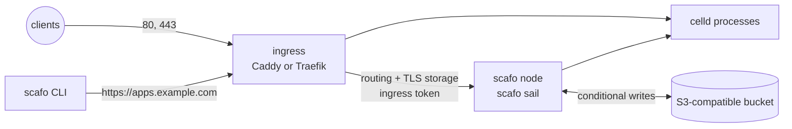

# Deploy

> The prerequisites every Scafo installation shares, the recipe to follow for each kind of host and ingress, and the first deploy that is the same on all of them.

Each recipe runs one or more Scafo nodes against one S3-compatible bucket and puts an ingress in front of them. The ingress pulls: Caddy reads `/v1/ingress/routes` through the `scafo` dynamic-upstreams module, Traefik reads `/v1/ingress/routes/traefik` through its http provider. The node writes no ingress configuration, and nothing but the ingress ever talks to the node's own listener. Operators reach the fleet through the ingress too, at the platform apex.



## Common prerequisites

### Object store

An S3-compatible bucket that supports conditional writes with `If-Match` and `If-None-Match`. It is the whole registry: no recipe creates it, and the node refuses to boot without `SCAFO_S3_ENDPOINT`, `SCAFO_S3_BUCKET`, `SCAFO_S3_ACCESS_KEY` and `SCAFO_S3_SECRET_KEY`.

Prefer a **flat-rate or self-hosted** store over one billed per request: every runtime process polls the bucket several times a minute whether or not anyone is calling it, and that adds up to tens of millions of requests a month for a small installation. See [what an installation costs its bucket](/docs/operations#what-an-installation-costs-its-bucket).

One bucket-and-prefix pair is one fleet. Every node pointed at the same bucket and the same `SCAFO_S3_PREFIX` is one installation; nothing else joins two nodes together. Use separate buckets or prefixes for separate installations.

::warning
The bucket is both the durable registry and the availability boundary. It must provide reliable, low-latency conditional writes. Bucket credentials are fleet-root authority: they live on the nodes and in the shell that mints the first operator key, and never reach the ingress.
::

### DNS

Point an apex record and a wildcard record for the platform domain at the machines that terminate TLS, for example `apps.example.com` and `*.apps.example.com`. The same domain goes in `SCAFO_PLATFORM_DOMAINS` (no scheme, no wildcard); without it, applications get no host.

Do this before the first deploy, not after: the apex is also how the CLI reaches the fleet, and the recipes assume it resolves.

A wildcard DNS record does not imply a wildcard certificate. Whether the platform domain is covered by one wildcard certificate (DNS-01) or by a certificate per host (HTTP-01 or TLS-ALPN, issued on first request) is per recipe.

### Ports

On every host that terminates TLS, open TCP 80 and 443, plus UDP 443 where the recipe's ingress speaks HTTP/3. With the WireGuard transport, also open UDP 51820 between the hosts.

Nothing else is opened, published or forwarded. The node API is not a port of the host in any recipe: see [the node API](#the-node-api).

### Ingress token

The ingress presents one bearer token to `/v1/ingress/routes` and `/v1/storage` on the node's own listener. Generate one per installation, or per host where the recipe says so:

```sh
openssl rand -hex 32
```

It goes to the node as `SCAFO_INGRESS_TOKEN` and to the ingress through whatever mechanism that ingress has. It is the only credential the ingress ever holds.

::read-more{to="/docs/security"}
::

### Persistent state

Every recipe keeps the node's state directory (`SCAFO_STATE_DIR`, `/var/lib/scafo` in the image) on storage that survives the node being **re-created**, not only restarted: a named volume, a retained claim, a real host directory. It holds the node's identity and the working directory of every runtime process, and a write is acknowledged to the caller once a peer holds it there, before the bucket has a copy. Starting on an empty one starts without those writes.

The node id has to be stable for the same reason. Neither it nor the directory may change when you move the node to a newer image.

::read-more{to="/config/celld#durability-and-the-state-directory"}
What lives there, and what is lost without it.
::

### Shutdown grace

Give the node at least 50 seconds between `SIGTERM` and `SIGKILL`, so it can drain its runtimes. If `CELLD_SHUTDOWN_TOTAL_MS` is raised above its 40-second default, use that value plus at least 10 seconds instead.

In containers this is `stop_grace_period: 50s` (Compose), `--stop-timeout 50` (`docker run`) or `terminationGracePeriodSeconds: 50` (Kubernetes). Under systemd it is `TimeoutStopSec=50s`.

### Process layout

In a container, the Node entrypoint must stay PID 1 in a private PID namespace. Do not use host PID mode, and do not wrap the entrypoint in a persistent supervisor. On a bare host, use the installer's systemd unit or an equivalent cgroup-owning supervisor that signals the daemon itself rather than every process beside it.

## The node API

The node's own listener, `127.0.0.1:7400` by default, carries everything privileged: deploy intake, operator commands, the routing document and the TLS storage the ingress keeps private keys in. Two parties need it, and both are already next to the node:

- **The ingress**, which reads routing and storage from it with the ingress token. A colocated Caddy shares the node's network namespace and dials loopback; a platform's Traefik dials the node over the container network it shares with it.
- **The node itself**, whose health probe asks it.

Operators are not a third. The node serves its API at the platform apex through the ingress by default (`SCAFO_API_PUBLIC`), with `/v1/storage` and `/v1/ingress/routes` denied there, so `scafo remote add prod --endpoint https://apps.example.com` is the operator path on every recipe, from any machine, over the TLS the ingress already terminates. No recipe publishes port 7400 to a host, a loopback included: a listener nothing uses is only a surface, and a host-loopback publish is one edit away from a public one.

Widening the listener beyond loopback is a transport decision: `SCAFO_TRANSPORT=none` states that the network the node binds is already private and trusted (a container bridge, a pod network), `SCAFO_TRANSPORT=wireguard` puts node and runtime traffic on a tunnel. The recipes that need one say which and why; the ones that do not leave the defaults alone.

::read-more{to="/docs/nodes#transports"}
What each transport changes about the listener, the advertised address and the runtime binds.
::

### Without the apex

If `SCAFO_API_PUBLIC=0` leaves the apex unrouted, or the DNS record does not exist yet, the API is reached only where it listens, through a tunnel you open for the occasion:

| Recipe | The API listens on | Reach it with |
|---|---|---|
| Bare metal | the host's loopback | `ssh -L 7400:127.0.0.1:7400 <host>` |
| VPS mesh | the host's tunnel address | `ssh -L 7400:10.83.0.1:7400 <host>` |
| K3s and RKE2 | the pod network | `kubectl -n scafo port-forward svc/scafo-nodes 7400:7400` |
| Coolify, Dokploy | the container's bridge address | add `ports: ["127.0.0.1:7400:7400"]` to the node service for the duration, then `ssh -L 7400:127.0.0.1:7400 <host>`; remove the publish after |
| Compose | the container's loopback | nothing reaches it, a publish included: a published port forwards to the container's bridge address, not its loopback. Set `SCAFO_LISTEN: 0.0.0.0:7400` and `SCAFO_TRANSPORT: none` beside the publish above, for the duration, and revert all three after |

Then name the forwarded end on each command, `--node http://127.0.0.1:7400`, or register it as the remote's endpoint. The forward is yours and goes away with the shell; nothing in the recipe stays open for it.

::read-more{to="/config/operator#the-endpoint"}
How a command resolves which node it talks to.
::

## The recipes

| Recipe | Hosts | Ingress | TLS |
|---|---|---|---|
| [Docker Compose](/deploy/compose) | one host, Docker | `scafo-caddy` colocated, shared network namespace | on-demand per host the fleet routes |
| [Bare metal](/deploy/bare-metal) | one Linux host, systemd | `scafo-caddy` colocated, installer-written unit | on-demand per host the fleet routes |
| [VPS mesh](/deploy/vps) | two or more VPSs, WireGuard | `scafo-caddy` per host, `-dns` flavour | DNS-01 wildcard for the platform domain, on-demand for custom domains |
| [K3s and RKE2](/deploy/k3s) | a cluster | the bundled Traefik, http provider | cert-manager wildcard, Traefik HTTP-01 for custom domains |
| [Coolify](/deploy/coolify) | a Coolify server | Coolify's Traefik, http provider | Coolify's Let's Encrypt resolver, HTTP-01 per host |
| [Dokploy](/deploy/dokploy) | a Dokploy server | Dokploy's Traefik, http provider | Dokploy's `letsencrypt` resolver, HTTP-01 per host |

[The container image](/deploy/image) documents the image the first six recipes run, its tags, and the `scafo-caddy` images and flavours.

### Choosing by ingress

**No ingress on the host yet: run `scafo-caddy` beside the node.** The Compose, bare-metal and VPS recipes take this shape. Caddy holds no bucket credential: it keeps certificates and their locks in the bucket by asking the colocated node over `/v1/storage`, and reads the fleet's routing from `/v1/ingress/routes`. Both calls carry the ingress token. The image runs from environment variables alone, and one Caddy can front several fleets. `scafo-caddy` is the only Caddy build that can do it; upstream Caddy carries none of its `scafo` modules.

**A Traefik already runs in front of everything on this host or cluster: teach it the http provider.** The K3s, Coolify and Dokploy recipes take this shape. Traefik polls `/v1/ingress/routes/traefik` with an `Authorization: Bearer` header and gets native Traefik dynamic configuration back; its routers arrive as `<host>@http` beside the platform's own. That needs Traefik v3, because `providers.http.headers` is what presents the token; Traefik 2.x has no such setting. TLS is then whatever that Traefik already does, and `SCAFO_TRAEFIK_ENTRYPOINTS` names the entryPoint Scafo's routers attach to.

::note
Both paths poll. A node restart does not reconfigure the ingress: Caddy keeps the last routing document that parsed, and Traefik keeps its previous configuration.
::

::read-more{to="/docs/ingress-caddy"}
::

::read-more{to="/docs/ingress-traefik"}
::

## First deploy

The same on every recipe. The fleet trusts no operator key until somebody mints one, and no node holds one: the first key is minted on your own machine, never on a server or inside a container, and it talks to the fleet through the apex.

::steps

### Install the CLI

On your own machine.

```sh
npm install --global scafo
```

### Give the shell the nodes' bucket values

`scafo remote add --register` writes the key's public half straight into the registry, with no daemon involved, so this one shell needs the same values the nodes run with. Each recipe says where it put them.

```sh
export SCAFO_S3_ENDPOINT="https://s3.example.com"
export SCAFO_S3_BUCKET="scafo"
export SCAFO_S3_ACCESS_KEY="<access key>"
export SCAFO_S3_SECRET_KEY="<secret key>"
export SCAFO_S3_REGION="us-east-1"
export SCAFO_S3_PREFIX="scafo"
```

`SCAFO_S3_PREFIX` must be the nodes': a different prefix is a different, empty installation.

### Mint and register the first admin key

`--endpoint` is the apex in `SCAFO_PLATFORM_DOMAINS`, which the ingress routes to the node API.

```sh
scafo remote add prod --endpoint https://apps.example.com --register
```

The key it minted stays in your operator home, `~/.scafo` unless `SCAFO_HOME` says otherwise. Nothing can reissue it; back it up. Every later command goes through the remote and needs no bucket value.

### Confirm the fleet

```sh
scafo fleet nodes
```

Every node is listed with its `CELLD` and `SCAFO` versions. `scafo: no node is registered in this bucket; a machine joins the fleet by running "scafo sail"` means this shell is reading a different bucket or prefix than the nodes write.

### Deploy

```sh
scafo deploy ./my-app --name shop
curl -sS https://shop.apps.example.com/
```

### Hand it to CI

A job deploys with its provider's OIDC token and no operator key at all, once [`scafo trust set`](/docs/deploying#deploying-from-ci-with-oidc) has written the application's trust policy into the same bucket.

::

::read-more{to="/docs/deploying"}
Deploy flags, admission bounds, watching status and OIDC deploys.
::

::read-more{to="/docs/operators"}
Operator keys, roles, application scopes, remotes and rotation.
::
