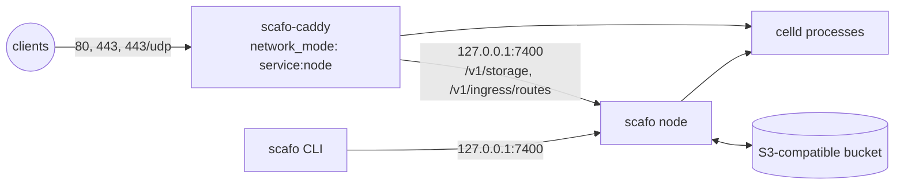

# Docker Compose

> One Scafo node and its colocated `scafo-caddy` ingress on a single host, with an external S3-compatible bucket.

Two services share one network namespace: the node publishes 80, 443 and 443/udp, Caddy runs inside that namespace and reaches the node over loopback. The bucket is provisioned outside Compose.



::::steps

### Prepare the host

Provision an S3-compatible bucket that supports `If-Match` and `If-None-Match` conditional writes and `Range` reads. Create a wildcard DNS record such as `*.apps.example.com`, plus the apex, pointing at this host. Allow TCP 80 and 443 plus UDP 443.

### Write the Compose file

Put `compose.yaml` and `.env` in one directory. Caddy needs no configuration file of its own: the image ships its Caddyfile and reads the rest from its environment.

```yaml [compose.yaml]
# Single-host production fleet. The S3 bucket is provisioned outside Compose.
services:
  node:
    image: ghcr.io/sandros94/scafo:${SCAFO_VERSION:?set SCAFO_VERSION in .env}
    restart: unless-stopped
    stop_grace_period: 50s
    ports:
      - "80:80"
      - "443:443"
      - "443:443/udp"
      # Deploy and storage APIs stay on host loopback.
      - "127.0.0.1:7400:7400"
    volumes:
      - state:/var/lib/scafo
      - ingress-log:/var/log/scafo-ingress
    environment:
      SCAFO_S3_ENDPOINT: ${SCAFO_S3_ENDPOINT:?set SCAFO_S3_ENDPOINT in .env}
      SCAFO_S3_BUCKET: ${SCAFO_S3_BUCKET:?set SCAFO_S3_BUCKET in .env}
      SCAFO_S3_ACCESS_KEY: ${SCAFO_S3_ACCESS_KEY:?set SCAFO_S3_ACCESS_KEY in .env}
      SCAFO_S3_SECRET_KEY: ${SCAFO_S3_SECRET_KEY:?set SCAFO_S3_SECRET_KEY in .env}
      SCAFO_S3_REGION: ${SCAFO_S3_REGION:-us-east-1}
      SCAFO_S3_PREFIX: ${SCAFO_S3_PREFIX:-scafo}
      SCAFO_PLATFORM_DOMAINS: ${SCAFO_PLATFORM_DOMAINS:?set SCAFO_PLATFORM_DOMAINS in .env}
      SCAFO_LISTEN: 0.0.0.0:7400
      # `none` declares this single-host Docker network trusted.
      SCAFO_TRANSPORT: none
      SCAFO_ADVERTISE: 127.0.0.1:7400
      SCAFO_INGRESS_TOKEN: ${SCAFO_INGRESS_TOKEN:?set SCAFO_INGRESS_TOKEN in .env}
      SCAFO_OBSERVABILITY: "1"
      SCAFO_INGRESS_ACCESS_LOG: /var/log/scafo-ingress/access.log
    healthcheck:
      # The image's own probe, which reads this service's configuration and asks
      # whatever it says the node bound. Only the timings are tightened here, so
      # `depends_on: service_healthy` releases Caddy as soon as the node answers.
      test: ["CMD", "node", "/app/dist/cli/index.mjs", "health"]
      interval: 5s
      timeout: 5s
      retries: 30
      start_period: 10s

  caddy:
    # The image's own Caddyfile is the whole configuration: it reads the fleet
    # from the environment below, keeps certificates in the bucket through the
    # node, issues on demand only for names the fleet routes, and redirects
    # HTTP to HTTPS. `edge` until a release pins the pair.
    image: ghcr.io/sandros94/scafo-caddy:${SCAFO_CADDY_VERSION:-edge}
    restart: unless-stopped
    # Caddy reaches the node and the runtimes through shared loopback.
    network_mode: "service:node"
    depends_on:
      node:
        # Caddy reads shared certificate storage through the node at startup.
        condition: service_healthy
    environment:
      SCAFO_FLEET_ENDPOINT: http://127.0.0.1:7400
      # The one credential Caddy holds, for both storage and routing.
      SCAFO_FLEET_TOKEN: ${SCAFO_INGRESS_TOKEN:?set SCAFO_INGRESS_TOKEN in .env}
      # Where the node counts served requests from (SCAFO_INGRESS_ACCESS_LOG).
      SCAFO_ACCESS_LOG: /var/log/scafo-ingress/access.log
    volumes:
      - ingress-log:/var/log/scafo-ingress
      # The ACME account: the ingress's own, so it is kept here and never in
      # the bucket. Losing it only means registering with the CA again.
      - caddy-data:/data

volumes:
  # The node's identity, its ingress token, and the work directory of every
  # runtime process it supervises. It must outlive the container being
  # RE-CREATED, not only restarted: a write is acknowledged once a peer holds
  # it on the follower disk kept here, before the bucket has it, and a process
  # recovers it at boot from what its predecessor of the same node name left.
  # Removing this volume loses writes this fleet has already acknowledged.
  state:
  ingress-log:
  caddy-data:
```

### Fill in the environment

```sh [.env]
# Exact released Scafo image tag.
SCAFO_VERSION=

# scafo-caddy tag. The image carries the scafo modules; `edge` until a
# release pins the pair.
SCAFO_CADDY_VERSION=edge

# Pre-created S3-compatible registry store. It must support conditional writes.
SCAFO_S3_ENDPOINT=
SCAFO_S3_BUCKET=
SCAFO_S3_ACCESS_KEY=
SCAFO_S3_SECRET_KEY=

# Safe registry defaults. One bucket/prefix pair defines one fleet.
SCAFO_S3_REGION=us-east-1
SCAFO_S3_PREFIX=scafo

# Public platform apex, such as `apps.example.com`; no scheme or wildcard.
SCAFO_PLATFORM_DOMAINS=

# Ingress token Caddy presents on the node's loopback API for both storage and
# routing. Generate with `openssl rand -hex 32`.
SCAFO_INGRESS_TOKEN=
```

Set every blank value; Compose refuses to start with any of them empty. Use one bucket and prefix pair for this fleet alone.

### Start it

```sh
docker compose --env-file .env up -d
```

Caddy waits for the node's healthcheck before it starts, because it reads its certificate store through the node.

### Verify

```sh
curl -s http://127.0.0.1:7400/.well-known/scafo/health
```

The answer is `{ "ok": true, "version": ..., "node": ... }`. A host nobody has claimed answers 404 at the public apex — there is no wildcard application fallback — and `/v1/storage` and everything under `/v1/ingress/routes` stay denied there too, while the same paths on the loopback listener require the ingress token.

::::

## First deploy

The fleet trusts no operator key until somebody mints one, and the node holds none: the first key is minted on your own machine, with the [CLI installed there](/docs/install), never inside the container.

::steps

### Install the CLI

On your own machine, not in the node container.

```sh
npm install --global scafo
```

### Give the shell the node's bucket values

`scafo remote add --register` and `scafo fleet nodes` read the bucket directly, so that shell needs the same values the node has — they are the ones in the `.env` above.

```sh
export SCAFO_S3_ENDPOINT="https://s3.example.com"
export SCAFO_S3_BUCKET="scafo"
export SCAFO_S3_ACCESS_KEY="<access key>"
export SCAFO_S3_SECRET_KEY="<secret key>"
export SCAFO_S3_REGION="us-east-1"
export SCAFO_S3_PREFIX="scafo"
```

`SCAFO_S3_PREFIX` must be the node's: a different prefix is a different, empty installation. It is `scafo` here, which is what the Compose file falls back to when `.env` leaves it unset.

### Mint and register the first admin key

`--endpoint` is the apex in `SCAFO_PLATFORM_DOMAINS`, which Caddy routes to the node API; on the host itself the same API is at `http://127.0.0.1:7400`.

```sh
scafo remote add prod --endpoint https://apps.example.com --register
```

`--register` involves no daemon — it writes the key's public half straight into the registry, which is why that shell wants the bucket values — and the key it minted stays in your operator home, `~/.scafo` unless `SCAFO_HOME` says otherwise, which nothing can reissue.

### Confirm the fleet

```sh
scafo fleet nodes
```

The node is listed with its `CELLD` and `SCAFO` versions. `scafo: no node is registered in this bucket; a machine joins the fleet by running "scafo sail"` means this shell is reading a different bucket or prefix than the node writes.

### Deploy

```sh
scafo deploy ./my-app --name shop
```

### Hand it to CI

A job deploys with its provider's OIDC token and no operator key at all, once [`scafo trust set`](/docs/deploying#deploying-from-ci-with-oidc) has written the application's trust policy into the same bucket.

::

On the host itself, skip the remote and name the loopback API on each command instead:

```sh
scafo deploy ./my-app --node http://127.0.0.1:7400 --name shop
```

::read-more{to="/docs/deploying"}
::

## Certificates

Caddy obtains an ordinary certificate for each name on its first request, through HTTP-01 or TLS-ALPN. The wildcard DNS record does not require a wildcard certificate or a DNS-provider plugin. Which names may get one is decided from the routing document Caddy already holds: a name the fleet routes exactly, or its API apex, gets a certificate, and any other name does not.

Certificates, their private keys and the locks around them live in the bucket, reached through the node's `/v1/storage`. The ACME account and Caddy's own housekeeping stay in the `caddy-data` volume. Caddy holds the ingress token and nothing else.

For one wildcard certificate over the whole platform domain instead, switch `SCAFO_CADDY_VERSION` to a `-dns` tag and give Caddy a DNS provider.

::read-more{to="/docs/wildcard-certificates"}
::

## Logs

```sh
docker compose logs -f node
docker compose logs -f caddy
```

`SCAFO_OBSERVABILITY: "1"` makes the node record its own events, and `SCAFO_INGRESS_ACCESS_LOG` points it at the JSON access log Caddy writes into the shared `ingress-log` volume. Read both back with `scafo metrics` and `scafo traces`.

::read-more{to="/docs/observability"}
::

## Upgrading

Set `SCAFO_VERSION` in `.env` to the new release tag, then:

```sh
docker compose --env-file .env pull
docker compose --env-file .env up -d
```

This stack is the whole installation — one node — so stopping it and starting it on the new image is the entire upgrade, whether or not the release moves Celld. With more than one node, a release that moves Celld cannot be pulled one node at a time.

::read-more{to="/docs/operations#upgrading-nodes"}
::

`SCAFO_CADDY_VERSION` moves the ingress the same way. Keep `stop_grace_period` at 50 seconds or more so the node drains its runtimes on the way down.

## What stays on loopback

- `127.0.0.1:7400` is published to the host only. It carries deploys, operator commands, the routing document and the TLS storage surface; do not publish it further.
- Caddy reaches it as real loopback because `network_mode: "service:node"` puts it in the node's network namespace. That also means Caddy has no ports of its own — 80, 443 and 443/udp are published by the node service.
- `SCAFO_TRANSPORT: none` is the statement that this single-host Docker network is private and trusted. With it, runtime processes bind every interface of the container, which is how Caddy reaches them.

## Operator routes

Caddy runs the Caddyfile its image ships. For operator routes, redirects, headers or TLS policy of your own, mount a Caddyfile over it and add them ahead of the dynamic-upstreams catch-all; a route that matches first always wins, and nothing rewrites your file.

::read-more{to="/docs/ingress-caddy#the-caddyfile-form"}
::
