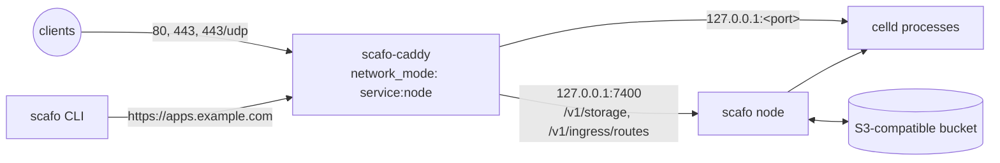

# Docker Compose

> One Scafo node and its colocated `scafo-caddy` ingress on a single host, with an external S3-compatible bucket.

Two services share one network namespace: the node service publishes 80, 443 and 443/udp, and Caddy runs inside that namespace, so it reaches the node API and every application process over loopback. Nothing in the node's configuration is widened for it: the API listens on `127.0.0.1:7400` and the runtime processes bind loopback, both the defaults, and no port but the three web ones leaves the container.



::::steps

### Prepare the host

Provision an S3-compatible bucket that supports `If-Match` and `If-None-Match` conditional writes and `Range` reads. Create the apex and wildcard DNS records, `apps.example.com` and `*.apps.example.com`, pointing at this host. Allow TCP 80 and 443 plus UDP 443, and nothing else.

### Write the Compose file

Put `compose.yaml` and `.env` in one directory. Caddy needs no configuration file: the image ships its Caddyfile and reads the rest from its environment.

```yaml [compose.yaml]
services:
  node:
    image: ghcr.io/sandros94/scafo:latest
    restart: unless-stopped
    stop_grace_period: 50s
    ports:
      - "80:80"
      - "443:443"
      - "443:443/udp"
    volumes:
      - state:/var/lib/scafo
      - ingress-log:/var/log/scafo-ingress
    environment:
      SCAFO_S3_ENDPOINT: ${SCAFO_S3_ENDPOINT:?set SCAFO_S3_ENDPOINT in .env}
      SCAFO_S3_BUCKET: ${SCAFO_S3_BUCKET:?set SCAFO_S3_BUCKET in .env}
      SCAFO_S3_ACCESS_KEY: ${SCAFO_S3_ACCESS_KEY:?set SCAFO_S3_ACCESS_KEY in .env}
      SCAFO_S3_SECRET_KEY: ${SCAFO_S3_SECRET_KEY:?set SCAFO_S3_SECRET_KEY in .env}
      SCAFO_S3_REGION: ${SCAFO_S3_REGION:-us-east-1}
      SCAFO_S3_PREFIX: ${SCAFO_S3_PREFIX:-scafo}
      SCAFO_PLATFORM_DOMAINS: ${SCAFO_PLATFORM_DOMAINS:?set SCAFO_PLATFORM_DOMAINS in .env}
      SCAFO_INGRESS_TOKEN: ${SCAFO_INGRESS_TOKEN:?set SCAFO_INGRESS_TOKEN in .env}
      SCAFO_OBSERVABILITY: "1"
      SCAFO_INGRESS_ACCESS_LOG: /var/log/scafo-ingress/access.log
    healthcheck:
      test: ["CMD", "node", "/app/dist/cli/index.mjs", "health"]
      interval: 5s
      timeout: 5s
      retries: 30
      start_period: 10s

  caddy:
    image: ghcr.io/sandros94/scafo-caddy:${SCAFO_CADDY_VERSION:?set SCAFO_CADDY_VERSION in .env}
    restart: unless-stopped
    # Shares the node's network namespace: loopback to the node and its processes.
    network_mode: "service:node"
    depends_on:
      node:
        condition: service_healthy
    environment:
      SCAFO_FLEET_ENDPOINT: http://127.0.0.1:7400
      SCAFO_FLEET_TOKEN: ${SCAFO_INGRESS_TOKEN:?set SCAFO_INGRESS_TOKEN in .env}
      SCAFO_ACCESS_LOG: /var/log/scafo-ingress/access.log
    volumes:
      - ingress-log:/var/log/scafo-ingress
      - caddy-data:/data

volumes:
  # Node identity and runtime work directories: never delete this volume.
  state:
  ingress-log:
  # Caddy's ACME account.
  caddy-data:
```

### Fill in the environment

```sh [.env]
# Exact released tags: https://github.com/sandros94/scafo-ingress/releases
SCAFO_CADDY_VERSION=0.2.1

# The bucket. It must support conditional writes, and nothing creates it for you.
SCAFO_S3_ENDPOINT=
SCAFO_S3_BUCKET=
SCAFO_S3_ACCESS_KEY=
SCAFO_S3_SECRET_KEY=
SCAFO_S3_REGION=us-east-1
SCAFO_S3_PREFIX=scafo

# Platform apex, such as apps.example.com: no scheme, no wildcard.
SCAFO_PLATFORM_DOMAINS=

# openssl rand -hex 32
SCAFO_INGRESS_TOKEN=
```

Set every blank value; Compose refuses to start with any of them empty. One bucket and prefix pair is this fleet and nothing else's.

### Start it

```sh
docker compose up -d
docker compose ps
```

Caddy starts once the node's healthcheck passes, because it reads its certificate store through the node. Within a minute the node reads `Up (healthy)` and Caddy `Up`.

### Verify

```sh
curl -sS https://apps.example.com/.well-known/scafo/health
curl -sS -o /dev/null -w '%{http_code}\n' https://nobody.apps.example.com/
```

The first answers `{ "ok": true, "version": ..., "node": ... }` from the node, through Caddy, with a certificate Caddy obtained for the apex on that first request. The second is `404`: a host nobody has claimed is answered by Caddy, never by a fallback application. `/v1/storage` and `/v1/ingress/routes` at the apex are `404` too; they exist only on the loopback listener, behind the ingress token.

Before the DNS record resolves, add `--resolve apps.example.com:443:<host ip>` to the first command.

::::

## Deploy

Follow [first deploy](/deploy#first-deploy) from your own machine. The bucket values it asks for are the ones in `.env`, prefix included; the endpoint is `https://` plus `SCAFO_PLATFORM_DOMAINS`.

```sh
scafo remote add prod --endpoint https://apps.example.com --register
scafo deploy ./my-app --name shop
```

The node API is not published to the host, and the CLI does not need it to be. If you turned the apex off, see [without the apex](/deploy#without-the-apex).

## Certificates

Caddy obtains an ordinary certificate for each name on its first request, through HTTP-01 or TLS-ALPN. The wildcard DNS record does not require a wildcard certificate or a DNS-provider plugin. Which names may get one is decided from the routing document Caddy already holds: a name the fleet routes exactly, or its API apex, gets a certificate, and any other name does not.

Certificates, their private keys and the locks around them live in the bucket, reached through the node's `/v1/storage`. The ACME account and Caddy's own housekeeping stay in the `caddy-data` volume. Caddy holds the ingress token and nothing else.

For one wildcard certificate over the whole platform domain instead, switch `SCAFO_CADDY_VERSION` to a `-dns` tag and give Caddy a DNS provider.

::read-more{to="/docs/wildcard-certificates"}
::

## Logs

```sh
docker compose logs -f node
docker compose logs -f caddy
```

`SCAFO_OBSERVABILITY` makes the node record its own events, and `SCAFO_INGRESS_ACCESS_LOG` points it at the JSON access log Caddy writes into the shared `ingress-log` volume. Read both back with `scafo metrics` and `scafo traces`. Drop both lines, and the `ingress-log` volume with them, for a node that records nothing.

::read-more{to="/docs/observability"}
::

## Upgrading

Set `SCAFO_VERSION` in `.env` to the new release tag, then:

```sh
docker compose pull
docker compose up -d
```

This stack is the whole installation, one node, so stopping it and starting it on the new image is the entire upgrade, whether or not the release moves Celld. With more than one node, a release that moves Celld cannot be pulled one node at a time unless the two Celld releases are a rolling pair upstream declared.

::read-more{to="/docs/operations#upgrading-nodes"}
::

`SCAFO_CADDY_VERSION` moves the ingress the same way. Keep `stop_grace_period` at 50 seconds or more so the node drains its runtimes on the way down. The `state` volume survives `docker compose down`; only `down -v` removes it, and with it writes this fleet has acknowledged and the bucket may not hold yet.

## What is reachable from where

- **From the internet**: 80, 443 and 443/udp, answered by Caddy. The apex carries the node API minus `/v1/storage` and `/v1/ingress/routes`; every other host is an application or a `404`.
- **From the host**: the same three ports and nothing else. Port 7400 is the container's loopback, which the host does not share.
- **Inside the namespace**: Caddy dials `127.0.0.1:7400` with the ingress token, and each application on the loopback port the node chose for it. `SCAFO_TRANSPORT` is unset because nothing here leaves loopback; setting it to `none` would make every runtime process bind every interface of the container for no reader.

## Container classes

This recipe runs the node in a network namespace of its own, where Celld can start a container but never reach it. A node that serves [container classes](/docs/containers) needs the engine's socket, the socket's group, and the host's network namespace for the node and for the Caddy that shares it. A label is how an application with a container class is kept on this node.

```yaml [compose.yaml]
services:
  node:
    # As above, without `ports:`: on the host network there is nothing to publish.
    network_mode: host
    # The group that owns the socket: stat -c %g /var/run/docker.sock
    group_add:
      - "${DOCKER_SOCKET_GID:?set DOCKER_SOCKET_GID in .env}"
    volumes:
      - state:/var/lib/scafo
      - ingress-log:/var/log/scafo-ingress
      - /var/run/docker.sock:/var/run/docker.sock
    environment:
      # As above, plus the label applications with a container class select on.
      SCAFO_NODE_LABELS: containers=true

  caddy:
    # As above, on the host network beside the node.
    network_mode: host
```

The node's listener and the runtime processes stay on loopback, now the host's own, and Caddy, on the same host network, still reaches them there. Caddy binds 80, 443 and 443/udp on the host itself. The runtime port range, `24000`–`24998` by default, is now drawn from the host's port space. `docker compose exec node id` lists the socket's group beside `10001`.

The application selects the label on the deploy that creates it:

```sh
scafo deploy ./sidecar --name sidecar --node-selector containers=true
```

On Docker Desktop the host network is the engine's virtual machine, not your machine's: Caddy's ports are that virtual machine's, reached through a container on a bridge network that forwards to the bridge's gateway.

::warning
Mounting the socket makes the node root-equivalent on this host. It is your opt-in; Scafo never makes it for you.
::

::read-more{to="/docs/containers"}
What a node needs, where a container deploy goes, and what stays on the host.
::

## Operator routes

Caddy runs the Caddyfile its image ships. For operator routes, redirects, headers or TLS policy of your own, mount a Caddyfile over it and add them ahead of the dynamic-upstreams catch-all; a route that matches first always wins, and nothing rewrites your file.

::read-more{to="/docs/ingress-caddy#the-caddyfile-form"}
::
