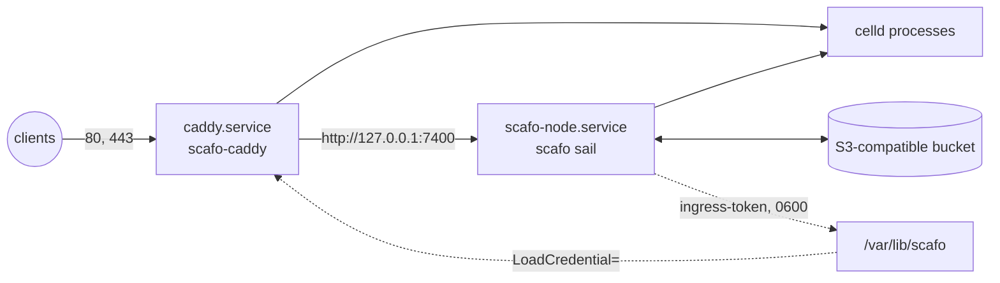

# Bare metal

> A Linux host without containers: the installer places verified binaries, writes systemd units and `/etc/scafo`, and leaves starting the node to you.

`scripts/install.sh` installs four binaries — `scafo`, `celld`, `caddy` and `esbuild` — verifies every download by SHA-256 before it changes anything on the host, and, when it runs as root on a systemd host, writes the node and ingress units plus their configuration. It does not start a node: the bucket credentials go in first.



## Prerequisites

- Linux on `x86_64` or `aarch64`, with glibc. The installer refuses musl hosts (Alpine and similar) because every binary it installs is linked against glibc; run the [container image](/deploy/image) there instead.
- `wireguard-tools` from the operating system, if this node will use the WireGuard transport. Scafo never generates key material itself.
- `curl` or `wget`, plus `uname`, `mktemp`, `install`, `sha256sum`, `tar` and `gzip`.
- An S3-compatible bucket supporting `If-Match` and `If-None-Match` conditional writes and `Range` reads.
- Apex and wildcard DNS for the platform domain pointing at this host, and TCP 80 and 443 open.

::steps

### Run the installer

```sh
curl -fsSLO https://raw.githubusercontent.com/sandros94/scafo/main/scripts/install.sh
sh install.sh
```

Run it as root to get the systemd units, the service accounts and `/etc/scafo`; run it as an ordinary user and it installs the four binaries and prints the equivalent manual setup instead.

It selects the latest release unless `SCAFO_VERSION` names an exact one:

```sh
sudo SCAFO_VERSION=1.2.3 sh install.sh
```

### Configure the node

```sh
sudoedit /etc/scafo/node.env
```

`SCAFO_S3_ENDPOINT`, `SCAFO_S3_BUCKET`, `SCAFO_S3_ACCESS_KEY` and `SCAFO_S3_SECRET_KEY` are the required four; `SCAFO_PLATFORM_DOMAINS` names the domains applications are served under, and applications get no host without it.

### Start the node and its ingress

```sh
sudo systemctl enable --now scafo-node.service
sudo systemctl status scafo-node.service caddy.service
```

The node unit carries `Wants=caddy.service` and `Before=caddy.service`, so the ingress comes up with it and after it.

### Mint an operator key

The key reads the same bucket settings the node does, so export them into that shell first:

```sh
scafo operator keygen --register
```

It lands in `./scafo-operator.json`, which is where `scafo deploy` looks for it. Nothing can reissue it — back it up.

### Deploy something

```sh
scafo deploy ./my-app --node http://127.0.0.1:7400 --project shop --env production
```

::

## What the installer does

1. Checks the platform: Linux only, `x86_64` or `aarch64` only, glibc only.
2. Resolves a destination: `SCAFO_INSTALL_BIN_DIR` if set, otherwise `/usr/local/bin` when it has root or non-interactive `sudo`, otherwise `~/.local/bin`.
3. Downloads and verifies, into a temporary directory, before touching the host:
   - `scafo-linux-<arch>` from the GitHub release — latest, or `v$SCAFO_VERSION`. The checksum comes from `SCAFO_SHA256` if set, otherwise from the `.sha256` file beside the download. With neither, it refuses to install.
   - `celld` 0.5.0 from the `denoland/celld` release, against a checksum pinned in the script.
   - `scafo-caddy-linux-<arch>` from the latest `sandros94/scafo-ingress` release, checked against `SCAFO_CADDY_SHA256` or the sidecar `.sha256`. There is no fallback to upstream Caddy: it carries neither `caddy.storage.scafo` nor the `scafo` dynamic-upstreams source.
   - `esbuild` 0.28.2, from its platform npm package, against a pinned checksum.
4. Installs the four binaries mode `0755` into the destination directory.
5. When it is root on a running systemd host and `SCAFO_INSTALL_SKIP_UNITS` is not `1`:
   - creates the system users `scafo` and `caddy` if they do not exist, and `/var/lib/scafo` mode `0700` owned by `scafo`;
   - writes `/etc/scafo/node.env` mode `0600` and `/etc/scafo/caddy.json` mode `0644` — never overwriting either if it already exists;
   - writes `/etc/systemd/system/scafo-node.service` and `/etc/systemd/system/caddy.service`, then runs `systemctl daemon-reload`;
   - records what it made in `/var/lib/scafo/install.manifest`, for the uninstaller.

Otherwise it prints the equivalent manual setup and installs nothing but the binaries.

### Environment variables

| Variable | Effect |
|---|---|
| `SCAFO_VERSION` | Exact Scafo release to install; unset means latest. |
| `SCAFO_SHA256` | Pins the Scafo checksum instead of trusting the sidecar file. |
| `SCAFO_INSTALL_BASE` | Alternative artifact base URL for the Scafo binary. |
| `SCAFO_CADDY_BASE` | Alternative artifact base URL for `scafo-caddy`. |
| `SCAFO_CADDY_SHA256` | Pins the `scafo-caddy` checksum. |
| `SCAFO_INSTALL_BIN_DIR` | Destination directory for the four binaries. |
| `SCAFO_INSTALL_MIRROR` | Mirrors the pinned third-party artifacts; checksums still apply. |
| `SCAFO_INSTALL_SKIP_UNITS` | `1` installs binaries only and writes no systemd units. |

::note
Only the stable channel is served here: GitHub releases, latest or pinned by `SCAFO_VERSION`. The edge channel ships as the `ghcr.io/sandros94/scafo:edge` image, with its binaries kept as run artifacts; point `SCAFO_INSTALL_BASE` at a mirror of those to install one.
::

## Files on the host

| Path | What it is |
|---|---|
| `/usr/local/bin/{scafo,celld,caddy,esbuild}` | The installed binaries. |
| `/etc/scafo/node.env` | Bucket credentials and every other node setting. Mode `0600`. |
| `/etc/scafo/caddy.json` | The ingress configuration. Generated once; operator edits are never overwritten. |
| `/var/lib/scafo` | Node state, mode `0700`, owned by `scafo`. |
| `/var/lib/scafo/node.json` | Node identity, mode `0600`. |
| `/var/lib/scafo/ingress-token` | The token the ingress presents to `/v1/ingress` and `/v1/storage`, minted on the node's first boot. Mode `0600`. |
| `/var/lib/scafo/install.manifest` | What this install made, for `uninstall.sh`. |
| `/var/lib/caddy` | Caddy's own state directory. The certificates are not here — they are in the bucket, through the node. |
| `/var/log/scafo-ingress/` | Where Caddy logs what it served, when the node is told to count it. |
| `/etc/systemd/system/scafo-node.service` | The node unit. |
| `/etc/systemd/system/caddy.service` | The ingress unit. |

### `/etc/scafo/node.env`

The generated file, with everything the node reads:

```sh
# Configuration of this scafo node, read by scafo-node.service.
#
# The bucket is the whole registry: every node pointed at the SAME bucket and
# prefix is one installation, and nothing else makes two nodes a fleet.
# Required — the node refuses to boot without them.
SCAFO_S3_ENDPOINT=
SCAFO_S3_BUCKET=
SCAFO_S3_ACCESS_KEY=
SCAFO_S3_SECRET_KEY=
SCAFO_S3_REGION=us-east-1
# Optional: keeps this installation inside one prefix of a shared bucket.
#SCAFO_S3_PREFIX=

# The names applications are served under: <project>.<domain> and
# <project>--<env>.<domain>. Comma-separated.
SCAFO_PLATFORM_DOMAINS=

# The node API. Loopback needs no further statement about the network; widening
# it makes the node refuse to boot until SCAFO_TRANSPORT says what that network
# is — "wireguard" to tunnel it, "none" to state that it is already private.
SCAFO_LISTEN=127.0.0.1:7400
#SCAFO_ADVERTISE=
#SCAFO_TRANSPORT=

# The ingress is not configured from here. It READS the fleet's routing off this
# node's API, at /v1/ingress/routes behind the ingress token, and follows it.

# What this machine IS, for environments that ask for a class of node.
#SCAFO_NODE_LABELS=tier=fast,region=eu-west-1

# Upstream Celld policy for every runtime process, comma-separated. Scafo adds
# no durability, idle-eviction or memory defaults. If SHUTDOWN_TOTAL_MS is
# raised above 40000, also raise TimeoutStopSec in scafo-node.service to at
# least that value plus 10 seconds.
#SCAFO_CELLD_ENV=CELLD_MAX_RSS_MB=512,CELLD_MAX_RESIDENT_CELLS=64

# Observing this node: the first switch makes it record its own events, and the
# second — which is REFUSED without the first — counts what Caddy actually
# served. Read both back with "scafo metrics" and "scafo traces".
#SCAFO_OBSERVABILITY=1
#SCAFO_INGRESS_ACCESS_LOG=/var/log/scafo-ingress/access.log
```

::read-more{to="/config"}
::

## The systemd units

### `scafo-node.service`

```ini
[Unit]
Description=scafo node daemon
Wants=network-online.target
After=network-online.target
Wants=caddy.service
Before=caddy.service

[Service]
Type=exec
User=scafo
Group=scafo
EnvironmentFile=/etc/scafo/node.env
Environment=SCAFO_STATE_DIR=/var/lib/scafo
Environment=CELLD_ESBUILD=/usr/local/bin/esbuild
Environment=SCAFO_CELLD_BIN=/usr/local/bin/celld
ExecStart=/usr/local/bin/scafo sail
Restart=on-failure
RestartSec=5s

KillMode=mixed
KillSignal=SIGTERM
SendSIGKILL=yes
TimeoutStopSec=50s
Delegate=no

StateDirectory=scafo
StateDirectoryMode=0700
NoNewPrivileges=yes
ProtectSystem=full
ProtectHome=yes
PrivateTmp=yes
LimitNOFILE=1048576

[Install]
WantedBy=multi-user.target
```

`KillMode=mixed` signals the daemon alone so it drains its runtimes in order, and kills whatever is left in the cgroup on timeout. `TimeoutStopSec=50s` is the shutdown grace; raise it past `CELLD_SHUTDOWN_TOTAL_MS + 10s` if that Celld value is increased.

### `caddy.service`

```ini
[Unit]
Description=Caddy, the ingress a scafo node routes through
Wants=network-online.target
After=network-online.target scafo-node.service
StartLimitIntervalSec=0

[Service]
Type=notify
User=caddy
Group=caddy
LoadCredential=ingress-token:/var/lib/scafo/ingress-token
ExecStart=/usr/local/bin/caddy run --config /etc/scafo/caddy.json
ExecReload=/usr/local/bin/caddy reload --config /etc/scafo/caddy.json --force
Restart=on-failure
RestartSec=5s
TimeoutStopSec=5s

StateDirectory=caddy
Environment=XDG_DATA_HOME=/var/lib/caddy
Environment=XDG_CONFIG_HOME=/var/lib/caddy
LogsDirectory=scafo-ingress
LogsDirectoryMode=0755

AmbientCapabilities=CAP_NET_BIND_SERVICE
NoNewPrivileges=yes
ProtectSystem=full
ProtectHome=yes
PrivateTmp=yes
LimitNOFILE=1048576

[Install]
WantedBy=multi-user.target
```

The node mints the ingress token `0600` inside a `0700` directory on its first boot. `LoadCredential=` is how Caddy gets it without loosening either mode: systemd reads the file as root and places a copy only Caddy's UID can open in `$CREDENTIALS_DIRECTORY`, which is what the two `token_file` values in `/etc/scafo/caddy.json` name.

::important
`LoadCredential=` fails before any of the unit's own commands run, so on the very first boot — before the token exists — the ingress unit fails and retries. That is what `StartLimitIntervalSec=0` with `Restart=on-failure` is for: do not add `Requires=`, and do not widen the token file's permissions.
::

## Uninstalling

`scripts/uninstall.sh`, from the same repository, undoes the install:

```sh
sudo sh uninstall.sh --dry-run
sudo sh uninstall.sh
```

It stops the ingress before the node, then removes the units, the four binaries and `/etc/scafo`. A plain run preserves `/var/lib/scafo`, `/var/lib/caddy`, `/var/log/scafo-ingress` and the accounts the install created.

| Flag | Effect |
|---|---|
| `--purge` | Also removes the state directory (node identity and the ingress token, which nothing can reissue), Caddy's state directory, the ingress logs, and the system users this install created. |
| `--dry-run`, `-n` | Prints every removal and performs none of them. |
| `--bin-dir <dir>` | Names a non-default binary directory; `SCAFO_INSTALL_BIN_DIR` does the same. |

Neither mode changes the bucket or its registry. The install manifest makes the removal exact; without it, the script derives safe defaults.

## Building the binary yourself

```sh
pnpm compile
```

produces `build/scafo-linux-amd64` and `build/scafo-linux-arm64`, each with a `.sha256` file. Celld, an ingress and WireGuard tools remain separate prerequisites — `pnpm compile` builds Scafo alone.
