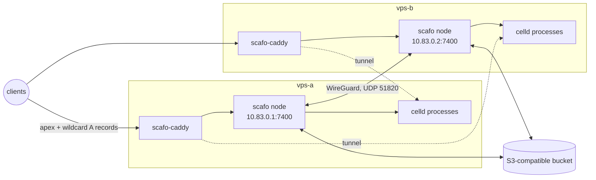

# VPS mesh

> Two or more rented machines on a WireGuard mesh, each running one Scafo node in Docker and its own colocated `scafo-caddy`.

No orchestrator joins the hosts: the bucket and prefix are the fleet, and each node's tunnel record in the registry is what the next node builds its interface from. `roll.sh` drives the whole thing over ssh.



With `SCAFO_TRANSPORT=wireguard` the node's API, its advertised address and the address runtime processes bind all default to its tunnel address. The node API is therefore private without being loopback-only: the colocated Caddy reaches it over the tunnel interface, a peer's Caddy reaches that host's application processes the same way, and nothing on the public interfaces answers on port 7400.

Both Caddys share one certificate store in the bucket, through their own node's `/v1/storage`, and read the fleet's routing from `/v1/ingress/routes` with `prefer self`. Either can serve any host: with apex and wildcard DNS pointing at both machines, the one a request lands on serves it locally when it can and proxies to the holder over the tunnel when it cannot.

## Prerequisites

- Two or more Ubuntu hosts with `docker` and `wireguard-tools` installed, and an ssh account with passwordless `sudo` on each.
- An S3-compatible bucket honouring `If-Match` / `If-None-Match` conditional writes and `Range` reads, reachable from every host. It is not created here.
- A DNS zone whose provider is one of the ones the `-dns` image carries — bunny, cloudflare, digitalocean, hetzner, ovh, route53 — and an API credential for it. Any other provider needs [its own build](https://github.com/sandros94/scafo-ingress#a-provider-that-is-not-in-the-list).
- Apex and wildcard `A` records — `apps.example.com` and `*.apps.example.com` — pointing at every host.
- Firewall: TCP 80 and 443 plus UDP 443 open to the world, UDP 51820 open between the hosts. Port 7400 stays on the tunnel and needs no rule.

## Configure

Three things are yours to fill in: `.env`, `Caddyfile.template`, and nothing else. The ingress token is minted per host by `roll.sh`.

### `.env`

Beside `roll.sh` by default, or anywhere named through `ENV_FILE`. It holds the bucket credentials, the DNS credential and the fleet's shape:

```sh [.env]
# `id:address:tunnel-address[:labels]` per host, whitespace separated. The
# address is what peers send tunnel traffic to and what ssh connects to.
HOSTS="vps-a:203.0.113.10:10.83.0.1/24 vps-b:203.0.113.11:10.83.0.2/24:provider=ovh"
SSH_USER=ubuntu

DOMAIN=apps.example.com
IMAGE=ghcr.io/sandros94/scafo:0.1.0
CADDY_IMAGE=ghcr.io/sandros94/scafo-caddy:edge-dns

SCAFO_S3_ENDPOINT=
SCAFO_S3_BUCKET=
SCAFO_S3_ACCESS_KEY=
SCAFO_S3_SECRET_KEY=
SCAFO_S3_REGION=us-east-1
SCAFO_S3_PREFIX=scafo

# Variable names copied into each host's ingress.env for the Caddyfile's `dns`
# line. Their values live in this file too, and reach Caddy only.
DNS_ENV="BUNNY_API_KEY"
BUNNY_API_KEY=
```

| Key | Meaning |
|---|---|
| `HOSTS` | Whitespace-separated `id:address:tunnel-address[:labels]` entries. The tunnel addresses share one `/24`. The id is the node id placement records and `scafo fleet nodes` show. Optional labels are node selectors, `key=value`. |
| `SSH_USER` | The ssh account on every host; defaults to `ubuntu`. |
| `DOMAIN` | The platform domain. It becomes `SCAFO_PLATFORM_DOMAINS` on each host and fills `@DOMAIN@` in the Caddyfile. |
| `IMAGE` | The Scafo image tag to run. |
| `CADDY_IMAGE` | The `scafo-caddy` image; use a `-dns` flavour for the DNS-01 wildcard. |
| `SCAFO_S3_*` | Bucket endpoint, bucket, keys, region and prefix. One bucket and prefix is one fleet. |
| `DNS_ENV` | The names of the variables to copy into each host's `ingress.env`, for the Caddyfile's `dns` line. Their values live in this same file. |

### `Caddyfile.template`

The ACME contact address and the `dns` line naming the zone's provider and the variable above are yours to edit. `@DOMAIN@`, `@NODE@` and `@LOGS@` are filled in per host during the roll; leave them.

```caddyfile [Caddyfile.template]
{
	# ACME contact address. @DOMAIN@, @NODE@ and @LOGS@ are filled in per host by
	# roll-node.sh; this line and the `dns` one below are yours to edit.
	email you@example.com
	storage scafo {
		endpoint http://@NODE@
		token {env.SCAFO_INGRESS_TOKEN}
	}
	# Whether a customer domain belongs to this fleet is the node's decision, so
	# this is the one scafo path Caddy calls without a token.
	on_demand_tls {
		ask http://@NODE@/v1/ingress/ask
	}
}

(scafo) {
	log {
		output file @LOGS@/access.log
		format json
	}
	reverse_proxy {
		dynamic scafo {
			endpoint http://@NODE@
			token {env.SCAFO_INGRESS_TOKEN}
			prefer self
		}
		# The node returns upstreams in priority order, this node's own first, so
		# `first` keeps a request on the machine it arrived at. `max_fails 1` is
		# what lets a retry move on: `first` skips only upstreams already marked
		# down, and a higher count would send every retry back to the dead one.
		lb_policy first
		lb_retries 2
		fail_duration 30s
		max_fails 1
	}
	handle_errors {
		@missing vars scafo.route unknown denied
		handle @missing {
			respond "scafo: no deployment answers to {http.vars.scafo.host}" 404
		}
		respond "{err.status_code} {err.status_text}" {err.status_code}
	}
}

# The platform domain and every deployment under it, on one DNS-01 wildcard.
# The `-dns` image carries bunny, cloudflare, digitalocean, hetzner, ovh and
# route53; name the zone's provider and the variable ingress.env holds its
# credential in, which is `DNS_ENV` in the roll script's env file.
*.@DOMAIN@, @DOMAIN@ {
	tls {
		dns bunny {env.BUNNY_API_KEY}
	}
	import scafo
}

# Customer domains pointed at this fleet, issued per name once the node's `ask`
# endpoint has agreed to them.
https:// {
	tls {
		on_demand
	}
	import scafo
}
```

The platform domain and everything under it come from that one DNS-01 wildcard, which is what the `-dns` image flavour is for. Custom domains an application claims are issued per name through on-demand TLS, gated by the node's `/v1/ingress/ask` endpoint.

## Roll

```sh
./roll.sh
```

### What `roll.sh` does, per host

1. Mints a fresh ingress token with `openssl rand -hex 32`. It authorizes that node's storage and routing APIs only, so a host's token is worth nothing on another host.
2. Writes `/etc/scafo/node.env` (mode `0700` directory, root-owned) over ssh, holding the bucket credentials plus `SCAFO_PLATFORM_DOMAINS`, `SCAFO_NODE_ID`, the optional `SCAFO_NODE_LABELS`, `SCAFO_TRANSPORT=wireguard`, `SCAFO_WG_ADDRESS`, `SCAFO_WG_ENDPOINT=<address>:51820`, the token, `SCAFO_OBSERVABILITY=1` and `SCAFO_INGRESS_ACCESS_LOG`.
3. Writes `/etc/scafo/ingress.env` with the token and every variable named in `DNS_ENV`. The DNS-01 credential is Caddy's alone; the bucket credentials never reach it.
4. Ships `Caddyfile.template` to `/etc/scafo/Caddyfile.template` and `roll-node.sh` to `/usr/local/bin/scafo-roll`.
5. Runs `scafo-roll` on that host with `WG_ADDRESS`, `IMAGE`, `CADDY_IMAGE` and `DOMAIN` in its environment.

### What `roll-node.sh` does, on the host

1. **Stops the previous roll.** Removes the `scafo-node` and `scafo-caddy` containers, brings `wg0` down, and deletes the tunnel material alone: `/var/lib/scafo/wg-private.key`, `/var/lib/scafo/wg-public.key` and `/etc/wireguard/wg0.conf`. **The rest of `/var/lib/scafo` stays**, because each runtime process keeps its working directory there and that directory can hold writes the fleet has already acknowledged and the bucket has not got yet. It then makes sure `/var/lib/scafo` is mode `0700` and `/var/log/scafo-ingress` mode `0755`, both owned by uid 10001 — the user inside the image.
2. **Mints tunnel keys** with the host's own `wg`: `wg genkey` into `/var/lib/scafo/wg-private.key`, `wg pubkey` into `wg-public.key`, both owned by 10001. The image carries no `wg`, and Scafo never invents key material.
3. **Pulls both images.**
4. **Runs `scafo wg init --stdout`** in the image, redirected to `/etc/wireguard/wg0.conf` mode `0600`, then `wg-quick up wg0`. `wg init` publishes this node's public key, tunnel address and endpoint in the registry and renders an interface from every peer that has done the same; bringing the interface up needs `NET_ADMIN` and the kernel module, so it stays the operator's job.
5. **Starts the node**: `docker run -d --name scafo-node --restart unless-stopped --stop-timeout 50 --network host --env-file /etc/scafo/node.env -v /var/lib/scafo:/var/lib/scafo -v /var/log/scafo-ingress:/var/log/scafo-ingress "$IMAGE" sail`.
6. **Waits for `healthy`**, polling `docker inspect -f '{{.State.Health.Status}}' scafo-node` every two seconds. Caddy reads its certificate store through the node, and a name whose storage is unreachable at startup is a name Caddy gives up managing until it is restarted.
7. **Renders the Caddyfile** with `sed`, substituting `@DOMAIN@` with the domain, `@NODE@` with `<tunnel-host>:7400` and `@LOGS@` with the log directory, into `/etc/scafo/caddy/Caddyfile`.
8. **Starts Caddy**: `docker run -d --name scafo-caddy --restart unless-stopped --network host --env-file /etc/scafo/ingress.env -v /etc/scafo/caddy:/etc/caddy:ro -v scafo-caddy-data:/data -v /var/log/scafo-ingress:/var/log/scafo-ingress "$CADDY_IMAGE"`.

### The peer refresh

After every selected host has been rolled, `roll.sh` runs on **every** host in `HOSTS`:

```sh
sudo docker run --rm --network host --env-file /etc/scafo/node.env \
  -v /var/lib/scafo:/var/lib/scafo $IMAGE wg peers --stdout \
  | sudo tee /etc/wireguard/wg0.conf >/dev/null \
  && sudo bash -c 'wg syncconf wg0 <(wg-quick strip wg0)' && sudo wg show wg0 peers
```

`scafo wg peers` re-renders the interface from the nodes registered right now, which is how a host rolled first learns about a host rolled after it. Every node publishes its public key and endpoint in the registry, so this is a read of what is registered, not an exchange between the hosts.

::warning
**A roll is destructive on the hosts it touches.** It removes the containers, the tunnel keypair in `/var/lib/scafo` and `/etc/wireguard/wg0.conf`, so the node comes back with a new tunnel keypair under the same id. The rest of `/var/lib/scafo` stays where it is: each runtime process keeps its working directory there, and that directory can hold writes a peer has already acknowledged and the bucket has not got yet — a host that loses it comes back having lost them. The registry, the applications' deployments and the certificates are in the bucket and survive a roll either way; anything else on those hosts does not.
::

## Verify

```sh
curl -sS https://apps.example.com/.well-known/scafo/health
curl -sS -o /dev/null -w '%{http_code}\n' https://nobody.apps.example.com/   # 404
ssh ubuntu@203.0.113.10 sudo wg show wg0
```

The health document comes from whichever host DNS resolved to; ask each address in turn with `--resolve apps.example.com:443:203.0.113.11` to see both. An unclaimed host is a 404, not a wildcard fallback: the routing document names only hosts backed by a running process. `wg show` lists the other hosts as peers, each with a recent handshake.

## Deploy

The fleet trusts no operator key until somebody mints one, and no host holds one: the first key is minted on your own machine, with the [CLI installed there](/docs/install), never inside a container on the mesh.

::steps

### Install the CLI

On your own machine, not on a rented host.

```sh
npm install --global scafo
```

### Give the shell the node's bucket values

`scafo remote add --register` and `scafo fleet nodes` read the bucket directly, so that shell needs the same values the hosts have — they are the ones in the `.env` beside `roll.sh`.

```sh
export SCAFO_S3_ENDPOINT="https://s3.example.com"
export SCAFO_S3_BUCKET="scafo"
export SCAFO_S3_ACCESS_KEY="<access key>"
export SCAFO_S3_SECRET_KEY="<secret key>"
export SCAFO_S3_REGION="us-east-1"
export SCAFO_S3_PREFIX="scafo"
```

`SCAFO_S3_PREFIX` must be the hosts': a different prefix is a different, empty installation.

### Mint and register the first admin key

`--endpoint` is `DOMAIN`, the platform apex, which either host's Caddy routes to its own node API.

```sh
scafo remote add prod --endpoint https://apps.example.com --register
```

`--register` involves no daemon — it writes the key's public half straight into the registry, which is why that shell wants the bucket values — and the key it minted stays in your operator home, `~/.scafo` unless `SCAFO_HOME` says otherwise, which nothing can reissue.

### Confirm the fleet

```sh
scafo fleet nodes
```

Every host in `HOSTS` is listed, by the id it was given, with its `CELLD` and `SCAFO` versions. `scafo: no node is registered in this bucket; a machine joins the fleet by running "scafo sail"` means this shell is reading a different bucket or prefix than the hosts write.

### Deploy

```sh
scafo deploy ./app --name hello --replicas all
curl -sS https://hello.apps.example.com/
```

### Hand it to CI

A job deploys with its provider's OIDC token and no operator key at all, once [`scafo trust set`](/docs/deploying#deploying-from-ci-with-oidc) has written the application's trust policy into the same bucket.

::

Before the apex resolves, reach a node's API through the tunnel instead and name it on each command:

```sh
ssh -L 7400:10.83.0.1:7400 ubuntu@203.0.113.10
scafo deploy ./app --node http://127.0.0.1:7400 --name hello --replicas all
```

## Adding a host

Add its entry to `HOSTS` — a free tunnel address in the same `/24` — point its `A` records at the machine, and roll that host alone:

```sh
./roll.sh vps-c
```

Named hosts are the only ones rolled, but the peer refresh at the end runs everywhere, which is what tells the existing hosts about the new one. Placement moves applications onto it by rendezvous hashing as it joins; `--replicas all` applications start there on the next reconcile.

## Re-rolling

`./roll.sh` with no arguments rolls every host in `HOSTS`, in the order they are listed, one after another. Naming hosts rolls those alone. A typo in an argument is rejected before anything is rolled. Because a roll is destructive per host, re-roll one host at a time when the fleet is serving: the other hosts keep answering for its applications as placement moves them.

::warning
That holds while the image being rolled carries the **same Celld version** as the one the other hosts run. The image bundles Celld, and a host rolled onto a different Celld neither starts nor accepts deploys for any application an answering host on the old version still serves (`version-skew`, 409). Moving Celld is the stop-everything procedure, not a host-by-host roll.
::

::read-more{to="/docs/operations#a-celld-upgrade"}
::

## Caveats

- **Caddy starts after the node is healthy, never beside it.** The wait loop in `roll-node.sh` is why the script is sequential.
- **The Caddyfile's directory is mounted, not the file.** An editor replaces the file's inode, and a file bind mount keeps pointing at the old one, so `caddy reload` would reload a stale configuration.
- **`lb_policy first` needs `max_fails 1`.** `first` picks the first upstream not already marked down, and a dial failure marks one down only after `max_fails` failures — so with a higher count every retry returns to the same dead process and the request fails before the mark is ever set.
- **A node's ingress token is that node's.** `roll.sh` mints a fresh one per host per roll, and rolling one host does not disturb another's.
- **One bucket and prefix is one fleet.** Bucket credentials are fleet-root authority and live in `/etc/scafo/node.env`, mode `0700` and root-owned, never in Caddy's environment.
- **Allow 50 seconds of stop grace.** `--stop-timeout 50` covers node drain plus the runtime's shutdown bound; raise it past `CELLD_SHUTDOWN_TOTAL_MS + 10s` if that is increased.

::read-more{to="/docs/wireguard"}
::
