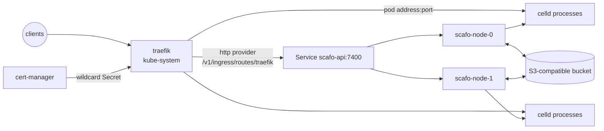

# K3s and RKE2

> The cluster's bundled Traefik becomes the fleet's ingress: it polls `/v1/ingress/routes/traefik` through a `scafo-api` Service and routes each host to whichever pod runs it.

The Scafo pods carry no ingress of their own. Scafo's routers arrive as `<name>@http`; operator-owned Ingress and IngressRoute objects keep working beside them in their own providers.



## Prerequisites

- K3s v1.32 or newer with its bundled Traefik enabled. Older releases ship Traefik 2.11, which has no `providers.http.headers` and cannot present the ingress token. RKE2 works the same way; its manifests directory is `/var/lib/rancher/rke2/server/manifests/` and its chart is named `rke2-traefik`.
- An external S3-compatible store, reachable from every pod, honouring `If-Match` / `If-None-Match` conditional writes.
- cert-manager, installed separately — K3s does not bundle it — with a `ClusterIssuer` that can issue the platform apex and its wildcard. That needs DNS-01, so configure the issuer, its DNS-provider credentials, and DNS first.
- Apex and wildcard DNS pointing at the K3s Traefik address.

::steps

### Create the namespace and Secrets

They live outside the manifest. `scafo-bucket` holds the bucket credentials, which are fleet-root authority. `scafo-ingress` holds `SCAFO_INGRESS_TOKEN`, the one credential an ingress ever holds; Traefik runs in `kube-system`, so the same token goes there too.

```sh
kubectl create namespace scafo
kubectl -n scafo create secret generic scafo-bucket \
  --from-literal=SCAFO_S3_ACCESS_KEY="$SCAFO_S3_ACCESS_KEY" \
  --from-literal=SCAFO_S3_SECRET_KEY="$SCAFO_S3_SECRET_KEY"

INGRESS_TOKEN="$(openssl rand -hex 32)"
kubectl -n scafo create secret generic scafo-ingress \
  --from-literal=SCAFO_INGRESS_TOKEN="$INGRESS_TOKEN"
kubectl -n kube-system create secret generic scafo-ingress \
  --from-literal=SCAFO_INGRESS_TOKEN="$INGRESS_TOKEN"
```

### Edit the manifest

1. Set the non-secret `scafo-node` ConfigMap values: S3 endpoint, bucket, prefix, and the transport decision. Replace `apps.example.com` consistently in the ConfigMap, the Certificate and the Ingress.
2. Set the image's `VERSION` tag to a published Scafo release. This is the only publication-time substitution; never use a floating tag.
3. Set `Certificate.spec.issuerRef.name` to the existing ClusterIssuer.

### Apply it

```sh
kubectl apply -f scafo.yaml
kubectl -n scafo wait --for=condition=Ready certificate/scafo-platform --timeout=5m
kubectl -n scafo rollout status statefulset/scafo-node
```

### Teach the bundled Traefik

Set the ACME contact address in `traefik-config.yaml`, then place it on each server node. The helm-controller picks it up and upgrades the bundled release.

```sh
sudo cp traefik-config.yaml /var/lib/rancher/k3s/server/manifests/traefik-config.yaml
kubectl -n kube-system rollout status deploy/traefik
```

### Verify

```sh
kubectl -n kube-system logs deploy/traefik | grep -i "provider.*http"
curl -sk https://<cluster-edge>/.well-known/scafo/health -H "Host: apps.example.com"
```

A deployed environment answers at its own host the same way. Until a project is deployed, only the platform apex is routed: Scafo publishes no wildcard fallback, and an unclaimed host is a 404 at the edge.

::

## `scafo.yaml`

```yaml [scafo.yaml]
apiVersion: v1
kind: ConfigMap
metadata:
  name: scafo-node
  namespace: scafo
data:
  # These non-secret defaults identify one fleet; set them for the external store.
  SCAFO_S3_ENDPOINT: "https://s3.example.com"
  SCAFO_S3_BUCKET: "scafo"
  SCAFO_S3_REGION: "us-east-1"
  SCAFO_S3_PREFIX: "production"
  SCAFO_PLATFORM_DOMAINS: "apps.example.com"
  SCAFO_LISTEN: "0.0.0.0:7400"
  # `none` declares the pod network private: runtime processes bind the pod
  # address, so the cluster's Traefik dials whichever pod holds a host directly.
  SCAFO_TRANSPORT: "none"
  # The entryPoint the routers are attached to is the TLS one of the bundled
  # Traefik; see traefik-config.yaml, which is what polls this routing.
  SCAFO_TRAEFIK_ENTRYPOINTS: "websecure"
  SCAFO_OBSERVABILITY: "1"
---
apiVersion: v1
kind: Service
metadata:
  name: scafo-nodes
  namespace: scafo
spec:
  clusterIP: None
  selector:
    app.kubernetes.io/name: scafo
  ports:
    - name: api
      port: 7400
      targetPort: api
---
# Where the bundled Traefik polls the fleet's routing. Every node renders the
# same document, so this Service may answer from any of them; it asks for no
# preferred node, which spreads each host over every pod serving it.
apiVersion: v1
kind: Service
metadata:
  name: scafo-api
  namespace: scafo
spec:
  type: ClusterIP
  selector:
    app.kubernetes.io/name: scafo
  ports:
    - name: api
      port: 7400
      targetPort: api
---
apiVersion: apps/v1
kind: StatefulSet
metadata:
  name: scafo-node
  namespace: scafo
  labels:
    app.kubernetes.io/name: scafo
spec:
  # One node to start with. Scaling out is supported: the cluster edge reads the
  # whole fleet's routing, so it reaches a host on whichever pod holds it.
  replicas: 1
  serviceName: scafo-nodes
  persistentVolumeClaimRetentionPolicy:
    whenDeleted: Retain
    whenScaled: Retain
  selector:
    matchLabels:
      app.kubernetes.io/name: scafo
  template:
    metadata:
      labels:
        app.kubernetes.io/name: scafo
    spec:
      # Keep node and descendants inside the container lifecycle.
      hostPID: false
      shareProcessNamespace: false
      # Celld shutdown may take 40 seconds; permit Scafo to drain first.
      terminationGracePeriodSeconds: 50
      securityContext:
        fsGroup: 10001
      containers:
        - name: node
          # Replace VERSION with a published Scafo release before applying.
          image: ghcr.io/sandros94/scafo:VERSION
          imagePullPolicy: IfNotPresent
          args: ["sail"]
          securityContext:
            runAsNonRoot: true
            runAsUser: 10001
            runAsGroup: 10001
            allowPrivilegeEscalation: false
          envFrom:
            # Create these Secrets outside the manifest: `scafo-bucket` holds the
            # bucket-root credentials, `scafo-ingress` the SCAFO_INGRESS_TOKEN the
            # cluster's Traefik presents to read the fleet's routing. That token
            # needs a second copy in `kube-system`, where Traefik runs.
            - secretRef:
                name: scafo-bucket
            - secretRef:
                name: scafo-ingress
            - configMapRef:
                name: scafo-node
          env:
            - name: POD_IP
              valueFrom:
                fieldRef:
                  fieldPath: status.podIP
            - name: SCAFO_ADVERTISE
              value: "$(POD_IP):7400"
            - name: SCAFO_NODE_LABELS
              value: "platform=k3s"
          ports:
            - name: api
              containerPort: 7400
          volumeMounts:
            - name: state
              mountPath: /var/lib/scafo
          startupProbe:
            httpGet:
              path: /.well-known/scafo/health
              port: api
            periodSeconds: 5
            failureThreshold: 24
          readinessProbe:
            httpGet:
              path: /.well-known/scafo/health
              port: api
            periodSeconds: 5
          livenessProbe:
            httpGet:
              path: /.well-known/scafo/health
              port: api
            periodSeconds: 20
            failureThreshold: 3
          resources:
            # Cgroup bounds do not influence Scafo placement or deploy admission.
            requests:
              cpu: "500m"
              memory: "512Mi"
            limits:
              memory: "2Gi"
  volumeClaimTemplates:
    - metadata:
        name: state
      spec:
        # Omit storageClassName to use the K3s default StorageClass.
        accessModes: ["ReadWriteOnce"]
        resources:
          requests:
            storage: "1Gi"
---
# cert-manager and this ClusterIssuer are operator-managed prerequisites.
apiVersion: cert-manager.io/v1
kind: Certificate
metadata:
  name: scafo-platform
  namespace: scafo
spec:
  secretName: scafo-platform-tls
  issuerRef:
    name: letsencrypt-prod
    kind: ClusterIssuer
    group: cert-manager.io
  dnsNames:
    - apps.example.com
    - "*.apps.example.com"
---
# The routing comes from Scafo's http provider, so nothing here routes anything.
# This Ingress exists to hand the wildcard Secret to Traefik: its Kubernetes
# provider reads `spec.tls` into the certificate store before it looks at rules,
# so an Ingress with no rules adds the certificate and creates no router. The
# store is matched by SNI, which is how the platform hosts of the `@http`
# routers are served this certificate rather than an ACME-issued one.
apiVersion: networking.k8s.io/v1
kind: Ingress
metadata:
  name: scafo-platform-tls
  namespace: scafo
spec:
  ingressClassName: traefik
  tls:
    - hosts:
        - apps.example.com
        - "*.apps.example.com"
      secretName: scafo-platform-tls
```

Two Services, for two different jobs: `scafo-nodes` is the headless Service the StatefulSet needs for stable pod identity, and `scafo-api` is the ClusterIP the bundled Traefik polls. Every node renders the same routing document, so `scafo-api` may answer from any pod; it asks for no preferred node, which spreads each host over every pod serving it.

## `traefik-config.yaml`

A `HelmChartConfig` in `kube-system`, dropped into the server manifests directory. The helm-controller merges it into the bundled chart and upgrades the release.

```yaml [traefik-config.yaml]
apiVersion: helm.cattle.io/v1
kind: HelmChartConfig
metadata:
  name: traefik
  namespace: kube-system
spec:
  valuesContent: |-
    # A Traefik provider is static configuration, settled at startup, and the
    # chart has no value for the http one — its schema rejects unknown keys — so
    # arguments are the only way to declare it.
    #
    # Kubernetes expands $(VAR) in a container's arguments from that container's
    # environment, so the token stays in the Secret rather than in this file.
    additionalArguments:
      - "--providers.http.endpoint=http://scafo-api.scafo.svc:7400/v1/ingress/routes/traefik"
      - "--providers.http.pollInterval=5s"
      - "--providers.http.headers.Authorization=Bearer $(SCAFO_INGRESS_TOKEN)"
    # Traefik runs in kube-system, so the ingress token needs a copy there. It is
    # the only credential Traefik holds; it never sees bucket credentials.
    env:
      - name: SCAFO_INGRESS_TOKEN
        valueFrom:
          secretKeyRef:
            name: scafo-ingress
            key: SCAFO_INGRESS_TOKEN
    # Scafo's routers are attached to `websecure` (SCAFO_TRAEFIK_ENTRYPOINTS);
    # `asDefault` keeps operator-owned Kubernetes routes on the same entryPoint.
    ports:
      websecure:
        asDefault: true
        http:
          tls:
            enabled: true
            certResolver: letsencrypt
    # For domains an environment claimed: their DNS points at this cluster, so
    # HTTP-01 on the `web` entryPoint resolves without a DNS-provider plugin.
    # The platform apex and its wildcard are not issued here — cert-manager holds
    # them, and ACME skips a host the certificate store already covers.
    certificatesResolvers:
      letsencrypt:
        acme:
          email: "operator@example.com"
          storage: /data/acme.json
          httpChallenge:
            entryPoint: web
    # Issued certificates survive a restart only on a volume. The chart mounts
    # the claim at /data as uid 65532; acme.json must exist with mode 600 before
    # Traefik reads it, which is what the init container is for.
    persistence:
      enabled: true
      size: 128Mi
    deployment:
      initContainers:
        - name: volume-permissions
          image: busybox:latest
          command: ["sh", "-c", "touch /data/acme.json; chmod -v 600 /data/acme.json"]
          volumeMounts:
            - name: data
              mountPath: /data
    podSecurityContext:
      fsGroup: 65532
```

::important
The filename must be RFC-1123. Never edit the neighbouring `traefik.yaml`: K3s rewrites it on every start.
::

## Certificates

- The platform apex and `*.apps.example.com` come from cert-manager. The rules-less `scafo-platform-tls` Ingress exists only to put that Secret into Traefik's certificate store, which is matched by SNI for the `@http` routers.
- A custom domain an environment claimed is issued by Traefik itself, HTTP-01 on the `web` entryPoint, once its DNS points at the cluster edge. Traefik skips any host the store already covers, so the wildcard is never re-issued.

## Operating constraints

- A fleet is one bucket and prefix. Use separate ones for separate trust domains.
- The external object store is a control-plane dependency, not backup-only storage. Reliable low-latency conditional writes are required.
- `SCAFO_LISTEN=0.0.0.0:7400` permits in-cluster service access. `SCAFO_TRANSPORT=none` is valid only when the pod network is private and trusted; use an explicit transport decision for other networks. With it, runtime processes bind the pod address, which is how Traefik reaches a host's holder on any node.
- The node process stays PID 1 in a private PID namespace. `terminationGracePeriodSeconds: 50` is the minimum; use at least `CELLD_SHUTDOWN_TOTAL_MS + 10s` when that Celld value is raised.
- The StatefulSet gives each node a retained `1Gi` claim through K3s's default StorageClass. This preserves its identity across replacement; size the claim and retention policy for the operator's recovery plan.
- The StatefulSet starts with one replica and scales out: the routing Traefik polls names every pod serving a host, so a new node joins the edge as soon as it runs something.

## Deploying

Application traffic enters through the cluster's Traefik, not the node API. And the fleet trusts no operator key until somebody mints one: no pod holds one, so the first key is minted on your own machine, with the [CLI installed there](/docs/install), never with `kubectl exec` into a node container.

Export the same `SCAFO_S3_*` values the pods read — endpoint, bucket and prefix from the `scafo-node` ConfigMap, credentials from the `scafo-bucket` Secret — then register the key against the bucket and deploy:

```sh
scafo remote add prod --endpoint https://apps.example.com --register
scafo deploy ./my-app --project shop --env production
```

`--endpoint` is the apex in `SCAFO_PLATFORM_DOMAINS`, which Traefik routes to the node API. `--register` involves no daemon — it writes the key's public half straight into the registry, which is why that shell wants the bucket values — and the key it minted stays in your operator home, `~/.scafo` unless `SCAFO_HOME` says otherwise, which nothing can reissue.

Without the apex, forward the node API instead and name it on each command:

```sh
kubectl -n scafo port-forward svc/scafo-nodes 7400:7400
scafo deploy ./my-app --node http://127.0.0.1:7400 --project shop --env production
```

For CI, [`scafo trust set`](/docs/deploying#deploying-from-ci-with-oidc) writes a project's trust policy into the same bucket, and the job then deploys with its provider's OIDC token, holding no operator key at all.

::read-more{to="/docs/deploying"}
::
