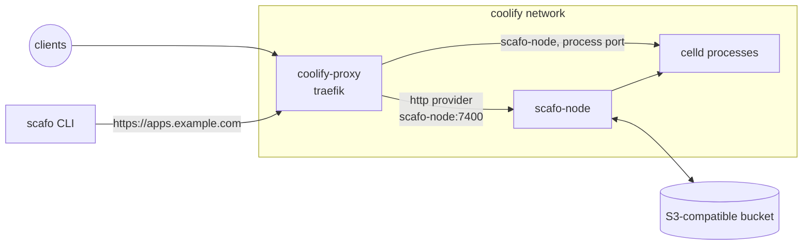

# Coolify

> The Scafo node runs beside Coolify's own resources as an ordinary Compose service, and Coolify's Traefik polls `/v1/ingress/routes/traefik` on it.

Scafo writes no proxy configuration; the additions below are yours, in Coolify's file, and nothing rewrites them. Scafo's routers arrive as `scafo_<host>@http`. Coolify's own routers stay in its Docker and file providers and are untouched. The node publishes no port to the server: the proxy reaches it over the `coolify` network, and so does everyone else, through the apex.



## Prerequisites

- Coolify v4.3 or newer with the proxy type set to Traefik. Coolify runs `traefik:v3.6`, which has `providers.http.headers` and so can present the ingress token; Traefik 2.x cannot. The Caddy proxy option is `lucaslorentz/caddy-docker-proxy`, for which no Scafo-flavoured image is published; Traefik is the supported path on Coolify.
- An external S3-compatible store honouring `If-Match` / `If-None-Match` conditional writes and `Range` reads. Provision it before starting the node; Compose does not create it.
- The apex and wildcard DNS records, `apps.example.com` and `*.apps.example.com`, pointing at this server.
- An ingress token: `openssl rand -hex 32`.

::::steps

### Run the node

Create a Coolify **Docker Compose** resource from the file below, with the `.env` values in the resource's environment panel. It joins the `coolify` network that Coolify's proxy is already on, and it publishes nothing.

```yaml [compose.yaml]
services:
  scafo-node:
    image: ghcr.io/sandros94/scafo:latest
    restart: unless-stopped
    stop_grace_period: 50s
    volumes:
      - state:/var/lib/scafo
    environment:
      SCAFO_S3_ENDPOINT: ${SCAFO_S3_ENDPOINT:?set SCAFO_S3_ENDPOINT in .env}
      SCAFO_S3_BUCKET: ${SCAFO_S3_BUCKET:?set SCAFO_S3_BUCKET in .env}
      SCAFO_S3_ACCESS_KEY: ${SCAFO_S3_ACCESS_KEY:?set SCAFO_S3_ACCESS_KEY in .env}
      SCAFO_S3_SECRET_KEY: ${SCAFO_S3_SECRET_KEY:?set SCAFO_S3_SECRET_KEY in .env}
      SCAFO_S3_REGION: ${SCAFO_S3_REGION:-us-east-1}
      SCAFO_S3_PREFIX: ${SCAFO_S3_PREFIX:-scafo}
      SCAFO_PLATFORM_DOMAINS: ${SCAFO_PLATFORM_DOMAINS:?set SCAFO_PLATFORM_DOMAINS in .env}
      SCAFO_INGRESS_TOKEN: ${SCAFO_INGRESS_TOKEN:?set SCAFO_INGRESS_TOKEN in .env}
      # The proxy dials this container across the `coolify` bridge.
      SCAFO_LISTEN: 0.0.0.0:7400
      SCAFO_TRANSPORT: none
      SCAFO_ADVERTISE: scafo-node:7400
      # Coolify's HTTPS entryPoint.
      SCAFO_TRAEFIK_ENTRYPOINTS: https
      SCAFO_NODE_LABELS: platform=coolify
    networks:
      coolify:
        aliases:
          - scafo-node
    healthcheck:
      test: ["CMD", "node", "/app/dist/cli/index.mjs", "health"]
      interval: 5s
      timeout: 5s
      retries: 30
      start_period: 10s

volumes:
  # Node identity and runtime work directories: never delete this volume.
  state:

networks:
  # Created by Coolify with its proxy.
  coolify:
    external: true
```

```sh [.env]
# The bucket. It must support conditional writes, and nothing creates it for you.
SCAFO_S3_ENDPOINT=
SCAFO_S3_BUCKET=
SCAFO_S3_ACCESS_KEY=
SCAFO_S3_SECRET_KEY=
SCAFO_S3_REGION=us-east-1
SCAFO_S3_PREFIX=scafo

# Platform apex, such as apps.example.com: no scheme, no wildcard.
SCAFO_PLATFORM_DOMAINS=

# openssl rand -hex 32
SCAFO_INGRESS_TOKEN=
```

Set every blank value; the resource refuses to start with any of them empty. Keep the `state` volume across redeploys: it holds the node's identity and the working directory of every runtime process, and a write is acknowledged once a peer holds it there, before the bucket does. Deleting it loses those writes. See [durability and the state directory](/config/celld#durability-and-the-state-directory).

### Teach the proxy

Open **Server → Proxy → Configuration** and merge these entries into the existing `services.traefik.command` list, replacing `<SCAFO_INGRESS_TOKEN>` with the token. On disk that file is `/data/coolify/proxy/docker-compose.yml`.

```yaml [proxy-args.yaml]
services:
  traefik:
    command:
      - "--providers.http.endpoint=http://scafo-node:7400/v1/ingress/routes/traefik?prefer=self"
      - "--providers.http.pollInterval=5s"
      - "--providers.http.headers.Authorization=Bearer <SCAFO_INGRESS_TOKEN>"
      # Coolify's `https` entryPoint has no default resolver; Scafo's routers need one.
      - "--entrypoints.https.http.tls=true"
      - "--entrypoints.https.http.tls.certresolver=letsencrypt"
```

:::warning
Merge, do not replace. Coolify's own arguments, its two entryPoints, its Docker and file providers and its Let's Encrypt resolver, must stay.
:::

Save and restart the proxy. Static configuration is read once at startup; only the routing itself is dynamic, on Traefik's five-second poll.

### Verify

```sh
docker ps --filter name=scafo-node --format "{{.Names}} {{.Status}}"
docker logs coolify-proxy 2>&1 | grep -i "provider.*http"
curl -sS https://apps.example.com/.well-known/scafo/health
curl -sS -o /dev/null -w '%{http_code}\n' https://nobody.apps.example.com/
```

The node's status ends in `(healthy)`. The third command answers `{ "ok": true, "version": ..., "node": ... }` from the node, through the proxy: the apex is a router the http provider delivered, so its answering is the proof the provider polled. The fourth is `404`. Until an application is deployed only the apex is routed; there is no wildcard application fallback.

Before the DNS record resolves, add `--resolve apps.example.com:443:<server ip>` to the third command.

::::

## Deploy

Follow [first deploy](/deploy#first-deploy) from your own machine. The bucket values it asks for are in the resource's environment panel. Read `SCAFO_S3_PREFIX` there too: Coolify keeps a variable after its line leaves the Compose file, so the panel is the truth and the file's default is not.

```sh
scafo remote add prod --endpoint https://apps.example.com --register
scafo deploy ./my-app --name shop
```

The node API is not published to the server, and the CLI does not need it to be. If you turned the apex off, see [without the apex](/deploy#without-the-apex).

## How the pieces reach each other

`SCAFO_TRANSPORT=none` states that the `coolify` bridge network is private and trusted. With it, the runtime processes the node supervises bind every interface of the container, so the proxy can dial them.

`SCAFO_ADVERTISE=scafo-node:7400` is the name the fleet's routing publishes for this node and for each process port; the network alias in the Compose file is what makes that name resolve regardless of how Coolify names the container.

The node API is reachable from the `coolify` network and, through the proxy, at the apex, and from nowhere else.

`prefer=self` on the provider endpoint applies because the proxy and the node share a machine: this node's upstreams are used while they are healthy, and the fleet's other nodes only when they are not. On a single-node fleet it changes nothing.

## The arguments, and not a dynamic file

A Traefik provider is static configuration, read once at startup. Coolify's dynamic directory (`/data/coolify/proxy/dynamic/`) cannot declare one, so the arguments are the only place it fits. The token therefore lives in that file, in plain text, readable by anyone with the Coolify UI or the server. There is no alternative on this proxy.

Coolify gives the `https` entryPoint no default certificate resolver; it sets `tls.certresolver` per router in its dynamic files instead. Scafo's routers carry no TLS block, so the entryPoint has to supply one. Per-router settings still win, so Coolify's existing routers keep the resolver they already name. The trade-off: any router deliberately attached to `https` without TLS would start requiring a certificate. Coolify creates no such router.

## Certificates

Coolify's resolver is HTTP-01 only, so the platform domain gets an ordinary certificate per host, issued on the first request for that host; there is no wildcard certificate, and none is needed. A custom domain an application claimed is issued the same way once its DNS points at this server. DNS-01, for a real wildcard, would need a second resolver and its provider credentials added to the same proxy compose file.

## Caveats

- "Reset configuration" on the proxy, and switching the proxy type away and back, both discard these arguments. Coolify keeps the edited configuration in its database, so it survives ordinary restarts and upgrades, but re-apply it after either of those two actions.
- The ingress token sits in plain text in the proxy's compose file. It is nonetheless the only credential the proxy holds; it never sees bucket credentials, which are fleet-root authority.
- Restarting the proxy is required for the arguments to take effect.
- [Container classes](/docs/containers) are not verified on this recipe: its node runs on the `coolify` network, not in the host's network namespace a container class needs.
- Keep at least 50 seconds of container stop grace. If `CELLD_SHUTDOWN_TOTAL_MS` is increased, set the grace at least 10 seconds beyond it.
