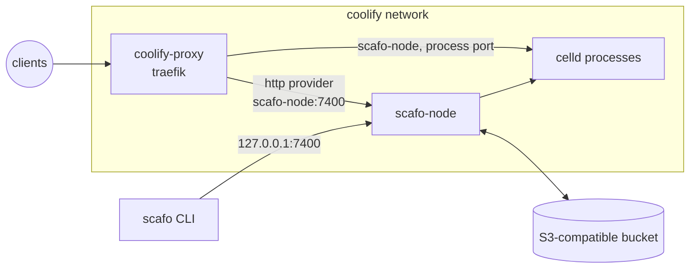

# Coolify

> The Scafo node runs beside Coolify's own resources as an ordinary Compose service, and Coolify's Traefik polls `/v1/ingress/routes/traefik` on it.

Scafo writes no proxy configuration; the two additions below are yours, in Coolify's file, and nothing rewrites them. Scafo's routers arrive as `scafo_<host>@http`. Coolify's own routers stay in its Docker and file providers and are untouched.



## Prerequisites

- Coolify v4.3 or newer with the proxy type set to Traefik. Coolify runs `traefik:v3.6`, which has `providers.http.headers` and so can present the ingress token; Traefik 2.x cannot. The Caddy proxy option is `lucaslorentz/caddy-docker-proxy`, for which no Scafo-flavoured image is published yet — Traefik is the supported path on Coolify.
- An external S3-compatible store honouring `If-Match` / `If-None-Match` conditional writes. Provision it before starting the node; Compose does not create it.
- A wildcard DNS record such as `*.apps.example.com`, plus the apex, pointing at this server.
- An ingress token: `openssl rand -hex 32`.

::::steps

### Run the node

Deploy the Compose file below as a Coolify **Docker Compose** resource, or run it on the host with `docker compose`. Either way it joins the `coolify` network that Coolify's proxy is already on, and it publishes nothing to the internet.

```yaml [compose.yaml]
# One Scafo node on a Coolify-managed server. Coolify's Traefik is the fleet's
# ingress, so this file carries no ingress of its own and publishes no web ports.
services:
  scafo-node:
    image: ghcr.io/sandros94/scafo:${SCAFO_VERSION:?set SCAFO_VERSION in .env}
    restart: unless-stopped
    stop_grace_period: 50s
    ports:
      # Deploy and operator APIs stay on host loopback, for the `scafo` CLI.
      # Coolify's proxy does not use this mapping; it dials the alias below.
      - "127.0.0.1:7400:7400"
    volumes:
      - state:/var/lib/scafo
    environment:
      SCAFO_S3_ENDPOINT: ${SCAFO_S3_ENDPOINT:?set SCAFO_S3_ENDPOINT in .env}
      SCAFO_S3_BUCKET: ${SCAFO_S3_BUCKET:?set SCAFO_S3_BUCKET in .env}
      SCAFO_S3_ACCESS_KEY: ${SCAFO_S3_ACCESS_KEY:?set SCAFO_S3_ACCESS_KEY in .env}
      SCAFO_S3_SECRET_KEY: ${SCAFO_S3_SECRET_KEY:?set SCAFO_S3_SECRET_KEY in .env}
      SCAFO_S3_REGION: ${SCAFO_S3_REGION:-us-east-1}
      SCAFO_S3_PREFIX: ${SCAFO_S3_PREFIX:-scafo}
      SCAFO_PLATFORM_DOMAINS: ${SCAFO_PLATFORM_DOMAINS:?set SCAFO_PLATFORM_DOMAINS in .env}
      SCAFO_LISTEN: 0.0.0.0:7400
      # `none` declares the `coolify` bridge network trusted. With it, runtime
      # processes bind every interface of this container, which is how the proxy
      # reaches them.
      SCAFO_TRANSPORT: none
      # What the fleet's routing names as this node's address, for the node API
      # and for every process port. The proxy resolves it through the network
      # alias below, so it holds whatever Coolify names the container.
      SCAFO_ADVERTISE: scafo-node:7400
      # Coolify's HTTPS entryPoint. Scafo's routers carry no TLS block of their
      # own; the entryPoint terminates.
      SCAFO_TRAEFIK_ENTRYPOINTS: https
      SCAFO_INGRESS_TOKEN: ${SCAFO_INGRESS_TOKEN:?set SCAFO_INGRESS_TOKEN in .env}
      SCAFO_NODE_LABELS: platform=coolify
    networks:
      coolify:
        aliases:
          - scafo-node
    healthcheck:
      # The image's own probe, which asks this service's configuration what the
      # node bound. Only the timings are tightened here.
      test: ["CMD", "node", "/app/dist/cli/index.mjs", "health"]
      interval: 5s
      timeout: 5s
      retries: 30
      start_period: 10s

volumes:
  state:

networks:
  # Created by Coolify when it installs its proxy. `coolify-proxy` is on it.
  coolify:
    external: true
```

The values it needs are the ones in the [Compose recipe's `.env`](/deploy/compose), minus `SCAFO_CADDY_VERSION`: this recipe has no Caddy.

```sh
docker compose --env-file .env up -d
curl -s http://127.0.0.1:7400/.well-known/scafo/health
```

### Teach the proxy

Open **Server → Proxy → Configuration** and merge these entries into the existing `services.traefik.command` list, replacing `<SCAFO_INGRESS_TOKEN>` with the token. On disk that file is `/data/coolify/proxy/docker-compose.yml`.

```yaml [proxy-args.yaml]
services:
  traefik:
    command:
      - "--providers.http.endpoint=http://scafo-node:7400/v1/ingress/routes/traefik?prefer=self"
      - "--providers.http.pollInterval=5s"
      # Compose exec-form arguments are not word-split, so the space is safe.
      - "--providers.http.headers.Authorization=Bearer <SCAFO_INGRESS_TOKEN>"
      # Scafo's routers carry no TLS block, and Coolify's arguments give the
      # `https` entryPoint no default resolver. These two supply it. Coolify's
      # own routers set `tls.certresolver` per router, which still wins, so
      # nothing already deployed changes.
      - "--entrypoints.https.http.tls=true"
      - "--entrypoints.https.http.tls.certresolver=letsencrypt"
```

:::warning
Merge, do not replace. Coolify's own arguments — its two entryPoints, its Docker and file providers, its Let's Encrypt resolver — must stay.
:::

Save and restart the proxy.

### Verify

```sh
docker logs coolify-proxy 2>&1 | grep -i "provider.*http"
curl -s -H "Authorization: Bearer $SCAFO_INGRESS_TOKEN" \
  "http://127.0.0.1:7400/v1/ingress/routes/traefik?prefer=self"
curl -sk --resolve apps.example.com:443:127.0.0.1 \
  https://apps.example.com/.well-known/scafo/health
```

A deployed environment answers at its own host the same way. Until then only the platform apex is routed: Scafo publishes no wildcard application fallback, and an unclaimed host is a 404 at the proxy.

::::

## How the pieces reach each other

`SCAFO_TRANSPORT=none` states that the `coolify` bridge network is private and trusted. With it, the runtime processes the node supervises bind every interface of the container, so the proxy can dial them.

`SCAFO_ADVERTISE=scafo-node:7400` is the name the fleet's routing publishes for this node and for each process port; the network alias in the Compose file is what makes that name resolve regardless of how Coolify names the container.

The node API is also published on host loopback, for `scafo` deploy and operator commands only.

`prefer=self` on the provider endpoint applies because the proxy and the node share a machine: this node's upstreams are used while they are healthy, and the fleet's other nodes only when they are not. On a single-node fleet it changes nothing.

## The arguments, and not a dynamic file

A Traefik provider is static configuration, read once at startup. Coolify's dynamic directory (`/data/coolify/proxy/dynamic/`) cannot declare one, so the arguments are the only place it fits — and the token lives in that file, in plain text, readable by anyone with the Coolify UI or the server. There is no alternative on this proxy.

Coolify gives the `https` entryPoint no default certificate resolver; it sets `tls.certresolver` per router in its dynamic files instead. Scafo's routers carry no TLS block, so the entryPoint has to supply one. Per-router settings still win, so Coolify's existing routers keep the resolver they already name. The trade-off: any router deliberately attached to `https` without TLS would start requiring a certificate. Coolify creates no such router.

## Certificates

Coolify's resolver is HTTP-01 only, so the platform domain gets an ordinary certificate per host, issued on the first request for that host — there is no wildcard certificate, and none is needed. A custom domain an environment claimed is issued the same way once its DNS points at this server. DNS-01, for a real wildcard, would need a second resolver and its provider credentials added to the same proxy compose file.

## Caveats

- "Reset configuration" on the proxy, and switching the proxy type away and back, both discard these arguments. Coolify keeps the edited configuration in its database, so it survives ordinary restarts and upgrades, but re-apply it after either of those two actions.
- Restarting the proxy is required for the arguments to take effect; only the routing itself is dynamic, on Traefik's five-second poll.
- The ingress token is the only credential the proxy holds. It never sees bucket credentials, which are fleet-root authority.
- Keep at least 50 seconds of container stop grace. If `CELLD_SHUTDOWN_TOTAL_MS` is increased, set the grace at least 10 seconds beyond it.
