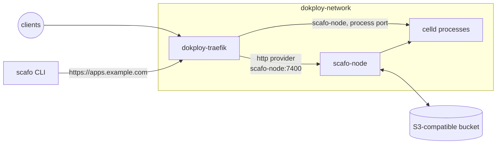

# Dokploy

> The Scafo node runs beside Dokploy's own resources as an ordinary Compose service, and `dokploy-traefik` polls `/v1/ingress/routes/traefik` on it.

Scafo writes no proxy configuration; the provider block below is yours, in Dokploy's file, and nothing rewrites it. Scafo's routers arrive as `scafo_<host>@http`. Dokploy's own routers stay in its Docker, Swarm and file providers and are untouched. The node publishes no port to the server: Traefik reaches it over `dokploy-network`, and so does everyone else, through the apex.



## Prerequisites

- Dokploy running Traefik v3.6 or newer (`TRAEFIK_VERSION`). Traefik v3 has `providers.http.headers`, which is how the ingress token is presented; v2 cannot.
- An external S3-compatible store honouring `If-Match` / `If-None-Match` conditional writes and `Range` reads. Provision it before starting the node; Compose does not create it.
- The apex and wildcard DNS records, `apps.example.com` and `*.apps.example.com`, pointing at this server.
- An ingress token: `openssl rand -hex 32`.

::::steps

### Run the node

Create a Dokploy **Compose** service from the file below, with the `.env` values in the service's environment panel. It joins `dokploy-network`, which Traefik is already on, and it publishes nothing.

```yaml [compose.yaml]
services:
  scafo-node:
    image: ghcr.io/sandros94/scafo:latest
    restart: unless-stopped
    stop_grace_period: 50s
    volumes:
      - state:/var/lib/scafo
    environment:
      SCAFO_S3_ENDPOINT: ${SCAFO_S3_ENDPOINT:?set SCAFO_S3_ENDPOINT in .env}
      SCAFO_S3_BUCKET: ${SCAFO_S3_BUCKET:?set SCAFO_S3_BUCKET in .env}
      SCAFO_S3_ACCESS_KEY: ${SCAFO_S3_ACCESS_KEY:?set SCAFO_S3_ACCESS_KEY in .env}
      SCAFO_S3_SECRET_KEY: ${SCAFO_S3_SECRET_KEY:?set SCAFO_S3_SECRET_KEY in .env}
      SCAFO_S3_REGION: ${SCAFO_S3_REGION:-us-east-1}
      SCAFO_S3_PREFIX: ${SCAFO_S3_PREFIX:-scafo}
      SCAFO_PLATFORM_DOMAINS: ${SCAFO_PLATFORM_DOMAINS:?set SCAFO_PLATFORM_DOMAINS in .env}
      SCAFO_INGRESS_TOKEN: ${SCAFO_INGRESS_TOKEN:?set SCAFO_INGRESS_TOKEN in .env}
      # Traefik dials this container across the `dokploy-network` bridge.
      SCAFO_LISTEN: 0.0.0.0:7400
      SCAFO_TRANSPORT: none
      SCAFO_ADVERTISE: scafo-node:7400
      # Dokploy's HTTPS entryPoint, which already terminates with `letsencrypt`.
      SCAFO_TRAEFIK_ENTRYPOINTS: websecure
      SCAFO_NODE_LABELS: platform=dokploy
    networks:
      dokploy-network:
        aliases:
          - scafo-node
    healthcheck:
      test: ["CMD", "node", "/app/dist/cli/index.mjs", "health"]
      interval: 5s
      timeout: 5s
      retries: 30
      start_period: 10s

volumes:
  # Node identity and runtime work directories: never delete this volume.
  state:

networks:
  # Created by Dokploy on install.
  dokploy-network:
    external: true
```

```sh [.env]
# The bucket. It must support conditional writes, and nothing creates it for you.
SCAFO_S3_ENDPOINT=
SCAFO_S3_BUCKET=
SCAFO_S3_ACCESS_KEY=
SCAFO_S3_SECRET_KEY=
SCAFO_S3_REGION=us-east-1
SCAFO_S3_PREFIX=scafo

# Platform apex, such as apps.example.com: no scheme, no wildcard.
SCAFO_PLATFORM_DOMAINS=

# openssl rand -hex 32
SCAFO_INGRESS_TOKEN=
```

Set every blank value; the service refuses to start with any of them empty. Keep the `state` volume across redeploys: it holds the node's identity and the working directory of every runtime process, and a write is acknowledged once a peer holds it there, before the bucket does. Deleting it loses those writes. See [durability and the state directory](/config/celld#durability-and-the-state-directory).

### Teach Traefik

Dokploy bind-mounts Traefik's static configuration from `/etc/dokploy/traefik/traefik.yml`. Open it under **Traefik File System** in the UI, or edit it on disk, and merge this `http` provider into the `providers` mapping that is already there, replacing `<SCAFO_INGRESS_TOKEN>` with the token.

```yaml [traefik.providers.yml]
providers:
  http:
    endpoint: "http://scafo-node:7400/v1/ingress/routes/traefik?prefer=self"
    pollInterval: 5s
    headers:
      Authorization: "Bearer <SCAFO_INGRESS_TOKEN>"
```

:::warning
That file already has a `providers` mapping holding `swarm`, `docker` and `file`. Add `http` as a fourth key inside it. A second top-level `providers` would replace the first and unroute everything Dokploy deploys.
:::

### Reload Traefik

Static configuration is not hot-reloaded, so apply it with Traefik's Reload action in the UI or with `docker restart dokploy-traefik`. Only the routing itself is dynamic, on Traefik's five-second poll.

Nothing else needs changing. Dokploy's `websecure` entryPoint already carries `http.tls.certResolver: letsencrypt`, which is what `SCAFO_TRAEFIK_ENTRYPOINTS=websecure` relies on: Scafo's routers carry no TLS block, and the entryPoint terminates for them as it does for Dokploy's own.

### Verify

```sh
docker ps --filter name=scafo-node --format "{{.Names}} {{.Status}}"
docker logs dokploy-traefik 2>&1 | grep -i "provider.*http"
curl -sS https://apps.example.com/.well-known/scafo/health
curl -sS -o /dev/null -w '%{http_code}\n' https://nobody.apps.example.com/
```

The node's status ends in `(healthy)`. The third command answers `{ "ok": true, "version": ..., "node": ... }` from the node, through Traefik: the apex is a router the http provider delivered, so its answering is the proof the provider polled. The fourth is `404`. Until an application is deployed only the apex is routed; there is no wildcard application fallback.

Before the DNS record resolves, add `--resolve apps.example.com:443:<server ip>` to the third command.

::::

## Deploy

Follow [first deploy](/deploy#first-deploy) from your own machine. The bucket values it asks for are in the service's environment panel. Read `SCAFO_S3_PREFIX` there too: Dokploy keeps a variable after its line leaves the Compose file, so the panel is the truth and the file's default is not.

```sh
scafo remote add prod --endpoint https://apps.example.com --register
scafo deploy ./my-app --name shop
```

The node API is not published to the server, and the CLI does not need it to be. If you turned the apex off, see [without the apex](/deploy#without-the-apex).

## How the pieces reach each other

`SCAFO_TRANSPORT=none` states that `dokploy-network` is private and trusted. With it, the runtime processes the node supervises bind every interface of the container, so Traefik can dial them.

`SCAFO_ADVERTISE=scafo-node:7400` is the name the fleet's routing publishes for this node and for each process port; the network alias in the Compose file is what makes that name resolve regardless of how Dokploy names the container.

The node API is reachable from `dokploy-network` and, through Traefik, at the apex, and from nowhere else.

`prefer=self` applies because Traefik and the node share a machine: this node's upstreams are used while they are healthy, and the fleet's other nodes only when they are not. On a single-node fleet it changes nothing.

## Certificates

Dokploy's `letsencrypt` resolver is HTTP-01 on the `web` entryPoint, storing to `/etc/dokploy/traefik/dynamic/acme.json`. The platform domain therefore gets an ordinary certificate per host, issued on the first request for that host; there is no wildcard certificate, and none is needed. A custom domain an application claimed is issued the same way once its DNS points at this server. DNS-01, for a real wildcard, would need a second resolver and its provider credentials in the same static file.

## Caveats

- The ingress token sits in plain text in `/etc/dokploy/traefik/traefik.yml`, readable by anyone with the Dokploy UI or the server. A Traefik provider is static configuration, so there is no dynamic file and no environment indirection to put it behind. It is nonetheless the only credential Traefik holds; it never sees bucket credentials, which are fleet-root authority.
- Every edit to the static file needs the reload above. Forgetting it leaves Traefik running the previous configuration with no error.
- [Container classes](/docs/containers) are not verified on this recipe: its node runs on `dokploy-network`, not in the host's network namespace a container class needs.
- Keep at least 50 seconds of container stop grace. If `CELLD_SHUTDOWN_TOTAL_MS` is increased, set the grace at least 10 seconds beyond it.
