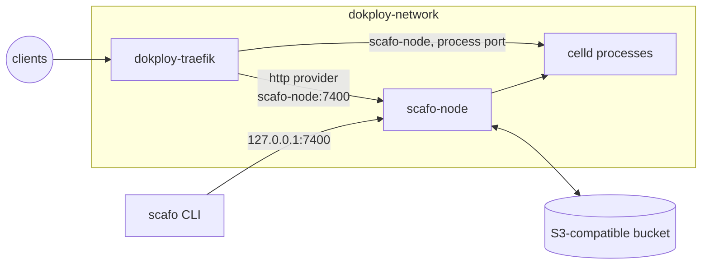

# Dokploy

> The Scafo node runs beside Dokploy's own resources as an ordinary Compose service, and `dokploy-traefik` polls `/v1/ingress/routes/traefik` on it.

Scafo writes no proxy configuration; the provider block below is yours, in Dokploy's file, and nothing rewrites it. Scafo's routers arrive as `scafo_<host>@http`. Dokploy's own routers stay in its Docker, Swarm and file providers and are untouched.



## Prerequisites

- Dokploy running Traefik v3.6 or newer (`TRAEFIK_VERSION`). Traefik v3 has `providers.http.headers`, which is how the ingress token is presented; v2 cannot.
- An external S3-compatible store honouring `If-Match` / `If-None-Match` conditional writes and `Range` reads. Provision it before starting the node; Compose does not create it.
- A wildcard DNS record such as `*.apps.example.com`, plus the apex, pointing at this server.
- An ingress token: `openssl rand -hex 32`.

::::steps

### Run the node

Deploy the Compose file below as a Dokploy **Compose** service, or run it on the host with `docker compose`. Either way it joins `dokploy-network`, which Traefik is already on, and it publishes nothing to the internet.

```yaml [compose.yaml]
# One Scafo node on a Dokploy-managed server. Dokploy's Traefik is the fleet's
# ingress, so this file carries no ingress of its own and publishes no web ports.
services:
  scafo-node:
    image: ghcr.io/sandros94/scafo:${SCAFO_VERSION:?set SCAFO_VERSION in .env}
    restart: unless-stopped
    stop_grace_period: 50s
    ports:
      # Deploy and operator APIs stay on host loopback, for the `scafo` CLI.
      # Dokploy's proxy does not use this mapping; it dials the alias below.
      - "127.0.0.1:7400:7400"
    volumes:
      - state:/var/lib/scafo
    environment:
      SCAFO_S3_ENDPOINT: ${SCAFO_S3_ENDPOINT:?set SCAFO_S3_ENDPOINT in .env}
      SCAFO_S3_BUCKET: ${SCAFO_S3_BUCKET:?set SCAFO_S3_BUCKET in .env}
      SCAFO_S3_ACCESS_KEY: ${SCAFO_S3_ACCESS_KEY:?set SCAFO_S3_ACCESS_KEY in .env}
      SCAFO_S3_SECRET_KEY: ${SCAFO_S3_SECRET_KEY:?set SCAFO_S3_SECRET_KEY in .env}
      SCAFO_S3_REGION: ${SCAFO_S3_REGION:-us-east-1}
      SCAFO_S3_PREFIX: ${SCAFO_S3_PREFIX:-scafo}
      SCAFO_PLATFORM_DOMAINS: ${SCAFO_PLATFORM_DOMAINS:?set SCAFO_PLATFORM_DOMAINS in .env}
      SCAFO_LISTEN: 0.0.0.0:7400
      # `none` declares the `dokploy-network` bridge trusted. With it, runtime
      # processes bind every interface of this container, which is how the proxy
      # reaches them.
      SCAFO_TRANSPORT: none
      # What the fleet's routing names as this node's address, for the node API
      # and for every process port. The proxy resolves it through the network
      # alias below, so it holds whatever Dokploy names the container.
      SCAFO_ADVERTISE: scafo-node:7400
      # Dokploy's HTTPS entryPoint, which already terminates TLS with the
      # `letsencrypt` resolver. Scafo's routers carry no TLS block of their own.
      SCAFO_TRAEFIK_ENTRYPOINTS: websecure
      SCAFO_INGRESS_TOKEN: ${SCAFO_INGRESS_TOKEN:?set SCAFO_INGRESS_TOKEN in .env}
      SCAFO_NODE_LABELS: platform=dokploy
    networks:
      dokploy-network:
        aliases:
          - scafo-node
    healthcheck:
      # The image's own probe, which asks this service's configuration what the
      # node bound. Only the timings are tightened here.
      test: ["CMD", "node", "/app/dist/cli/index.mjs", "health"]
      interval: 5s
      timeout: 5s
      retries: 30
      start_period: 10s

volumes:
  state:

networks:
  # Created by Dokploy on install. `dokploy-traefik` is on it.
  dokploy-network:
    external: true
```

The values it needs are the ones in the [Compose recipe's `.env`](/deploy/compose), minus `SCAFO_CADDY_VERSION`: this recipe has no Caddy.

```sh
docker compose --env-file .env up -d
curl -s http://127.0.0.1:7400/.well-known/scafo/health
```

### Teach Traefik

Dokploy bind-mounts Traefik's static configuration from `/etc/dokploy/traefik/traefik.yml`. Open it under **Traefik File System** in the UI, or edit it on disk, and merge this `http` provider into the `providers` mapping that is already there, replacing `<SCAFO_INGRESS_TOKEN>` with the token.

```yaml [traefik.providers.yml]
providers:
  http:
    # `prefer=self` keeps traffic on this machine while its processes are
    # healthy, and uses the fleet's other nodes only when they are not.
    endpoint: "http://scafo-node:7400/v1/ingress/routes/traefik?prefer=self"
    pollInterval: 5s
    headers:
      Authorization: "Bearer <SCAFO_INGRESS_TOKEN>"
```

:::warning
That file already has a `providers` mapping holding `swarm`, `docker` and `file`. Add `http` as a fourth key inside it — do not paste a second top-level `providers`, which would replace the first and unroute everything Dokploy deploys.
:::

### Reload Traefik

Static configuration is not hot-reloaded, so apply it with Traefik's Reload action in the UI or with `docker restart dokploy-traefik`. Only the routing itself is dynamic, on Traefik's five-second poll.

Nothing else needs changing. Dokploy's `websecure` entryPoint already carries `http.tls.certResolver: letsencrypt`, which is what `SCAFO_TRAEFIK_ENTRYPOINTS=websecure` in the Compose file relies on: Scafo's routers carry no TLS block, and the entryPoint terminates for them as it does for Dokploy's own.

### Verify

```sh
docker logs dokploy-traefik 2>&1 | grep -i "provider.*http"
curl -s -H "Authorization: Bearer $SCAFO_INGRESS_TOKEN" \
  "http://127.0.0.1:7400/v1/ingress/routes/traefik?prefer=self"
curl -sk --resolve apps.example.com:443:127.0.0.1 \
  https://apps.example.com/.well-known/scafo/health
```

A deployed environment answers at its own host the same way. Until then only the platform apex is routed: Scafo publishes no wildcard application fallback, and an unclaimed host is a 404 at the proxy.

::::

## First deploy

The fleet trusts no operator key until somebody mints one, and the node holds none: the first key is minted on your own machine, with the [CLI installed there](/docs/install), never inside the container.

::steps

### Install the CLI

On your own machine, not on the Dokploy server.

```sh
npm install --global scafo
```

### Give the shell the node's bucket values

`scafo remote add --register` and `scafo fleet nodes` read the bucket directly, so that shell needs the same values the node has — they are in the Dokploy service's environment panel.

```sh
export SCAFO_S3_ENDPOINT="https://s3.example.com"
export SCAFO_S3_BUCKET="scafo"
export SCAFO_S3_ACCESS_KEY="<access key>"
export SCAFO_S3_SECRET_KEY="<secret key>"
export SCAFO_S3_REGION="us-east-1"
export SCAFO_S3_PREFIX="scafo"
```

`SCAFO_S3_PREFIX` must be the node's: a different prefix is a different, empty installation. It is `scafo` here, from the Compose file's default, and the value stays with the service after that line is removed from the Compose file.

### Mint and register the first admin key

`--endpoint` is the apex in `SCAFO_PLATFORM_DOMAINS`, which Traefik routes to the node API; on the server itself the same API is at `http://127.0.0.1:7400`.

```sh
scafo remote add prod --endpoint https://apps.example.com --register
```

`--register` involves no daemon — it writes the key's public half straight into the registry, which is why that shell wants the bucket values — and the key it minted stays in your operator home, `~/.scafo` unless `SCAFO_HOME` says otherwise, which nothing can reissue.

### Confirm the fleet

```sh
scafo fleet nodes
```

The node is listed with its `CELLD` and `SCAFO` versions. `scafo: no node is registered in this bucket; a machine joins the fleet by running "scafo sail"` means this shell is reading a different bucket or prefix than the node writes.

### Deploy

```sh
scafo deploy ./my-app --project shop --env production
```

### Hand it to CI

A job deploys with its provider's OIDC token and no operator key at all, once [`scafo trust set`](/docs/deploying#deploying-from-ci-with-oidc) has written the project's trust policy into the same bucket.

::

::read-more{to="/docs/deploying"}
::

## How the pieces reach each other

`SCAFO_TRANSPORT=none` states that `dokploy-network` is private and trusted. With it, the runtime processes the node supervises bind every interface of the container, so Traefik can dial them.

`SCAFO_ADVERTISE=scafo-node:7400` is the name the fleet's routing publishes for this node and for each process port; the network alias in the Compose file is what makes that name resolve regardless of how Dokploy names the container.

The node API is also published on host loopback, for `scafo` deploy and operator commands only.

`prefer=self` applies because Traefik and the node share a machine: this node's upstreams are used while they are healthy, and the fleet's other nodes only when they are not. On a single-node fleet it changes nothing.

## Certificates

Dokploy's `letsencrypt` resolver is HTTP-01 on the `web` entryPoint, storing to `/etc/dokploy/traefik/dynamic/acme.json`. The platform domain therefore gets an ordinary certificate per host, issued on the first request for that host — there is no wildcard certificate, and none is needed. A custom domain an environment claimed is issued the same way once its DNS points at this server. DNS-01, for a real wildcard, would need a second resolver and its provider credentials in the same static file.

## Caveats

- The ingress token sits in plain text in `/etc/dokploy/traefik/traefik.yml`, readable by anyone with the Dokploy UI or the server. A Traefik provider is static configuration, so there is no dynamic file and no environment indirection to put it behind; this is the cost of the http provider on this platform.
- The token is nonetheless the only credential Traefik holds. It never sees bucket credentials, which are fleet-root authority.
- Every edit to the static file needs the reload above. Forgetting it leaves Traefik running the previous configuration with no error.
- Keep at least 50 seconds of container stop grace. If `CELLD_SHUTDOWN_TOTAL_MS` is increased, set the grace at least 10 seconds beyond it.
